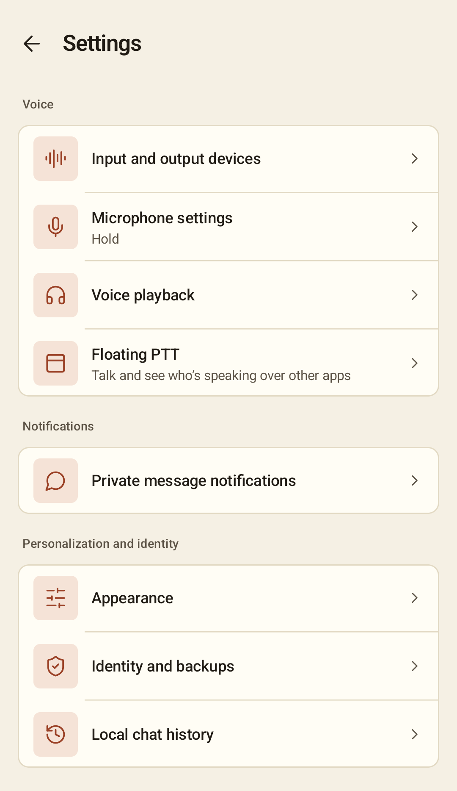
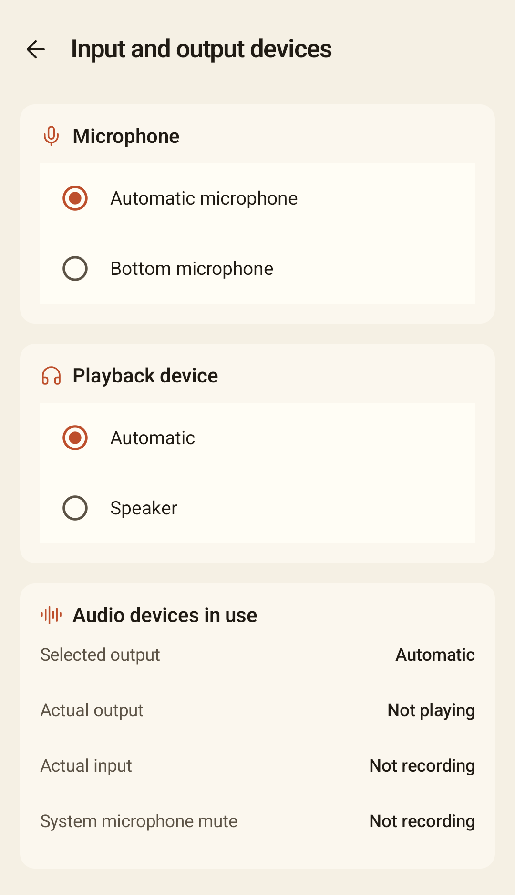
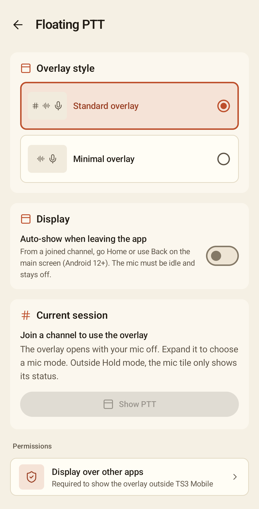
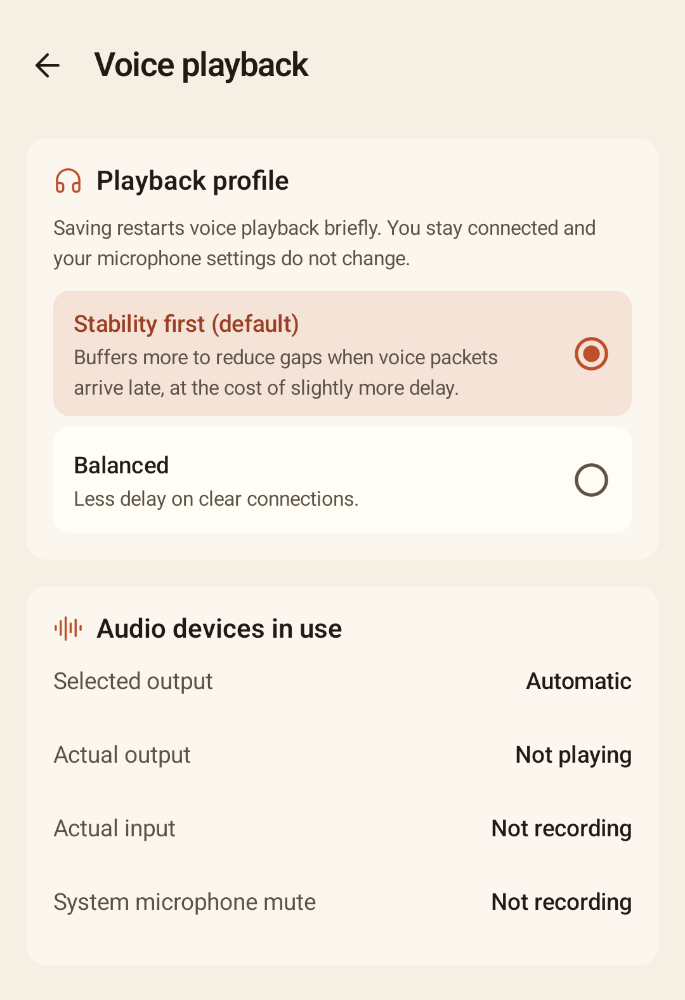
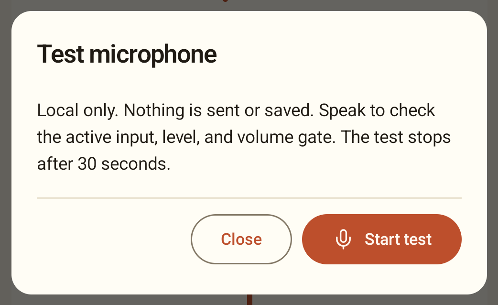
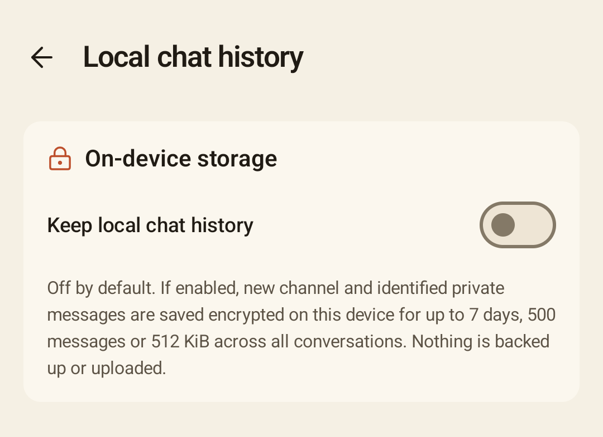
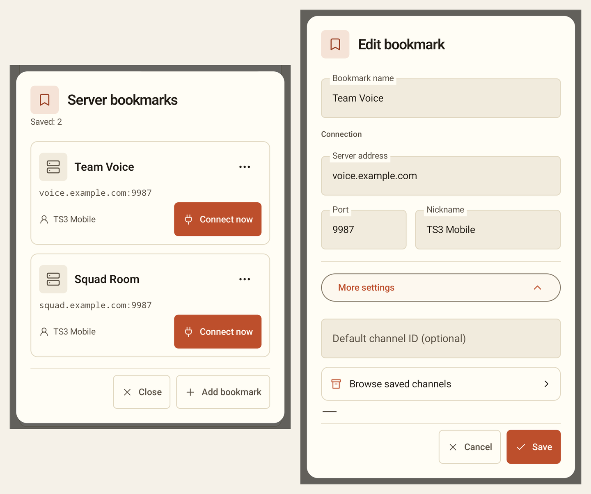

# TS3 Mobile

[](https://github.com/monet4070/ts3-mobile/actions/workflows/android.yml)
[](https://github.com/monet4070/ts3-mobile/releases/latest)
[](LICENSE)

[简体中文](README_ZH.md) · [Download APK](https://github.com/monet4070/ts3-mobile/releases/latest) · [1.3.0 Release Notes](docs/release/1.3.0/RELEASE_NOTES.md) · [Documentation](docs/README.md) · [Report a problem](https://github.com/monet4070/ts3-mobile/issues)

**Use TeamSpeak 3 on Android: join voice channels, exchange messages, talk over other apps with floating PTT, browse channel files, and save your usual servers.**

> **Current version: 1.3.0 (versionCode 17, Android 8.0+)**
> Compared with 1.2.0 (code 16), 1.3.0 adds **connected floating PTT**, **separate input and output audio device selection (including LE Audio and explicit Bluetooth call headset mic)**, **read-only channel files and chat attachments**, **opt-in local chat history**, **bookmark credential isolation and offline channel lists**, and **on-demand feature help**, along with **Wi-Fi ↔ mobile data session preservation** and **Bluetooth safeguard hardening**.
> See the [1.3.0 Release Notes](docs/release/1.3.0/RELEASE_NOTES.md), [Changelog](CHANGELOG.md), [Installation & Upgrades](docs/INSTALLATION.md#english), and [Verification Status](docs/release/CANDIDATE_STATUS_2026-11-25.md) (public APK downloads follow actual assets published on [GitHub Releases](https://github.com/monet4070/ts3-mobile/releases)).

## Contents

[What's new in 1.3.0](#whats-new-in-130-vs-120) · [Interface tour](#interface-tour) · [Features](#features) · [Installation](#installation) · [First use](#first-use) · [Interface controls](#interface-controls) · [Voice and audio](#voice-and-audio) · [Channels and users](#channels-and-users) · [Chat and pokes](#chat-and-pokes) · [Files and attachments](#files-and-attachments) · [Server bookmarks](#server-bookmarks) · [Away, background and handoff](#away-background-and-handoff) · [Settings and More menu](#settings-and-the-more-menu) · [Identity backup and restore](#identity-backup-and-restore) · [Offline audio diagnostics](#offline-audio-diagnostics) · [Privacy and limits](#data-privacy-and-limits) · [FAQ](#frequently-asked-questions) · [Build and contribute](#build-and-contribute)

---

## What's new in 1.3.0 (vs 1.2.0)

### New features

- **Connected floating PTT:** Open the overlay from Settings or recall it from the active connection notification. Choose **Standard** or **Minimal** overlay styles, expand to see up to three active speakers (`+N` overflow) in one compact row and switch mic modes, and optionally enable **Auto-show when leaving the app** (Home or Back on the main screen on Android 12+). Showing the overlay never starts recording.
- **Separate input and output audio devices:** Open **Settings → Input and output devices** to choose physical microphones (built-in position labels and duplicate numbering, without raw addresses) separately from playback devices, including independent **Bluetooth LE Audio** input/output when supported and an explicit, non-persisted **Bluetooth call (use headset microphone)** option for classic SCO headsets.
- **Read-only channel files, chat attachments, and server images:** Browse channel files and explicitly download files or supported same-server chat attachments (up to 20 MiB per file, length-verified before saving via Android's file picker). Tap an available avatar in the Users list or a custom channel icon to preview it.
- **Opt-in local chat history and BBCode formatting:** Enable **Settings → Local chat history** (off by default) to save eligible new text in a bounded local encrypted archive browsable offline per identity. Chat renders basic TeamSpeak BBCode, keeps raw text when copying, and confirms external link destinations before opening.
- **Bookmark credential isolation and offline channel lists:** Editing a bookmark's host or port clears saved passwords and the old default channel from the draft (editing only the channel keeps the server password). Save a connected server's channel list for offline default-channel picking, and **Connect now** no longer replaces an active session.
- **On-demand feature help and actual-device panel:** Open **Settings → Help and about → Feature help** offline with control highlights (never opens automatically on launch). **Settings → Voice playback** defaults to **Stability first** for unset installs (preserving saved profiles) and adds a read-only **Audio devices in use** panel plus redacted timing diagnostics.
- **Settings and Identity polish:** **Identity and backups** offers direct **Create encrypted backup** and **Restore from backup** actions; standardized switches, readouts, and narrow-screen/large-font reflow across Settings.

### Fixes and reliability hardening

- **Wi-Fi ↔ mobile data handoff and clone-limit (`521`) recovery:** Holds the original server session briefly (up to 2 seconds) during unblocked network drops and probes it on the new network to continue without reconnecting when possible. Fixed a ts3j initialization race that masked server rejections (`521`) as retryable interrupts; a confirmed network-switch reconnect hitting `521` now waits 60 seconds and retries once cleanly.
- **Bluetooth and playback safeguards:** Continuously detects unnotified Bluetooth auto-route fallbacks to apply safety mute, retires idle delayed Bluetooth tracks cleanly, bounds stale-packet eviction to 360 ms, and moves local mic trial cleanup and diagnostics I/O off the main thread.
- **Session, storage, and export reliability:** Preserves user mic tuning and diagnostics across disconnects, hardens exit/reconnect concurrency and channel-move timeouts, protects local chat history across clock rollbacks, retains verified downloads across screen recreation, preserves existing bookmarks on size-limit errors, isolates diagnostic exports, and adds playback/update DataStores to backup exclusions.

> Full list in [1.3.0 Release Notes](docs/release/1.3.0/RELEASE_NOTES.md) and [CHANGELOG.md](CHANGELOG.md).

---

## Interface tour

| Settings | Input and output devices | Floating PTT |
| :---: | :---: | :---: |
|  |  |  |

| Voice playback | Local microphone test | Local chat history |
| :---: | :---: | :---: |
|  |  |  |

> Captured directly from the signed **TS3 Mobile 1.3.0 (versionCode 17)** release APK on an Android 15 emulator (offline, no server connected, no capture started, synthetic data only). See the [screenshot index](docs/images/README.md) for the full set.

TS3 Mobile is an open-source, unofficial client with a warm cream/terracotta interface, outline icons,
English and Simplified Chinese. Connect directly to your TeamSpeak server; there is no project account
to register.

## Features

| What you want to do | What the app provides |
| --- | --- |
| Talk with teammates | Push-to-talk, continuous, volume gate, and Off; quick input gain, RNNoise, device AEC, and local mic test |
| Talk over another app | Connected floating PTT (Standard/Minimal styles, live speaker strip, notification recall, optional auto-show) |
| Browse and join channels | Channel hierarchy, expandable members, public/password-protected joins, and local search |
| Invite teammates | Open, paste, or share server and channel invites; preview the destination before connecting |
| Send text and read offline | Channel/private chat, separate drafts, unread counts, BBCode, link confirmation, and opt-in encrypted local chat history |
| Save files and view avatars | Read-only channel files and same-server chat attachments (20 MiB limit, verified save) plus session-scoped avatar/icon previews |
| Get someone's attention | Member-list poke icon, optional reason, in-app notices, and generic background notifications |
| Keep servers handy | Up to 50 named bookmarks, credential isolation, offline channel lists, Connect, Edit, Delete, and opt-in encrypted passwords |
| Control listening & devices | Separate mic/playback selection (LE Audio & explicit Bluetooth call headset mic), Stability-first/Balanced profiles, actual-device panel, Bluetooth safeguards, per-user volume |
| Listen while watching or playing | Voice shares media volume without taking audio focus or switching Android into call mode |
| Step away or switch networks | Away status, brief network-handoff session preservation, reconnect recovery, background checks, notification controls |
| Back up identity & diagnose audio | Verified encrypted `.ts3mbak` identity export/import & rollback, offline audio diagnostics JSON export, on-demand feature help |
| Keep data local | Separately encrypted identity/form/bookmarks/chat history; no ads, analytics SDK, or project relay |

## Installation

For checksum commands, signing compatibility, and safe in-place upgrades, see [Installation & Upgrades](docs/INSTALLATION.md#english). Do not substitute a Debug or QA package for a release update.

1. Open [GitHub Releases](https://github.com/monet4070/ts3-mobile/releases) and read the version's release notes.
2. Download the release APK (`ts3-mobile-<version>-release.apk`) from **Assets**. Source code ZIP/TAR archives are not installers.
3. Compare its SHA-256 with `SHA256SUMS.txt` and `BUILDINFO.json` from the same release, then install through a trusted browser or file manager.
4. Allow installation from that source if Android asks. The app never checks for or installs updates automatically.

### In-app update check

Open **More options → Settings → Check for updates**. Stable releases are the default; **Include prereleases** is an optional, remembered choice. Release notes render Markdown with a six-line preview and a fixed **Show less** action in the full reader; **Download APK** opens the official asset in your browser. Checks run only when you open the page, switch channels, or tap retry—there is no background polling or automatic installation. Updates compare Android `versionCode`, including same-name repair releases.

### Requirements and upgrade safety

- **Requirements:** **Android 8.0 (API 26)+**. The universal APK includes `arm64-v8a`, `armeabi-v7a`, `x86`, and `x86_64`. Installability does not imply physical testing on every device; see [Compatibility & Validation](docs/COMPATIBILITY.md#english).
- **Keep the existing app when upgrading:** In-place updates require the same application ID (`io.github.ts3mobile.app`) and compatible signing. Disconnect first before installing. **Do not uninstall or clear storage** to fix an install conflict—that deletes your local TeamSpeak identity, bookmarks, form memory, and local chat history. Export a verified backup under [Identity backup and restore](#identity-backup-and-restore) first.
- Separate `TS3 Mobile UI` or QA test packages keep independent data and do not migrate into the release app.

## First use

Open **More options → Settings → Help and about → Feature help** at any time for offline guides and highlighted controls covering setup, invites, floating PTT, files, and troubleshooting. Help never opens automatically on launch.

### Get the connection details

Ask the server administrator for its address, **voice port**, and any password. You do not need ServerQuery credentials. First use generates a local TeamSpeak identity; your nickname is a display name, not that identity.

| Field | What to enter |
| --- | --- |
| Server address | Hostname or address, for example `voice.example.com` (example only, not a live server) |
| Port | Usually `9987`; use the administrator's configured voice port |
| Nickname | Your display name, 3–30 characters |
| Server password | Leave empty if none is required; the eye icon shows/hides input |

### Make your first call

1. Fill the form and press the orange **Connect** button. Wait for **Connected**.
2. On **Channels**, tap a row to expand members; **double-tap the channel row** (or tap **Join**) to enter. Protected channels ask for their separate channel password.
3. Select **Hold** in the microphone controls, allow microphone access if requested, then hold **Push to talk** while speaking.
4. Release to stop talking. Choose **Off** for listening only. Playback mute prevents hearing others and is separate from turning your microphone off.
5. Finish with **Disconnect** beside the server, or use the connection notification's action.

> Server and channel passwords are separate. If connecting fails, verify the voice port, network, and permissions before retrying; follow connection-limit wait guidance rather than repeatedly retrying a refused identity.

### Join or share an invite

Open a TeamSpeak invite link or tap **Paste invite** on the connection page. TS3 previews the server and channel before you confirm, and never disconnects an active session or connects automatically. While connected, use **More options → Share invite** to share the current server or channel—passwords and identity data are never included.

## Interface controls

| Area | What it is for |
| --- | --- |
| Top app bar | Connection status; top-right ellipsis opens **More options** |
| Disconnected form | Server parameters, saved servers, Paste invite, and Connect; recent successful endpoints appear when available |
| Connected server card | Server name, channel/online counts, and **Disconnect** |
| Audio row below the card | Left to right: audio route, channel/user search, Away, playback mute |
| Channels / Users / Chat tabs | Channel tree, user list, and text conversations; Chat shows an unread badge |
| Microphone controls | Mode selection, push-to-talk, live status, and a quick input-volume shortcut |

Icon reference: **headphones + arrow** selects a route; **magnifier** searches; **coffee cup + clock** opens Away; **speaker** controls listening; the member's **hand icon** opens Poke; a user's **sliders icon** expands their playback volume.

Tabs scroll horizontally on narrow/large-text layouts, and microphone modes collapse into a menu when space is tight. Opening the chat keyboard compacts the layout while keeping the composer and voice controls; switching tabs or focusing text input releases push-to-talk to avoid accidental transmission.

## Voice and audio

Use **More options → Settings → Voice playback** to choose **Stability first (default)** or **Balanced**. Stability first tolerates more late packets in exchange for a small extra delay; existing saved choices are never overwritten. Changing profiles resets incoming playback immediately without disconnecting or changing microphone settings.

The **Audio devices in use** panel (shown in both **Voice playback** and **Input and output devices**) separately reports selected output, confirmed actual output (distinguishing Bluetooth media A2DP, Bluetooth call SCO, and Bluetooth LE Audio), actual recording input, and system microphone mute state—an idle microphone is never reported as muted.

### Choose a microphone mode

| Mode | Capture and transmission | Useful for |
| --- | --- | --- |
| Off | Stops capture and discards buffered audio; listening stays available | Listening only or stopping capture completely |
| Hold / push-to-talk | Captures and sends while the button is held | First-time use, noisy rooms, precise control |
| Always on (continuous) | Captures and sends continuously | Ongoing speech, preferably with headphones |
| Gate / volume gate | Captures continuously; sends above threshold with short onset/tail buffers | Automatic transmission based on voice level |

**A quiet gate still uses the microphone.** Listening is not Off; choose **Off** to stop capture completely. With the chat keyboard open, the compact voice bar's mic-off icon stops capture directly.

### Use floating PTT

While joined to a channel, open **More options → Settings → Floating PTT**, grant **Display over other apps**, and tap **Show PTT** (or recall it from the active connection notification):

- **Overlay styles:** Choose **Standard overlay** (default; displays one active speaker's nickname when collapsed) or **Minimal overlay** (two-icon collapsed style).
- **Controls:** Drag the left area to move the overlay, or tap it to expand a compact fixed-height row showing up to three active speakers (`+N` overflow) and microphone mode switches. Only **Hold** mode transmits when pressing the right-hand target; in other modes that target only shows live microphone status.
- **Auto-show:** Enable **Auto-show when leaving the app** (off by default) to display the overlay when going Home or using Back on the main screen (Android 12+) while joined to a channel with the microphone idle. Showing or recalling the overlay never starts recording or changes active capture.
- **Safety stops:** Locking the screen, leaving the channel, or returning to the app ends floating capture. An active local microphone test blocks concurrent floating capture.

### Adjust input and output

Tap the **microphone icon in the voice controls** for a quick vertical input-volume slider. Use **More options → Settings → Microphone settings** for input gain (0–200%), RNNoise, device echo cancellation, and the live gate threshold. Saved tuning survives restarts and disconnects; opening either control never starts capture.

Choose **Test microphone** on that page for a local level and gate check offline or while connected (set microphone mode to **Off** first when connected). The local test stops after 30 seconds and never sends or saves audio—unlike **Hold to talk**, which transmits to the current channel.

By default, TS3 voice mixes with videos, music, and games without taking audio focus or switching Android into call mode, using media volume and per-user controls. Available Bluetooth media headsets are selected at session start and on hot-plug, with automatic microphone preferring the phone mic to preserve media quality. To pick a specific microphone or use a Bluetooth headset mic, open **More options → Settings → Input and output devices** (supports separate **LE Audio headset microphone** / **Bluetooth LE Audio** output when available, or an explicit **Bluetooth call (use headset microphone)** playback choice; classic call mode may lower audio quality, is never auto-selected or persisted, and releases when switching back or disconnecting). Device removal or Bluetooth route fallback (including unnotified auto-route fallbacks) triggers a listening safety mute to prevent speaker output; confirm the route and unmute manually after reconnecting. Bluetooth first-utterance protection gives a waking Bluetooth output extra time before rebuilding the track without delaying already-ready outputs. Prefer headphones if speaker echo occurs.

## Channels and users

### Browse, join and search

- **Tap a channel row:** Expand/collapse its direct members and see talking, input-muted, and output-muted states.
- **Double-tap (or tap Join):** Request to join. Locked channels prompt for their password; server permissions apply.
- **Tap the magnifier:** Search loaded channel names, topics, and nicknames locally, then join a channel or a user's current channel.

Search covers only the current server snapshot and never reveals permission-hidden data. Channel details and server administration are not provided.

### Control one user's audio and preview avatars

On **Users**, another member's row provides a down-arrow menu, speaker, sliders, and tappable avatar tile:

| Action | Where and what it does |
| --- | --- |
| Private message / Poke | Open the down-arrow menu and choose the action |
| Per-user mute | Toggle that user's speaker icon; leaves others audible |
| Per-user volume | Open sliders and adjust playback from 0–200% (perceptual curve below 100%) |
| Preview avatar / icon | Tap an available avatar in the Users list or a displayed custom channel icon |

Per-user mute and volume change only your local playback (kept in service memory), not server talk permissions. Avatars and icons are cached in memory for the current session only.

## Chat and pokes

### Channel chat, private messages and local chat history

1. Open **Chat**, enter text at the bottom, and send to the current channel.
2. For private text, open a user's down-arrow menu → **Send private message**.
3. Tap the conversation title/arrow at the top of Chat to switch between the channel and open private chats.
4. Chat renders basic TeamSpeak BBCode (bold, italic, code, and explicit HTTP(S) links); long-press to copy original raw text, and review external destinations before opening links.
5. Reading older messages keeps your scroll position; use the new-message button to jump to the latest. The trash icon in a private chat closes it and clears its in-memory messages and draft after confirmation.

Each conversation keeps its own draft, unread count, and scroll position. Status distinguishes sending, server-accepted, rejected, and unknown (**server acceptance is not a read receipt**; unknown sends are never retried automatically). Input is capped at 1,024 UTF-8 bytes.

Background private messages use the dedicated **Private message alerts** channel with a generic summary (no sender or body) and never mark messages read on tap; manage system settings via **More options → Settings → Private message notifications**.

- **Opt-in local chat history:** **More options → Settings → Local chat history** is off by default. When enabled, it saves eligible new text in a separately encrypted local archive (newest 7 days, max 500 messages / 512 KiB encoded total). Use **Browse saved messages** offline to read the current identity's records, or delete one conversation or all records. It never backfills older messages, archives drafts/pokes/passwords/attachment contents, or syncs to the cloud.

### Poke a member

Tap the hand icon beside a channel member or choose **Poke** in their user menu. Verify the recipient, enter an optional reason (up to 100 UTF-8 bytes), and confirm. Opening the dialog does not send; submitting keeps your current tab and shows brief feedback.

Foreground pokes display an in-app notice; background/locked pokes use the dedicated **Poke alerts** channel with generic text (no sender or reason). Returning to the app displays any retained pending notice.

## Files and attachments

- **Channel files:** Join a channel and open **More options → Channel files** to browse and pick a file to download.
- **Same-server chat attachments:** Tap a supported attachment in chat and confirm **Download attachment**.
- **Verify and save:** Downloads are limited to **20 MiB per file** and always come from the currently connected server. After verifying the exact byte length, choose **Save verified file…** to pick a destination in Android's file picker. Verified downloads survive screen recreation; if a destination write may be incomplete, TS3 warns you and lets you retry to a different file.
- **Limits:** Server permissions govern access. Uploads, renaming, deletion, automatic downloads, and cross-server retrieval are not supported. Reopen the browser if you change channels or reconnect.

See [User Guide — Files and server images](docs/USER_GUIDE.md#files-and-server-images) for step-by-step instructions.

## Server bookmarks



Open **Choose a saved server** on the connection form or **More options → Server bookmarks**. Each card separates name, address, and nickname; **Connect now** is the primary action (it will not replace an active session), and the top-right ellipsis holds management actions.

| Goal | Action |
| --- | --- |
| Add a usual server | **Add bookmark** at the bottom (or **Save current connection** while connected) → name and fields → Save |
| Connect directly | **Connect now** on its card (disconnect an active session first) |
| Review parameters first | Card menu → **Fill form** (replaces form values without connecting) |
| Change / remove | Card menu → **Edit** / **Delete** (deletion requires confirmation) |
| Channels and passwords | Editor → **More settings** → default channel ID, offline channel list, and opt-in passwords |

- New entries prefill the current address, port, and nickname **without copying the form password**; up to 50 bookmarks are stored in a separate encrypted vault.
- **Credential isolation:** Editing a bookmark's host or port clears the old default channel and both saved passwords from the draft; editing or clearing only the default channel clears only its password. Canceling keeps the original bookmark; disabling **Save passwords** clears only that bookmark's passwords, not the separate connection form.
- **Offline channel lists:** When editing a bookmark matching the current connection, open **More settings** → **Save channel list for offline use** (up to 100 channels per endpoint, max 6 endpoints), then use **Browse saved channels** offline or forget the list.

## Away, background and handoff

- **Away status:** Tap the coffee-cup/clock icon → select **Away** with an optional message → **Apply status**. Warm emphasis appears after server confirmation. Away never stops voice capture or listening; use the microphone controls when stepping away.
- **Wi-Fi ↔ mobile data handoff:** Home, switching apps, and screen lock preserve the active session. During brief default-network drops (up to 2 seconds unless explicitly blocked), TS3 keeps the original session and audio and probes the server on the returning network; if the original session responds, it continues without reconnecting (voice may briefly pause). Otherwise normal recovery runs, including a single 60-second deferred retry when a confirmed network switch hits a clone-limit (`521`) refusal.
- **Background voice check:** Open **More options → Settings → Background voice check** to review battery optimization status, jump to system settings, and optionally enable **CPU awake** (cannot override all Android/OEM restrictions).
- **Clean disconnect:** The connection notification offers **Mute listening**, **Resume listening**, **Show PTT**, and **Disconnect**. Always disconnect via the app or notification rather than swiping the task away; if you hit an identity connection-limit refusal, wait at least 60 seconds before manually retrying.

## Settings and the More menu

**More options** keeps session actions close at hand: **Share invite**, **Away and status**, **Find channels and users**, **Channel files** (when in a channel), and **Server bookmarks**. Opening **Settings** from the same menu never disconnects you from the server or channel:

| Settings section | What it contains |
| --- | --- |
| Voice | **Input and output devices** (separate mic & playback selection), **Microphone settings** (tuning & local mic test), **Voice playback** (Stability first / Balanced & actual-device panel), **Floating PTT** |
| Notifications | **Private message notifications** (managed by Android) |
| Personalization & identity | **Appearance** (Light / Dark / System; Light by default), **Identity and backups**, **Local chat history** (off by default) |
| Help & about | **Background voice check**, **Diagnostics**, **Feature help**, **Check for updates**, and the GitHub project link |

English or Simplified Chinese follows Android's system/app locale; there is no in-app language toggle.

## Identity backup and restore

Open **More options → Settings → Identity and backups** to back up or migrate your local TeamSpeak identity using TS3 Mobile's passphrase-encrypted `.ts3mbak` format (opening this screen never creates an identity or connects, and disables screenshots/recents previews):

1. **Create encrypted backup:** Disconnect from the server first, choose **Create encrypted backup**, set and confirm a 12–1,024-character passphrase, and pick a save location. TS3 closes, reopens, authenticates, and verifies exact identity match before reporting **Backup saved and verified**. If verification fails, retry to a new file. **Keep the passphrase separately—it cannot be recovered.**
2. **Restore from backup:** While disconnected, choose **Restore from backup**, enter the passphrase, pick your `.ts3mbak` file, review the current vs proposed UID, security level, and permission impact, then confirm **Use this identity**. Preflight or cancellation never replaces your identity or auto-connects.
3. **Local rollback:** **Restore previous identity** appears only when a local verified rollback copy exists (tied to the installation key; not a substitute for an external backup).
4. **Safety boundaries:** Identity backups exclude bookmarks and connection forms. Storage corruption or a missing Keystore key reports an explicit error and preserves original data without silently creating a new identity; keep the original installation and restore your verified external backup on a fresh install. Standard release builds keep desktop TS3 `.ini` import disabled (available only as a separate Debug/opt-in QA preview).

## Offline audio diagnostics

When investigating weak-network drops or Bluetooth issues without USB, open **More options → Settings → Diagnostics**:

1. Listen under the conditions that reproduce the issue; tap **Mark interruption** when you hear a dropout.
2. Disconnect cleanly afterward and choose **Copy** or **Save file** to export a redacted JSON report (persisted records remain exportable after reopening the app).
3. Up to 120 samples (normally ~10 minutes) and 64 events are kept for each of the last three audio sessions, including receive/playback counters, redacted protocol timing buckets, and coarse route/network types—**no audio, server address, password, identity, or participant names are recorded**.

See [User Guide — Offline audio diagnostics](docs/USER_GUIDE.md#offline-audio-diagnostics) for details.

## Data privacy and limits

| Content | Lifetime and handling |
| --- | --- |
| TeamSpeak identity | Encrypted locally with Android Keystore; uninstall/clear-data removes it and may lose identity-bound permissions |
| Connection form | Address, port, nickname, and server password encrypted separately (including unsent edits); never auto-connects; excluded from backup |
| Recent endpoints | Up to 10 successful endpoints; deleting history never clears bookmarks or the form |
| Bookmarks & offline channels | Separate encrypted storage with opt-in passwords and credential isolation; no cross-package migration |
| Messages & drafts | Live chat stays in service memory (up to 20 chats sharing 500 messages / 2 MiB); opt-in local chat history is off by default and separately encrypted |
| Voice & diagnostics | No voice archive; diagnostics leave only when you explicitly copy, save, or share |

No ads, analytics SDK, or automatic project crash backend. Read [Privacy](PRIVACY.md) for complete details.

**Current limits:** One active server at a time; channel files and chat attachments are read-only downloads (20 MiB per file); Whisper, file uploads, server administration, and multi-server tabs are not supported. Tested device and Android coverage is recorded in [Compatibility & Validation](docs/COMPATIBILITY.md#english).

## Frequently asked questions

| Symptom | Check first |
| --- | --- |
| Others cannot hear you | Microphone mode, mic permission, channel talk permission, and gate threshold |
| No output or wrong device | Playback/per-user mute, user gain, Android media volume, and selected route; confirm route and manually unmute after Bluetooth loss |
| Quiet gate shows a mic indicator | Expected continuous capture; choose **Off** to stop completely |
| Floating PTT does not auto-show | Grant overlay permission and enable **Auto-show when leaving the app** in **Settings → Floating PTT**; join a channel with mic idle (Back gesture requires Android 12+), or tap **Show PTT** in the notification |
| No incoming poke alert | Notification permission, app notifications, **Poke alerts** channel, DND, and background policy |
| Chat gone after restart | Live chat resets; if you opted in under **Settings → Local chat history**, browse saved new messages there |
| Bookmark passwords cleared after editing | Expected 1.3.0 credential isolation when changing host, port, or channel; re-enter passwords for the new target |
| APK conflicts with existing app | Compare package ID and signing certificate; keep current data and avoid immediate uninstall |

See [Troubleshooting](docs/TROUBLESHOOTING.md) and the [User Guide](docs/USER_GUIDE.md). For unresolved problems, follow [Support](SUPPORT.md#english) to open an [issue](https://github.com/monet4070/ts3-mobile/issues) with version, device, steps, and sanitized diagnostics (never post real servers, passwords, identities, or participant data). Report security vulnerabilities [privately](SECURITY.md).

## Build and contribute

Use **JDK 17**, **Android SDK Platform 35**, **Build Tools 35.0.0**, **NDK 27.0.12077973**, and **CMake 3.22.1**. Set your SDK path using [local.properties.example](local.properties.example), then run:

```sh
./gradlew quality :ts3-protocol:test :audio-opus:testDebugUnitTest :audio-opus:lintDebug :app:testDebugUnitTest :app:lintDebug :app:lintRelease :app:assembleDebug :app:assembleRelease
```

Use `gradlew.bat` on Windows. See [Contributing](CONTRIBUTING.md), [Architecture](ARCHITECTURE.md), [Releases](docs/release/README.md), and [Support](SUPPORT.md#english). Release assembly and production signing/publication are separate steps.

Built on [ts3j](https://github.com/Manevolent/ts3j), licensed under [Apache-2.0](LICENSE) with [third-party notices](THIRD_PARTY_NOTICES.md). Not affiliated with, endorsed by, or sponsored by TeamSpeak Systems GmbH. Thanks to [@polleyr](https://github.com/polleyr) for [server-password authentication](https://github.com/monet4070/ts3-mobile/pull/1) and English localization. Follow the [Code of Conduct](CODE_OF_CONDUCT.md) when contributing.
