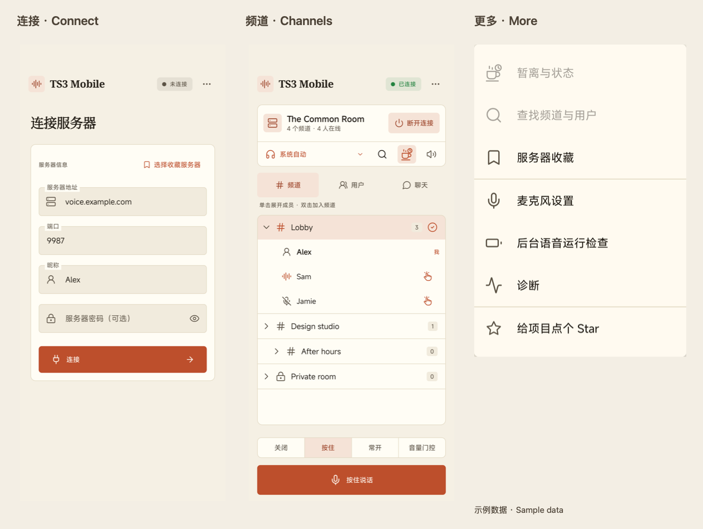
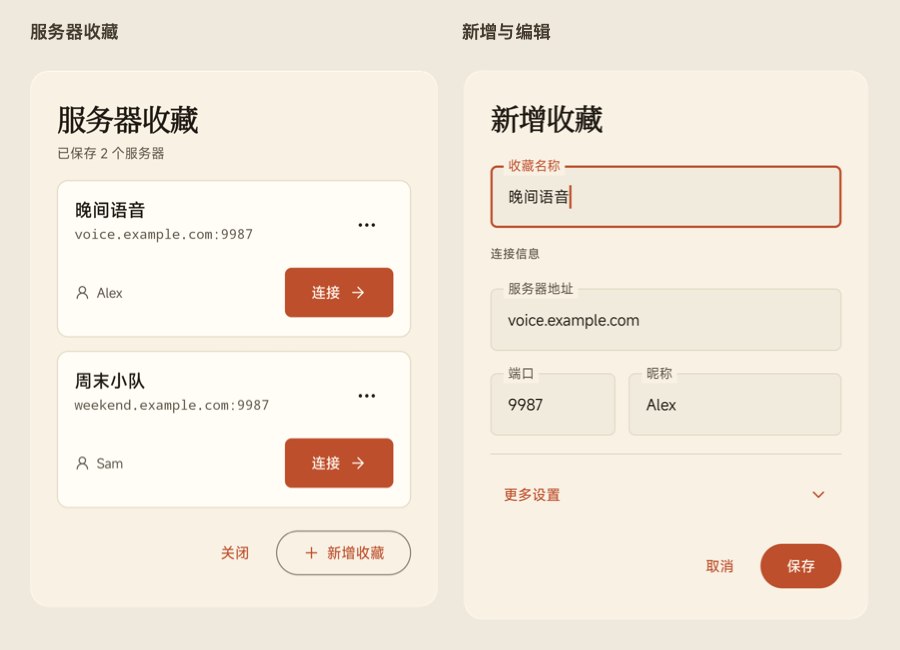

# TS3 Mobile

[](https://github.com/monet4070/ts3-mobile/actions/workflows/android.yml)
[](https://github.com/monet4070/ts3-mobile/releases/latest)
[](LICENSE)

[简体中文](README_ZH.md) · [Download APK](https://github.com/monet4070/ts3-mobile/releases/latest) · [Documentation](docs/README.md) · [Report a problem](https://github.com/monet4070/ts3-mobile/issues)

**Use TeamSpeak 3 on Android: join voice channels, exchange messages, reach your teammates and save your usual servers.**

TS3 Mobile is an open-source, unofficial client with a warm cream/terracotta interface, outline icons,
English and Simplified Chinese. Connect directly to your TeamSpeak server; there is no project account
to register.

> **Latest stable: [1.0.0](https://github.com/monet4070/ts3-mobile/releases/tag/v1.0.0)**,
> released on **2026-11-04** (versionCode 13). Download the signed APK and checksums
> from the release. Its certificate matches the public 0.11.1-m10 APK; keep your
> existing installation when updating. See [installation](docs/INSTALLATION.md),
> [tested coverage](docs/COMPATIBILITY.md) and the [changelog](CHANGELOG.md).

## Contents

[Features](#features) · [Installation](#installation) · [First use](#first-use) ·
[Interface tour](#interface-tour) · [Voice and audio](#voice-and-audio) ·
[Channels and users](#channels-and-users) · [Chat and pokes](#chat-and-pokes) ·
[Server bookmarks](#server-bookmarks) · [Away and background](#away-background-and-disconnect) ·
[More menu](#settings-and-the-more-menu) · [Privacy and limits](#data-privacy-and-limits) · [FAQ](#frequently-asked-questions)

## Features

| What you want to do | What the app provides |
| --- | --- |
| Talk with teammates | Push-to-talk, continuous, volume gate and Off; input gain, noise suppression and device AEC |
| Browse and join channels | Channel hierarchy, expandable members, public/password-protected joins and local search |
| Send text | Channel/private chat, separate drafts, unread counts, conversation switching and long-press copy |
| Get someone's attention | A member-list poke icon, optional reason, in-app notices and generic background notifications |
| Keep servers handy | Up to 50 named bookmarks, Connect, Edit, Delete, optional default channel and encrypted passwords |
| Control listening | Playback mute, per-user mute/volume and Android's available audio devices |
| Step away or use it in background | Away/message, reconnect handling, background checks and notification disconnect |
| Keep data local | Separately encrypted identity/form/bookmarks; no ads, analytics SDK or project relay |

## Installation

1. Open [GitHub Releases](https://github.com/monet4070/ts3-mobile/releases) and read the version's notes.
2. Download the APK from **Assets**. Source code ZIP/TAR archives are not installers.
3. Compare its SHA-256 with `SHA256SUMS.txt` from the same release, then install
   through a trusted browser or file manager.
4. Allow installation from that source if Android asks. The app does not
   automatically check for or install later updates.

**Android 8.0 (API 26)+** is required. The universal APK contains arm64-v8a, armeabi-v7a, x86
and x86_64. Installability does not mean every device/version has been tested; see
[compatibility and validation](docs/COMPATIBILITY.md).

**Keep the existing app when upgrading.** An in-place update needs the same application ID and
compatible signing. Do not fix a conflict by immediately uninstalling or clearing storage: that removes
the local identity, bookmarks and encrypted form. There is no built-in identity export/restore. Separate
TS3 Mobile UI test packages have their own data and do not migrate into the release. See [installation
and upgrades](docs/INSTALLATION.md) for checksums and certificates.

## First use

### Get the connection details

Ask the server administrator for its address, **voice port** and any password. You do not need
ServerQuery credentials. First use creates a local TeamSpeak identity; your nickname is a display name,
not that identity.

| Field | What to enter |
| --- | --- |
| Server address | The hostname or address, for example `voice.example.com`; this is an example, not a live service |
| Port | Usually `9987`; use the administrator's configured voice port |
| Nickname | Your display name, 3–30 characters |
| Server password | Leave empty if none is required; the eye icon shows/hides the input |

### Make your first call

1. Fill the form and press the orange **Connect** button. Wait for Connected.
2. On Channels, tap a row to expand members; **double-tap the channel row to join**.
   A protected channel asks for its separate channel password.
3. Select Hold in the microphone controls, allow microphone access if requested,
   then hold Push to talk while speaking.
4. Release to stop that talk. Choose Off for listening only. Playback mute prevents
   you hearing others and is a separate control.
5. Finish with Disconnect beside the server, or the connection notification's action.

Server and channel passwords are different. If connection fails, check the voice port, network and
permissions before retrying. Follow connection-limit guidance rather than repeatedly submitting the same
refused identity.

## Interface tour



The illustration uses the Chinese UI in different states, with sample server
and member data. Session-dependent menu entries are disabled while disconnected.

| Area | What it is for |
| --- | --- |
| Top app bar | Connection status; the top-right ellipsis opens More options |
| Disconnected form | Server parameters, saved servers and Connect; recent successful endpoints appear when available |
| Connected server card | Server name, channel/online counts and Disconnect |
| Audio row below the card | Left to right: route, channel/user search, Away, playback mute |
| Channels / Users / Chat tabs | Channel tree, user list and text conversations; Chat has an unread badge |
| Microphone controls | Mode selection, the talk button and listening/transmitting status |

Icon reference: **headphones + arrow** selects a route; **magnifier** searches; **coffee cup + clock**
opens Away; **speaker** controls listening; the member's **hand icon** opens Poke; a user's **sliders
icon** expands their playback volume.

Tabs scroll horizontally on narrow/large-text layouts, and microphone modes may collapse into a menu.
Opening the chat keyboard compacts the interface while keeping the composer and voice controls. Changing
tabs or focusing input releases push-to-talk to avoid unintended transmission.

## Voice and audio

### Choose a microphone mode

| Mode | Capture and transmission | Useful for |
| --- | --- | --- |
| Off | Stops capture and discards buffered audio; listening stays available | Listening only or stopping capture completely |
| Hold / push-to-talk | Captures and sends while the button is held | First-time use, noisy rooms, precise control |
| Always on (continuous) | Captures and sends continuously | Ongoing speech, preferably with headphones |
| Gate / volume gate | Captures continuously; sends above a threshold with short onset/tail buffers | Automatic transmission based on volume |

**A quiet gate still uses the microphone.** Listening is not Off; select Off to stop capture. With the
chat keyboard open, the compact voice bar's microphone-off icon can stop capture directly.

### Adjust input and output

Open **More options → Microphone settings**. Input gain ranges from 0–200%; you can switch RNNoise and
device echo cancellation, and adjust the gate threshold. Lower thresholds let quieter sounds trigger it.
Lower it if soft speech is missed; raise it if background noise triggers transmission. Settings apply
immediately, opening the dialog does not start capture, and service recreation restores defaults.

Tap the audio row's device name to choose from Android's available earpiece, speaker, headset, Bluetooth
or USB routes. Available Bluetooth communication headsets are selected automatically at session start
and when connected. Removing the selected device or losing an active Bluetooth output mutes listening
to prevent speaker playback. Reconnecting selects Bluetooth again but keeps listening muted until you
check the route and unmute manually. System/device delays still require physical-headset validation.
Playback mute and microphone Off serve different purposes. Prefer headphones if speaker echo occurs;
device AEC status is not a guarantee of equal acoustic performance on every phone.

## Channels and users

### Browse, join and search

- **Tap a channel row:** expand/collapse its direct members and see talking,
  input-muted and output-muted states.
- **Double-tap:** request to join. Locked channels ask for a password; server
  permissions still apply.
- **Tap the magnifier:** search loaded names/topics/nicknames, then join a channel
  or a user's current channel.

Search stays on the current server snapshot and cannot reveal permission-hidden data. The
current channel is marked. Channel details and server administration are not provided.

### Control one user's audio

On Users, another member's row has an arrow, speaker and sliders:

| Action | Where and what it does |
| --- | --- |
| Private message / Poke | Open the down-arrow menu and choose the action |
| Per-user mute | Toggle that user's speaker icon; it leaves others audible |
| Per-user volume | Open sliders and adjust playback from 0–200% |

These controls change your playback, not the user's server talk permission.
Per-user mute/volume settings remain in service memory.

## Chat and pokes

### Channel and private messages

1. Open Chat, enter text at the bottom and send to the current channel.
2. For private text, open a user's down-arrow menu → Send private message.
3. Tap the conversation name/arrow at the top of the chat area to switch between
   the channel and open private conversations.
4. Long-press a message to copy its body. When viewing older messages, use the
   new-message action to return to the latest position.
5. The trash icon in a private chat means Close private conversation. If it has
   messages/draft, confirmation clears that conversation's retained memory.

Each conversation keeps its own draft, unread and scroll position. Status separates sending,
server-accepted, rejected and unknown. **Server acceptance is not a read receipt.** Unknown results are
not automatically retried. Offline or uncertain identity targets pause sending. Input is limited to
1,024 UTF-8 bytes; CJK/emoji may use multiple bytes per character.

### Poke a member

Tap the hand icon beside a channel member, or Poke in their user menu. Check the recipient, leave the
reason blank or enter up to 100 UTF-8 bytes, then confirm. Opening the dialog does not send. Submission
keeps your tab/conversation and gives brief feedback.

Foreground receives show an in-app notice. Background/locked receives use the Poke alerts notification
channel, with no sender or reason in notification content. Android permission, channel and DND settings
control appearance/sound. Returning to the app can show the retained pending notice.

## Server bookmarks



Open Choose a saved server on the form, or **More options → Server bookmarks**. Each card separates
name, address and nickname. Connect is the primary action; its top-right ellipsis contains management
actions.

| Goal | Action |
| --- | --- |
| Add a usual server | Add bookmark at the bottom → name and connection fields → Save |
| Connect directly | Connect on its card; disconnect an existing session first |
| Check parameters first | Card menu → Fill form; this does not connect |
| Change / remove | Card menu → Edit / Delete; deletion requires confirmation |
| Channel and passwords | Editor → More settings → default channel ID and password opt-in |

New entries prefill the current address/port/nickname, **without copying the form password**. Saving
does not connect. Up to 50 entries; leave the numeric default channel ID empty if unsure. Passwords are
retained only with Save passwords. Turning it off clears that bookmark's server/channel passwords, not
the separate connection form's password.

## Away, background and disconnect

Tap the coffee-cup/clock → select Away, optionally enter a message → Apply status. Warm emphasis appears
after server confirmation. Clear Away and apply to return. Away does not stop capture or listening; use
the microphone controls if leaving an active mic unattended.

Home, switching apps and screen lock retain the session. Ordinary network loss can trigger recovery;
background reconnect restores listening first, while stopped capture may need a return to the
foreground. **More options → Background voice check** shows battery/wake state, system-settings links
and optional CPU-awake. This cannot override all Android/vendor restrictions or guarantee indefinite
use.

Leave with Disconnect in the app or notification. Task swiping can kill the process before an exit
callback, leaving the server to time out the session. For identity connection-limit refusals, follow the
minimum 60-second wait/manual retry guidance; cleanup can take longer and repeated attempts may trigger
bans. Reopening does not connect automatically.

## Settings and the More menu

| Item | Purpose |
| --- | --- |
| Away and status | Away/message and server-state synchronization; connected only |
| Find channels and users | Search the loaded snapshot; connected only |
| Server bookmarks | Manage saved servers, including while disconnected |
| Microphone settings | Input gain, RNNoise, device AEC and gate threshold |
| Background voice check | Battery restrictions, CPU-awake and Android settings |
| Diagnostics | Inspect runtime information and manually copy redacted diagnostics |
| Give the project a Star | Open GitHub externally; starring remains your choice |

The app currently defaults to the warm light interface. English or Simplified
Chinese follows Android's system/app locale. There is no in-app language/theme switch.

## Data privacy and limits

| Content | Lifetime and handling |
| --- | --- |
| TeamSpeak identity | Encrypted locally with Keystore support; uninstall/clear-data removes it and may lose identity-bound server permissions |
| Connection form | Address/port/nickname/password encrypted separately, including unsubmitted edits; loading does not connect |
| Recent endpoints | Up to ten successful endpoints; deleting history does not clear bookmarks or the form |
| Bookmarks | Separate encrypted storage with opt-in passwords; no cross-package transfer/in-app restore |
| Messages/drafts | Service memory only; reconnect keeps them, manual/new/terminal sessions or process death clear them |
| Voice/diagnostics | No voice archive; diagnostics leave only when you choose to copy/share |

Up to 20 conversations share 500 messages / 2 MiB; older content may be evicted. Servers/recipients can
retain received text. No ads, analytics or automatic project crash backend. Read [privacy](PRIVACY.md)
for complete details.

One active server. Whisper, file transfer, administration, identity import/export and
multi-server tabs are absent. Tested Bluetooth/background/acoustic coverage is recorded in
[compatibility](docs/COMPATIBILITY.md).

## Frequently asked questions

| Symptom | Check first |
| --- | --- |
| Others cannot hear you | Mode, microphone permission, channel talk permission and gate threshold |
| No output | Playback/per-user mute, user gain, Android communication volume and route |
| Quiet gate shows a mic indicator | Expected capture; choose Off to stop it |
| No incoming poke alert | Permission, app notifications, Pokes channel, DND and background policy |
| Chat gone after restart | Records are memory-only, with no permanent history |
| APK conflicts with existing app | Compare package/certificate; keep current data and avoid immediate uninstall |

See [troubleshooting](docs/TROUBLESHOOTING.md) and the [user guide](docs/USER_GUIDE.md). For unresolved
problems, open an [issue](https://github.com/monet4070/ts3-mobile/issues) with version/device, steps and
sanitized diagnostics. Do not disclose endpoints, passwords, identities or participant data. Report
vulnerabilities [privately](SECURITY.md).

## Build and contribute

Use JDK 17, SDK Platform 35, Build Tools 35.0.0, NDK 27.0.12077973 and CMake
3.22.1. Set your SDK path using [local.properties.example](local.properties.example), then:

```sh
./gradlew quality :ts3-protocol:test :audio-opus:testDebugUnitTest :audio-opus:lintDebug :app:testDebugUnitTest :app:lintDebug :app:lintRelease :app:assembleDebug :app:assembleRelease
```

Use `gradlew.bat` on Windows. See [contributing](CONTRIBUTING.md),
[architecture](ARCHITECTURE.md), [releases](docs/release/README.md) and [support](SUPPORT.md).
Release assembly and production signing/publication are separate steps.

Built on [ts3j](https://github.com/Manevolent/ts3j), licensed [Apache-2.0](LICENSE) with
[third-party licenses](THIRD_PARTY_NOTICES.md). Not affiliated with, endorsed by or sponsored
by TeamSpeak Systems GmbH. Thanks to [@polleyr](https://github.com/polleyr) for
[server-password authentication](https://github.com/monet4070/ts3-mobile/pull/1) and English
localization. Follow the [Code of Conduct](CODE_OF_CONDUCT.md) when contributing.
