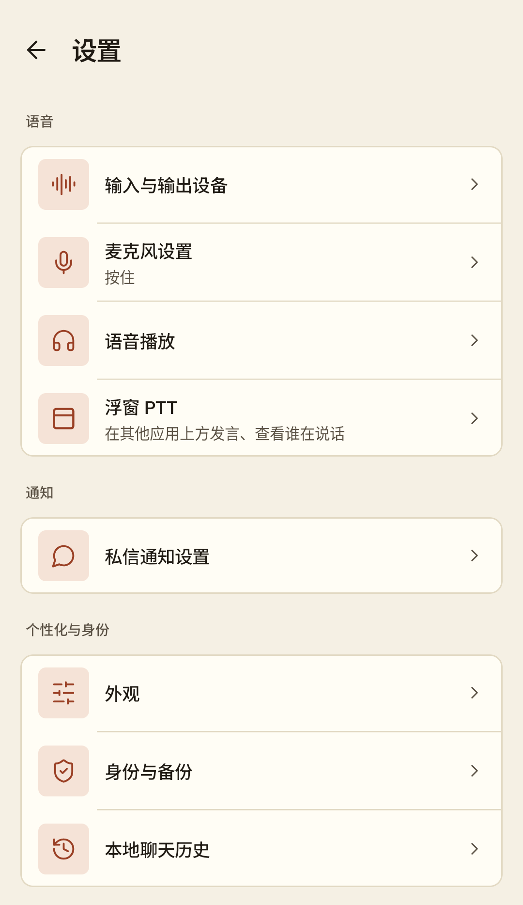
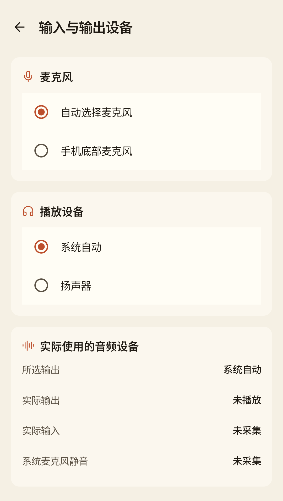
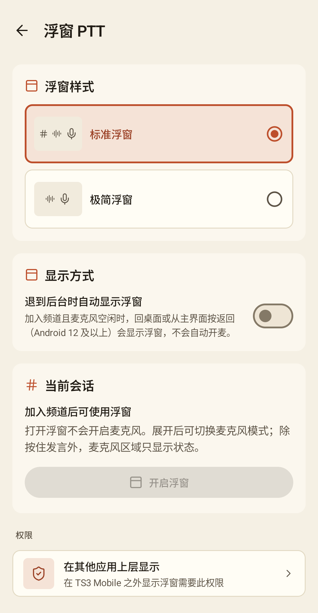
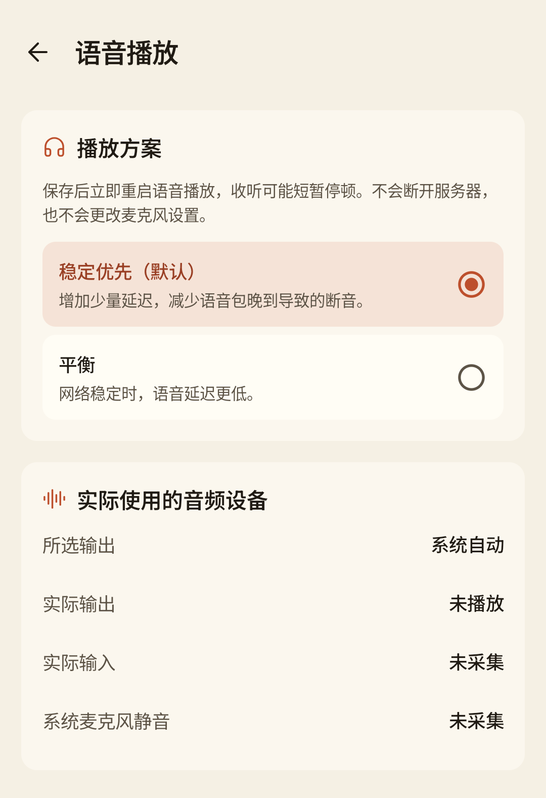
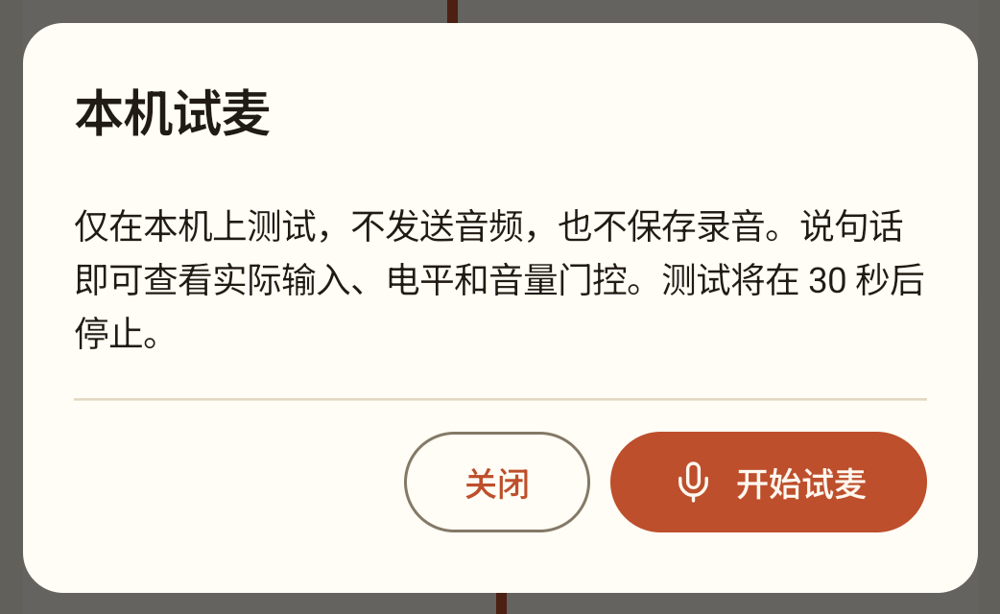
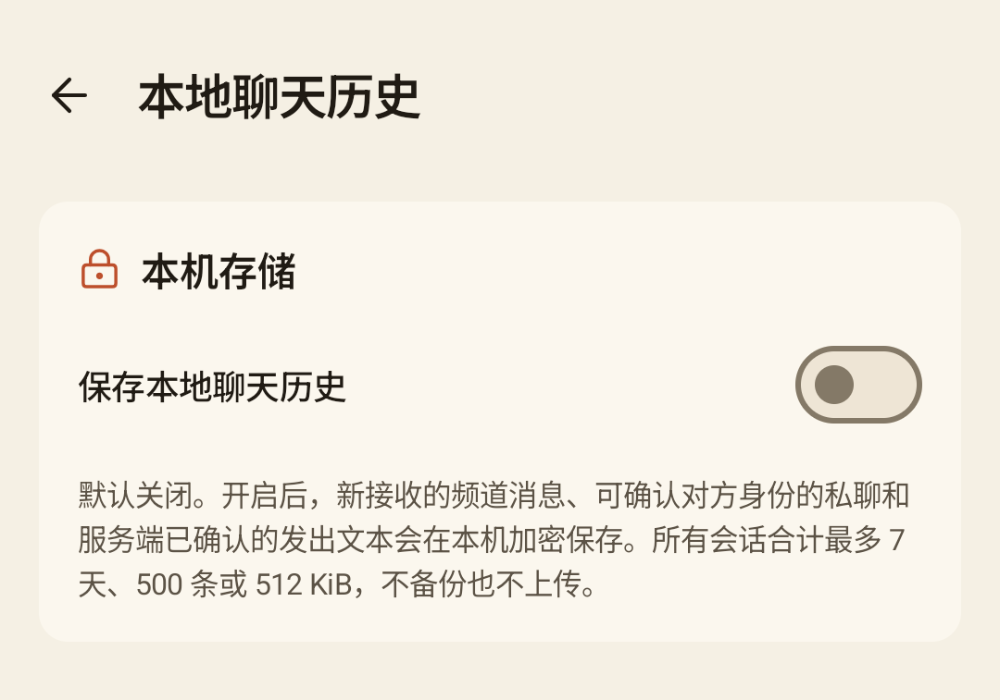
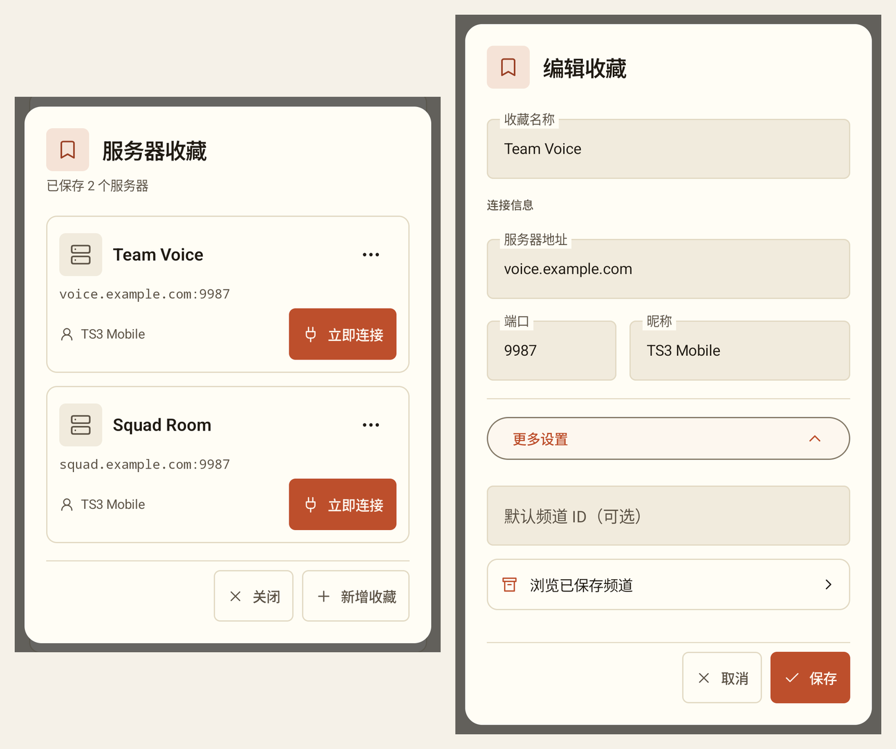

# TS3 Mobile

[](https://github.com/monet4070/ts3-mobile/actions/workflows/android.yml)
[](https://github.com/monet4070/ts3-mobile/releases/latest)
[](LICENSE)

[English](README.md) · [下载 APK](https://github.com/monet4070/ts3-mobile/releases/latest) · [1.3.0 更新说明](docs/release/1.3.0/RELEASE_NOTES_ZH.md) · [文档中心](docs/README.md) · [反馈问题](https://github.com/monet4070/ts3-mobile/issues)

**在 Android 手机上使用 TeamSpeak 3：加入语音频道、收发消息、使用浮窗发言、浏览频道文件，并收藏常用服务器。**

> **当前版本说明：1.3.0（versionCode 17，要求 Android 8.0+）**
> 相比 1.2.0（code 16），1.3.0 新增**连接浮窗 PTT**、**输入与输出设备独立选择（含 LE Audio 与可选蓝牙通话耳机麦）**、**只读频道文件与聊天附件**、**可选本地聊天历史**、**收藏凭据隔离与离线频道列表**、**按需功能帮助**，并重点加固了**切网保活**与**蓝牙防外放**。
> 详见 [1.3.0 更新说明](docs/release/1.3.0/RELEASE_NOTES_ZH.md)、[完整更新日志](CHANGELOG.md)、[安装与升级](docs/INSTALLATION.md)与[验收状态](docs/release/CANDIDATE_STATUS_2026-11-25.md)（公开 APK 下载以 [GitHub Releases](https://github.com/monet4070/ts3-mobile/releases) 实际发布为准）。

## 阅读导航

[1.3.0 更新亮点](#130-更新亮点对比-120) · [认识界面](#认识界面) · [功能一览](#功能一览) · [下载与安装](#下载与安装) · [第一次使用](#第一次使用) · [界面操作](#界面操作) · [语音与音频设置](#语音与音频设置) · [频道与用户](#频道与用户) · [聊天与戳一下](#聊天与戳一下) · [文件与附件](#文件与附件) · [服务器收藏](#服务器收藏) · [暂离、后台与切网保护](#暂离后台与切网保护) · [设置与更多菜单](#设置与更多菜单) · [身份备份与恢复](#身份备份与恢复) · [离线音频诊断](#离线音频诊断) · [数据隐私与使用边界](#数据隐私与使用边界) · [常见问题](#常见问题) · [开发与参与](#开发与参与)

---

## 1.3.0 更新亮点（对比 1.2.0）

### 新增功能

- **连接浮窗 PTT**：在设置或连接通知中打开悬浮窗，支持**标准浮窗**与**极简浮窗**两种样式，展开后紧凑单行显示最多 3 位实时发言者（`+N` 溢出）并切换麦模式；可选开启 **退到后台时自动显示浮窗**（Android 12+ 回桌面或主界面按返回），显示本身绝不自动开麦。
- **输入与输出设备独立选择**：新增 **设置 → 输入与输出设备**，分别选择物理麦克风（按已知位置标注底部／顶部／正面／背部并编号，不显示原始地址）与播放设备，支持独立选择 **蓝牙 LE Audio** 输入／输出，以及在传统蓝牙耳机上手动选择 **蓝牙通话（使用耳机麦克风）**（绝不自动启用或跨会话保存）。
- **只读频道文件、同服附件与服务端图片**：支持浏览并主动下载频道文件及同服聊天附件（单文件限 20 MiB，核验字节长度后通过系统选择器保存）；支持点击用户头像与自定义频道图标放大预览。
- **可选本地聊天历史与 BBCode 展示**：**设置 → 本地聊天历史**（默认关闭）支持限量加密保存符合条件的新文本，离线按当前身份浏览或清理；聊天支持基础 BBCode 展示、复制保留原文及外链目标核对。
- **收藏凭据隔离与离线频道列表**：修改收藏的地址或端口时自动清除草稿里的旧默认频道和两种密码（仅改频道时保留服务器密码）；支持在线保存频道列表供离线选默认频道；**立即连接**不会打断活动会话。
- **按需功能帮助与实际设备面板**：新增 **设置 → 帮助与关于 → 功能帮助**（离线可用、控件高亮引导，启动不弹窗）；**设置 → 语音播放** 默认采用 **稳定优先**（不覆盖旧配置），新增只读 **实际使用的音频设备** 面板与脱敏计时诊断。
- **设置与身份页面统一**：**身份与备份** 直接提供 **创建加密备份** 与 **从备份恢复**；统一各设置页开关、读数与窄屏／大字号排版。

### 解决的问题与稳定性加固

- **Wi-Fi ↔ 移动数据切网保活与 521 冲突恢复**：短暂切网时先保留原会话最多 2 秒并探测应答，能继续沿用时不再重新连接；修复初始化阶段服务器拒绝（含 `521` 同身份限制）被中断掩盖的问题，已确认切网后若触发 `521` 会等待 60 秒后自动再试一次。
- **蓝牙防外放与播放保护**：持续检测无回调的蓝牙自动回退并安全静音；及时回收延迟就绪的空闲音轨；收紧过期语音淘汰至 360 ms；将试麦清理和诊断读取移出主线程。
- **会话与存储可靠性**：主动断开保留用户麦克风调音与诊断状态，加固退出／重连并发与频道切换超时保护；修复聊天历史时钟回拨、验证文件旋转重建续存、收藏超限保留旧档、诊断安全落盘与播放／更新配置排除系统备份。

> 完整条目见 [1.3.0 更新说明](docs/release/1.3.0/RELEASE_NOTES_ZH.md) 与 [CHANGELOG.md](CHANGELOG.md)。

---

## 认识界面

| 设置 | 输入与输出设备 | 浮窗 PTT |
| :---: | :---: | :---: |
|  |  |  |

| 语音播放 | 本机试麦 | 本地聊天历史 |
| :---: | :---: | :---: |
|  |  |  |

> 以上截图采自签名版 **TS3 Mobile 1.3.0（versionCode 17）** 在 Android 15 模拟器上的离线界面（未连接服务器、未开启采集、无真实用户数据）；完整截图集见[文档截图索引](docs/images/README.md)。

TS3 Mobile 是开源的非官方客户端，采用暖米白与陶土色界面、线性图标和简体中文／英文本地化。
无需注册项目账号，直接连接你已有的 TeamSpeak 服务器。

## 功能一览

| 你想做什么 | TS3 Mobile 提供的能力 |
| --- | --- |
| 和队友语音交流 | 按住说话、常开、音量门控与关闭模式；快捷调节输入音量、RNNoise 降噪、设备回声消除与本机试麦 |
| 在其他应用上方发言 | 连接浮窗 PTT（标准／极简样式、实时发言人提示、通知召回、可选退后台自动显示） |
| 浏览和切换频道 | 层级频道、成员展开、公开／密码频道加入、频道与用户本地搜索 |
| 邀请队友加入 | 打开、粘贴或分享服务器／频道邀请，确认目标后才连接 |
| 发文字与离线看记录 | 频道聊天、私聊、独立草稿、未读提示、BBCode 展示、外链核对，以及默认关闭的加密本地聊天历史 |
| 保存文件与查看头像 | 只读频道文件与同服聊天附件下载（20 MiB 上限、校验后保存），以及会话内头像与频道图标预览 |
| 提醒某位成员 | 频道成员旁的戳一下图标，可选留言、前台弹窗与后台通用通知 |
| 管理常用服务器 | 最多 50 个命名收藏、凭据隔离、离线频道列表、直接连接、编辑、删除与可选加密密码 |
| 调整收听与音频设备 | 独立选择麦克风与播放设备（含 LE Audio 与可选蓝牙通话耳机麦）、稳定优先／平衡档位、实际设备面板、蓝牙首播与防外放保护、个人音量 |
| 边看视频边收听 | 语音使用系统媒体音量，不主动抢占音频焦点或切换系统通话模式 |
| 暂离、切网与后台 | 暂离状态、短暂切网原会话保活、断线恢复、后台语音检查与通知栏收听／断开控制 |
| 备份身份与排障 | `.ts3mbak` 加密身份导出／导入与本地回退、离线音频诊断 JSON 导出、按需功能帮助 |
| 保留本机隐私 | 身份／表单／收藏／聊天历史分别加密，不含广告、分析 SDK 或项目中转服务 |

## 下载与安装

完整校验命令、签名兼容性与升级路径见[安装与升级说明](docs/INSTALLATION.md)。请勿使用 Debug 或 QA 旁装包替代正式更新。

1. 打开 [GitHub Releases](https://github.com/monet4070/ts3-mobile/releases)，确认目标版本和发布说明。
2. 下载 **Assets** 中的正式 APK（`ts3-mobile-<version>-release.apk`）；`Source code.zip` / `.tar.gz` 是源码，不能直接安装。
3. 与同一 Release 的 `SHA256SUMS.txt` 和 `BUILDINFO.json` 比对摘要，再由可信浏览器或文件管理器安装。
4. 如果 Android 询问，按需允许该来源安装应用。应用不会自动检查或安装后续更新。

### 应用内检查更新

打开 **更多选项 → 设置 → 检查更新**：默认检查正式版，也可开启 **包含测试版** 并记住选择。页面按 Markdown 渲染更新说明（默认预览六行，展开后可随时收起并返回原浏览位置），点击 **下载 APK** 由浏览器下载。仅在用户主动打开页面、切换渠道或重新检查时联网，无后台轮询或自动安装。比较依据为内部 `versionCode`，同名修复重发也能准确识别。

### 系统要求与升级须知

- **系统要求**：**Android 8.0（API 26）及以上**。通用 APK 包含 `arm64-v8a`、`armeabi-v7a`、`x86`、`x86_64`；安装下限不等于所有机型均已实测，详见[兼容性与验证范围](docs/COMPATIBILITY.md)。
- **升级前先保留原应用**：覆盖安装需要相同应用 ID（`io.github.ts3mobile.app`）和兼容签名，安装前请先断开服务器。遇到安装冲突**不要直接卸载或清空存储**，否则本机 TeamSpeak 身份、收藏、连接表单和本地聊天历史都会丢失。建议提前通过[身份备份与恢复](#身份备份与恢复)导出 `.ts3mbak` 备份。
- `TS3 Mobile UI` 等旁装调试包拥有独立数据，不会自动迁入正式包。

## 第一次使用

随时可在 **更多选项 → 设置 → 帮助与关于 → 功能帮助** 离线查阅服务器连接、邀请、浮窗 PTT、文件下载与排障指引；帮助支持页面控件高亮定位，启动时不会自动弹出。

### 准备连接信息

向服务器管理员取得地址、**语音端口**和必要的密码，无需 ServerQuery 账号。首次使用会创建本机 TeamSpeak 身份；昵称只是显示名称，不等于身份。

| 表单字段 | 怎么填写 |
| --- | --- |
| 服务器地址 | 服务器域名或地址，例如 `voice.example.com`（示例域名，非真实服务） |
| 端口 | 默认 `9987`，自定义服务器按管理员提供的语音端口填写 |
| 昵称 | 你在服务器上显示的名字，长度 3–30 个字符 |
| 服务器密码 | 没有密码可留空；眼睛图标可显示／隐藏输入内容 |

### 完成第一次通话

1. 填写连接表单，点击底部橙色 **连接**，等待顶部状态变为已连接。
2. 在 **频道** 页单击频道展开成员，**双击频道行**（或点击该行 **加入** 按钮）进入频道；密码频道会单独询问频道密码。
3. 在麦克风模式中选择 **按住**，按需授予录音权限，再按住 **按住说话** 讲话。
4. 松开按钮停止发言。只想收听时选 **关闭**；总收听静音仅控制是否听到他人，互不替代。
5. 结束通话时点击服务器卡片右侧 **断开连接**，或使用连接通知中的断开操作。

> 服务器密码和频道密码是不同参数。连接失败时先核对语音端口、网络与权限，不要反复重试同一身份的连接限制错误。

### 使用或分享邀请

打开 TeamSpeak 邀请链接，或在连接页点 **粘贴邀请**。应用会先展示目标服务器和频道，等你确认后才连接，不会自动断开已有会话。已连接时，从 **更多选项 → 分享邀请** 分享当前服务器或频道，分享链接不包含密码或身份信息。

## 界面操作

| 界面区域 | 你可以在这里做什么 |
| --- | --- |
| 顶部应用栏 | 查看连接状态；点击右上角 **…** 打开更多选项菜单 |
| 未连接时的表单 | 输入服务器参数、打开收藏、粘贴邀请、连接；有成功历史时可选用最近连接 |
| 已连接的服务器卡片 | 查看服务器名称、频道／在线人数，主动断开连接 |
| 卡片下方音频栏 | 从左到右：选择音频路由、查找频道／用户、设置暂离、切换总收听静音 |
| 频道／用户／聊天页签 | 切换频道树、用户列表与文字会话，聊天角标显示未读 |
| 麦克风控制区 | 切换模式、按住说话、查看收听／发言状态，点麦克风图标快捷调输入音量 |

常用图标含义：**耳机＋下箭头**选择设备；**放大镜**查找；**咖啡杯＋小钟**设置暂离；**扬声器**控制收听；成员旁的**手势图标**戳一下；用户行的**滑杆图标**展开个人音量。

大字体或窄屏下，页签支持横向滚动，麦克风模式会自动收进下拉菜单。打开聊天键盘时界面会收紧，保留输入区与紧凑语音控制；切换页签或聚焦输入会释放按住说话，避免误发语音。

## 语音与音频设置

在 **更多选项 → 设置 → 语音播放** 选择 **稳定优先（默认）** 或 **平衡**。稳定优先用少量额外延迟换取对语音包晚到的更高容忍度（升级不会覆盖你已保存的档位选择）。切换档位后立即重置收听，可能短暂停顿，但不断开服务器也不改变麦克风设置。

同一页面的 **实际使用的音频设备** 面板（在 **输入与输出设备** 中同样可见）会分别展示所选输出、已确认实际输出（区分蓝牙媒体 A2DP、蓝牙通话 SCO 与蓝牙 LE Audio）、实际输入和系统麦克风静音状态；未录音时不会误显示为麦克风已静音。

### 选择麦克风模式

| 模式 | 采集与发送方式 | 适用情况 |
| --- | --- | --- |
| 关闭 | 停止麦克风采集并丢弃缓存；仍可收听 | 只听不说、临时完全关闭采集 |
| 按住 | 按住按钮时采集并发送，松开停止 | 新用户、嘈杂环境、精确控制发言 |
| 常开 | 持续采集并发送 | 连续讲话，建议配合耳机 |
| 音量门控 | 持续采集，达到阈值才发送，带短暂起声／收尾缓存 | 按音量自动发言 |

**音量门控在安静时也使用麦克风。** “正在监听”不表示麦克风已关闭；要完全停止采集请选择 **关闭**。聊天键盘打开时，紧凑语音栏的麦克风关闭图标可直接停止采集。

### 使用浮窗 PTT

已加入频道后，打开 **更多选项 → 设置 → 浮窗 PTT**，授予 Android **在其他应用上层显示** 权限，再手动开启或从连接通知点 **开启浮窗** 召回：

- **样式选择**：在 **浮窗样式** 预览卡片中选择 **标准浮窗**（默认，收起时显示当前发言者昵称）或 **极简浮窗**（收起后仅保留两个图标）。
- **操作方式**：拖动左侧区域移动浮窗，轻点展开查看实时发言人（单行最多 3 人 + `+N`）并切换麦克风模式。仅 **按住** 模式可按住右侧按钮发话、松手停麦；其他模式下该区域只显示实时麦克风状态。
- **退后台自动显示**：可按需开启 **退到后台时自动显示浮窗**（默认关闭）。具备权限、已加入频道且麦克风空闲时，回桌面或从主界面按返回（Android 12+）会自动弹出浮窗；显示与召回都不会自动开麦，也不改变正在使用的采集模式。
- **安全停止**：锁屏、离开频道或返回应用会停止浮窗采集；本机试麦占用输入时，浮窗不会同时采集。

### 调整输入与输出

点击**语音栏的麦克风图标**，可用竖向滑杆快捷调节输入音量。进入 **更多选项 → 设置 → 麦克风设置**，可进一步调整输入音量（0–200%）、门控阈值、RNNoise 降噪和设备回声消除。已保存的调音参数可跨重启与断开保留；打开音量滑杆或设置都不会开启麦克风。

点击该页的 **本机试麦**，连接前后均可检查实际输入、电平和门控（已连接时请先把麦克风模式设为 **关闭**）。试麦最长 30 秒，不发送音频也不保存录音，与会向频道发送语音的 **按住说话** 不同。

TS3 默认与视频、音乐和游戏混播，不主动抢占音频焦点，也不把 Android 切到通话模式，收听音量使用系统媒体音量与应用内个人音量。会话开始或连接蓝牙耳机时优先选用蓝牙媒体输出，自动麦克风优先用手机麦克风以保持媒体音质。如需指定输入或使用蓝牙耳机麦克风，可在 **更多选项 → 设置 → 输入与输出设备** 中分别选择物理麦克风与播放设备（支持独立的 **LE Audio 耳机麦克风**／**蓝牙 LE Audio** 输出，或手动选择 **蓝牙通话（使用耳机麦克风）**；通话模式音质可能下降，选回普通蓝牙或断开连接即退出，不跨会话保存）。所选设备断开或蓝牙路由意外回退（含系统无回调回退）时会自动触发收听安全静音以防外放；重连后请确认路由再手动取消静音。蓝牙首播保护会给已确认的蓝牙输出留出从待机唤醒的时间，已就绪时不额外延迟。外放出现回声时优先使用耳机。

## 频道与用户

### 浏览、加入与查找频道

- **单击频道行**：展开或收起直接成员，查看成员发言、输入静音、收听静音等状态。
- **双击频道行或点“加入”**：请求加入频道；带锁频道会询问频道密码，受服务器权限控制。
- **点击放大镜**：在当前已加载的频道名、主题与昵称快照中本地查找，可直接加入目标频道或某位用户所在频道。

搜索不跨服务器，也不会显示权限不可见的内容。当前频道有明显标识；不提供频道详情页或服务器管理功能。

### 单独调整某个用户与查看头像

进入 **用户** 页，其他成员行右侧提供下箭头、扬声器和滑杆入口，左侧头像支持点按预览：

| 操作 | 入口与效果 |
| --- | --- |
| 发送私信／戳一下 | 打开下箭头菜单选择对应操作 |
| 个人静音 | 点击该用户的扬声器图标，再次点击恢复，不影响收听其他人 |
| 个人音量 | 点击滑杆图标展开，调整 0–200% 播放音量（100% 以下按听感近似调节） |
| 预览头像／频道图标 | 点击用户列表左侧已有头像，或点击界面上显示的自定义频道图标放大查看 |

个人静音与音量仅影响本机播放，不是服务器禁言，保存在当前服务内存中。头像与图标仅在当前会话内缓存。

## 聊天与戳一下

### 频道聊天、私聊与本地聊天历史

1. 点击 **聊天**，在底部输入文字发送至当前频道。
2. 私聊某人：在 **用户** 页打开对方下箭头菜单 → **发送私信**。
3. 点击聊天顶部的会话名称／下箭头，在频道和已打开的私聊之间切换。
4. 聊天支持基础 TeamSpeak BBCode（粗体、斜体、代码与显式 HTTP(S) 链接）；长按消息复制原文，点击外链前会先弹窗核对目标地址。
5. 查看旧消息时不会被新消息强行拉回底部，可点新消息按钮跳回最新位置。私聊顶部垃圾桶用于 **关闭私聊**（有消息或草稿时会二次确认并清除内存记录）。

每个会话独立保留草稿、未读与滚动位置。发送状态区分发送中、服务器接受、拒绝与结果未知：**服务器接受不等于已读**，结果未知时绝不自动重发。单条上限 1,024 UTF-8 字节。

应用在后台收到新普通私信时，通过独立 **私信提醒** 通知频道推送通用摘要（不含发送者和正文），点击通知不自动标记已读；可在 **更多选项 → 设置 → 私信通知设置** 进入系统通知管理。

- **可选本地聊天历史**：**更多选项 → 设置 → 本地聊天历史** 默认关闭。开启后仅将符合条件的新文本加密保存在本机（最近 7 天，总计最多 500 条 / 512 KiB），断开连接后可点击 **浏览已保存消息** 查看当前身份的记录，或按会话／全部删除。不补存开启前的旧消息，不保存草稿、戳一下、密码或附件文件内容，也不云同步。

### 戳一下提醒对方

在频道成员行点手势图标，或在用户菜单选 **戳一下**。核对接收者并填写可选留言（最多 100 UTF-8 字节）后确认发送；打开弹窗不会立即发送，提交后保留当前页签并给出简短提示。

前台收到戳一下显示应用内弹窗；后台或锁屏时通过独立 **戳一下提醒** 通知频道显示通用提示（不含发送者和留言）。返回应用可查看保留的待处理提醒。

## 文件与附件

- **浏览与下载频道文件**：加入频道后打开 **更多选项 → 频道文件**，选择要下载的文件。
- **下载同服聊天附件**：点击聊天中支持的同服附件并确认 **下载附件**。
- **校验并保存**：单个文件上限 **20 MiB**，仅从当前已连接服务器传输。应用核验接收字节长度后，点击 **保存已验证文件…** 通过 Android 系统文件选择器保存；界面旋转或重建后仍可继续保存，若写入可能不完整会提示并允许改存到其他位置。
- **使用边界**：能否查看与下载取决于服务器权限；不支持上传、改名、删除、自动下载或跨服取件。切换频道或重连后请重新打开文件列表。

更多步骤见[使用指南 — 文件与服务端图片](docs/USER_GUIDE_ZH.md#文件与服务端图片)。

## 服务器收藏



从连接页 **选择收藏服务器** 或 **更多选项 → 服务器收藏** 进入。每张卡片分层展示名称、地址与昵称，**立即连接** 为主操作（不会打断或替换当前活动会话），右上角 **…** 包含管理操作。

| 你要做什么 | 操作 |
| --- | --- |
| 新增常用服务器 | 底部 **新增收藏**（或已连接时 **保存当前连接**）→ 填写名称与参数 → 保存 |
| 直接连接 | 点击对应卡片 **立即连接**；若已连接其他服务器，请先主动断开 |
| 先核对参数 | 单项 **…** → **填入表单**，仅替换表单内容，不会自动连接 |
| 修改或删除 | 单项 **…** → **编辑**／**删除**（删除需确认） |
| 默认频道与密码 | 编辑器 **更多设置** → 选择／输入默认频道 ID、保存离线频道列表与可选密码 |

- 新增收藏会预填当前表单的地址、端口与昵称，**不会自动复制表单密码**；最多保存 50 项。
- **凭据隔离**：修改收藏的服务器地址或端口时，自动清除草稿中的旧默认频道及服务器／频道密码；仅修改或清除默认频道时，仅清除频道密码。取消编辑不改动原收藏；关闭 **保存密码** 仅清除该收藏内的密码，不影响独立连接表单。
- **离线频道列表**：编辑与当前连接匹配的收藏时，可在 **更多设置** 中点 **保存频道列表供离线使用**（单端点最多 100 个频道，最多 6 个端点），离线时通过 **浏览已保存频道** 选用或清除。

## 暂离、后台与切网保护

- **暂离状态**：点击咖啡杯＋小钟 → 勾选 **暂时离开** 并填写可选留言 → **应用状态**。服务器确认后图标暖色强调。暂离不停止麦克风或收听，离开座位前请另行关闭麦克风。
- **Wi-Fi 与移动数据切网保活**：按 Home、切换应用或锁屏均保留后台会话。遇到短暂默认网络切换时（最长 2 秒，系统明确阻断除外），应用会先保留原服务器会话与音频，并在新网络恢复后探测原会话；若原会话能正常应答则继续沿用而无需重连（语音可能短暂停顿）。若无法保留或触发切网后的同身份冲突（`521`），应用会按策略自动恢复。
- **后台语音检查**：进入 **更多选项 → 设置 → 后台语音运行检查**，查看电池优化与唤醒状态、跳转系统电池设置，或按需开启 **CPU 保持唤醒**（无法绕过全部系统／厂商省电限制）。
- **正常退出与防冲突**：连接通知支持 **静音收听**、**恢复收听**、**开启浮窗** 与 **断开连接**。离开服务器请使用应用内或通知栏的 **断开连接**，不要直接划掉最近任务；若收到同一身份连接数量限制拒绝，按提示至少等待 60 秒后手动重试。

## 设置与更多菜单

**更多选项** 保留会话级快捷操作：**分享邀请**、**暂离与状态**、**查找频道与用户**、**频道文件**（加入频道后可用）与 **服务器收藏**。从同一菜单进入 **设置** 不会退出频道或断开服务器：

| 设置分区 | 包含项目 |
| --- | --- |
| 语音 | **输入与输出设备**（独立选择麦克风与播放设备）、**麦克风设置**（调音与本机试麦）、**语音播放**（稳定优先／平衡与实际设备面板）、**浮窗 PTT** |
| 通知 | **私信通知设置**（跳转系统管理） |
| 个性化与身份 | **外观**（浅色／深色／跟随系统，默认浅色）、**身份与备份**、**本地聊天历史**（默认关闭） |
| 帮助与关于 | **后台语音运行检查**、**诊断**、**功能帮助**、**检查更新** 与项目仓库入口 |

语言随 Android 系统／应用语言环境自动选择简体中文或英文，无应用内语言切换按钮。

## 身份备份与恢复

在 **更多选项 → 设置 → 身份与备份** 中，可使用自有 `.ts3mbak` 口令加密格式备份或迁移本机 TeamSpeak 身份（打开页面不会创建身份或连接服务器，且禁止截图与最近任务预览）：

1. **创建加密备份**：先断开服务器，点 **创建加密备份**，设置并确认 12–1,024 字符的备份口令，再通过系统选择器保存。应用在关闭文件后会重新打开、解密认证并核对原身份，确认无误后才显示 **备份已保存并验证**。若未通过验证请另存新文件重试；**口令需单独保管，忘记无法恢复**。
2. **从备份恢复**：断开服务器后点 **从备份恢复**，输入原口令并选择 `.ts3mbak` 文件，仔细核对新旧身份 UID、安全等级及服务器权限影响，再点 **使用此身份**。预检或取消不会替换身份，也不会自动连接。
3. **本地回退**：仅当本机留有可用旧身份副本时显示 **恢复上一个身份**（依赖原安装密钥，不能代替外部 `.ts3mbak` 备份）。
4. **安全边界**：身份备份不包含服务器收藏和连接表单。身份存储损坏或本机密钥丢失时会明确报错并保留原数据，不会悄悄生成新身份；请保留原安装，在全新安装中恢复外部备份。标准正式包默认关闭桌面 TS3 `.ini` 导入（仅 Debug / 专用 QA 构建提供独立预览入口）。

## 离线音频诊断

遇到弱网断音或蓝牙异常时，可在不连接电脑的情况下通过 **更多选项 → 设置 → 诊断** 收集脱敏证据：

1. 在复现问题的网络或蓝牙环境下收听；出现卡顿时，点 **标记刚才断音**。
2. 测试结束后正常断开连接，点 **复制** 或 **保存文件** 导出脱敏 JSON 报告（重开应用后仍可导出已落盘记录）。
3. 最近 3 次音频会话各保留最多 120 条采样（通常约 10 分钟）及 64 条事件，含接收／播放统计、脱敏协议计时桶、粗路由与网络类型，**不录音，也不记录服务器地址、密码、身份或成员昵称**。

详细步骤见[使用指南 — 离线音频诊断](docs/USER_GUIDE_ZH.md#离线音频诊断)。

## 数据隐私与使用边界

| 内容 | 保存方式与注意事项 |
| --- | --- |
| TeamSpeak 身份 | 本机 Keystore 支持的 AES-GCM 加密存储；卸载或清空数据会丢失，可能失去绑定身份的服务器权限 |
| 连接表单 | 地址、端口、昵称与服务器密码独立加密记忆（含未连接修改），加载不自动连接，排除系统备份 |
| 最近连接 | 最多 10 条成功端点；删除历史不清空表单或收藏 |
| 收藏与离线频道 | 独立加密保存，密码需主动选择；修改目标自动清除旧密码；不支持跨包自动迁移 |
| 聊天消息与草稿 | 实时聊天仅存服务内存（最多 20 会话共享 500 条 / 2 MiB）；可选本地聊天历史默认关闭，独立加密 |
| 语音与诊断 | 不录音归档；诊断只在用户主动复制、保存或分享后离开应用 |

项目不含广告、分析 SDK 或自动崩溃上报后端；完整细则见[隐私说明](PRIVACY_ZH.md)。

**当前使用边界**：同时仅维护一个活动服务器会话；频道文件与聊天附件仅支持只读下载（单文件限 20 MiB）；不支持 Whisper、文件上传、服务器管理或多服务器标签页。已验证的设备与系统覆盖范围见[兼容性与验证范围](docs/COMPATIBILITY.md)。

## 常见问题

| 问题 | 先检查什么 |
| --- | --- |
| 听得到别人，别人听不到我 | 麦克风模式、录音权限、频道发言权限；门控阈值是否过高 |
| 没有声音或声音设备不对 | 总收听静音、个人静音／音量、系统媒体音量与音频路由；蓝牙断开后需确认路由并手动取消安全静音 |
| 门控安静时仍显示录音指示 | 属正常采集；完全停止需要选择 **关闭** |
| 退到后台没弹出浮窗 PTT | 在 **设置 → 浮窗 PTT** 允许上层显示并开启自动显示；确认已加入频道且麦克风空闲（按返回触发需 Android 12+），或从连接通知点 **开启浮窗** |
| 别人戳我没有提醒 | 通知权限、应用通知总开关、**戳一下提醒** 频道、勿扰和后台限制 |
| 重启后聊天记录消失 | 实时聊天会清空；若已事先开启 **设置 → 本地聊天历史**，可在其中浏览已保存的新文本 |
| 改收藏地址后密码不见了 | 属 1.3.0 凭据隔离保护；请为新目标重新输入密码 |
| APK 安装与现有应用冲突 | 核对包名和签名，保留原应用数据，勿直接卸载 |

更多排查方案见[常见问题](docs/TROUBLESHOOTING_ZH.md)和[使用指南](docs/USER_GUIDE_ZH.md)。仍有问题请按[支持说明](SUPPORT.md)提交 [Issue](https://github.com/monet4070/ts3-mobile/issues)，附版本、设备、复现步骤和脱敏诊断（切勿公开服务器地址、密码、身份或其他成员信息）；疑似安全漏洞请按[安全政策](SECURITY.md#中文说明)私密报告。

## 开发与参与

构建环境要求：**JDK 17**、**Android SDK Platform 35**、**Build Tools 35.0.0**、**NDK 27.0.12077973**、**CMake 3.22.1**。参考 [local.properties.example](local.properties.example) 配置本机 SDK 后运行：

```sh
./gradlew quality :ts3-protocol:test :audio-opus:testDebugUnitTest :audio-opus:lintDebug :app:testDebugUnitTest :app:lintDebug :app:lintRelease :app:assembleDebug :app:assembleRelease
```

Windows 使用 `gradlew.bat`。更多工程资料见[开发约定](CONTRIBUTING.md)、[系统架构](ARCHITECTURE.md)、[发布资料](docs/release/README.md)与[支持说明](SUPPORT.md)。Release 构建与正式签名发布是独立步骤。

本项目基于 [ts3j](https://github.com/Manevolent/ts3j)，采用 [Apache-2.0](LICENSE) 许可证，第三方组件遵循[各自许可证](THIRD_PARTY_NOTICES.md)。本项目与 TeamSpeak Systems GmbH 无隶属、认可或赞助关系。感谢 [@polleyr](https://github.com/polleyr) 贡献的[服务器密码认证修复](https://github.com/monet4070/ts3-mobile/pull/1)与英文本地化支持。参与协作请遵守[行为准则](CODE_OF_CONDUCT.md)。
