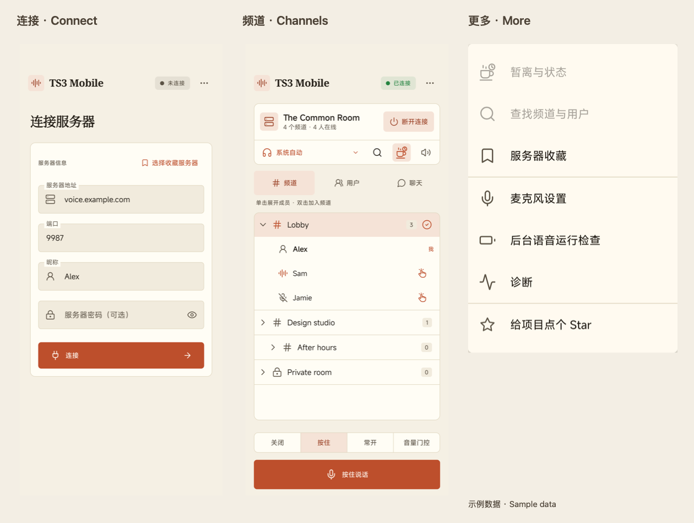
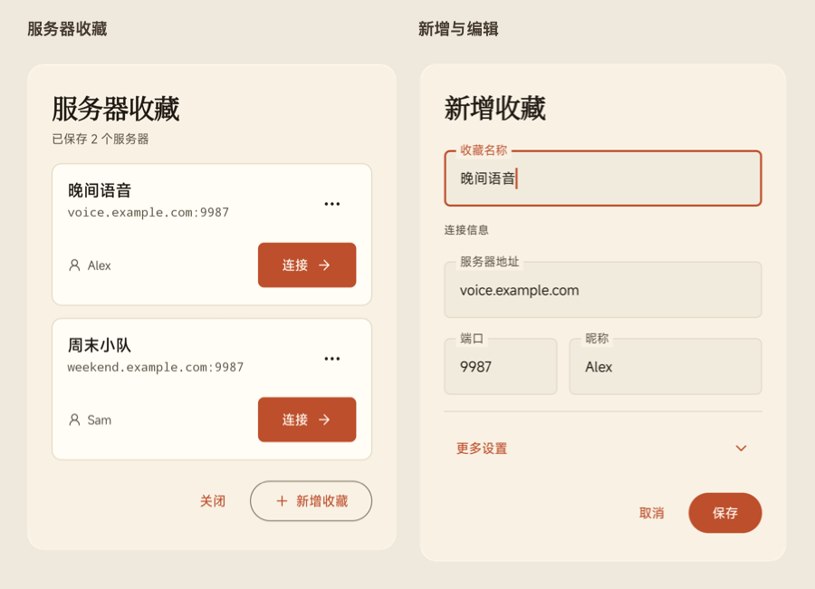

# TS3 Mobile

[](https://github.com/monet4070/ts3-mobile/actions/workflows/android.yml)
[](https://github.com/monet4070/ts3-mobile/releases/latest)
[](LICENSE)

[English](README.md) · [下载 APK](https://github.com/monet4070/ts3-mobile/releases/latest) · [文档中心](docs/README.md) · [反馈问题](https://github.com/monet4070/ts3-mobile/issues)

**在 Android 手机上使用 TeamSpeak 3：加入语音频道、收发消息、联系队友，并收藏常用服务器。**

TS3 Mobile 是开源的非官方客户端，采用暖米白与陶土色界面、线性图标和简体中文／英文本地化。
无需注册项目账号，直接连接你已有的 TeamSpeak 服务器。

> **最新稳定版：[1.0.0](https://github.com/monet4070/ts3-mobile/releases/tag/v1.0.0)**，
> 于 **2026-11-05** 修复语音断续后重新发布（versionCode 14），替代已撤回的 11 月 4 日构建。
> 请重新从 Release 下载签名 APK 和校验表。
> 证书与公开 0.11.1-m10 一致，升级时保留旧应用。详见[安装升级](docs/INSTALLATION.md)、
> [验证范围](docs/COMPATIBILITY.md)与[更新日志](CHANGELOG.md)。

## 阅读导航

开发分支新增：聊天阅读位置跨主页面保留，调音参数保存后可跨服务／进程重启恢复，
可保存当前连接并按频道名称配置收藏，频道行提供可见加入操作。
这些改动尚未包含在公开的1.0.0/code14 APK中；实际交付与离线验收见
[提升计划执行进度](docs/plans/IMPROVEMENT_PROGRESS_2026-11-07_ZH.md)。

[功能一览](#功能一览) · [下载与安装](#下载与安装) · [第一次使用](#第一次使用) ·
[认识界面](#认识界面) · [语音设置](#语音与音频设置) · [频道与用户](#频道与用户) ·
[聊天与戳一下](#聊天与戳一下) · [服务器收藏](#服务器收藏) · [暂离与后台](#暂离后台与断开) ·
[更多菜单](#设置与更多菜单) · [隐私与边界](#数据隐私与使用边界) · [常见问题](#常见问题)

## 功能一览

| 你想做什么 | TS3 Mobile 提供的能力 |
| --- | --- |
| 和队友语音交流 | 按住说话、常开、音量门控与关闭模式，输入音量、降噪和设备回声消除 |
| 浏览和切换频道 | 层级频道、成员展开、公开／密码频道加入、频道与用户搜索 |
| 发文字消息 | 当前频道聊天、私聊、独立草稿、未读提示、会话切换和长按复制 |
| 提醒某位成员 | 频道成员旁的戳一下图标，可选留言、前台弹窗与后台通用通知 |
| 管理常用服务器 | 最多 50 个命名收藏、直接连接、编辑、删除、可选默认频道与加密密码 |
| 调整收听体验 | 总收听静音、个人静音与音量、Android 可用音频设备选择 |
| 临时离开或后台使用 | 暂离状态与留言、断线恢复、后台语音检查、通知栏断开连接 |
| 保留本机隐私 | 身份／表单／收藏分别加密，不含广告、分析 SDK 或项目中转服务 |

## 下载与安装

1. 打开 [GitHub Releases](https://github.com/monet4070/ts3-mobile/releases)，确认版本和发布说明。
2. 下载 **Assets** 中的 APK；`Source code.zip` / `.tar.gz` 是源码，不能直接安装。
3. 与同一 Release 的 `SHA256SUMS.txt` 比对摘要，再由可信浏览器或文件管理器安装。
4. 如果 Android 询问，按需允许该来源安装应用。应用不会自动检查或安装后续更新。

要求 **Android 8.0（API 26）及以上**。通用包包含 arm64-v8a、armeabi-v7a、x86、x86_64；
安装下限不等于所有系统和机型均已实测，见[兼容性与验证范围](docs/COMPATIBILITY.md)。

**升级前先保留原应用。** 覆盖安装需要相同应用 ID 和兼容签名。遇到安装冲突不要直接卸载或
清空存储，否则本机 TeamSpeak 身份、收藏和加密表单会丢失；当前没有身份导出恢复工具。
`TS3 Mobile UI` 等旁装调试应用拥有独立数据，不会自动迁入正式应用。
校验命令和签名问题见[安装与升级说明](docs/INSTALLATION.md)。

## 第一次使用

### 准备连接信息

向服务器管理员取得地址、**语音端口**和必要的密码。无需 ServerQuery 账号。
首次使用会创建本机 TeamSpeak 身份；昵称只是显示名称，不等于身份。

| 表单字段 | 怎么填写 |
| --- | --- |
| 服务器地址 | 服务器域名或地址，例如 `voice.example.com`；示例域名不是真实服务 |
| 端口 | 默认 `9987`，自定义服务器按管理员提供的语音端口填写 |
| 昵称 | 你在服务器上显示的名字，长度 3–30 个字符 |
| 服务器密码 | 没有密码可留空；眼睛图标可以显示／隐藏输入内容 |

### 完成第一次通话

1. 填写连接表单，点击底部橙色“连接”，等待顶部状态变为已连接。
2. 在“频道”页单击频道展开成员，**双击频道行加入**；密码频道会单独询问频道密码。
3. 在麦克风模式中选择“按住”，需要时授予录音权限，再按住“按住说话”按钮讲话。
4. 松开按钮停止这次讲话。只想收听时选“关闭”；收听静音会让你听不到其他人。
5. 结束通话时点击服务器卡片右侧“断开连接”，或使用连接通知中的断开操作。

服务器密码和频道密码是不同的参数。不能连接时，先检查语音端口、网络与服务器权限，
不要反复重试同一身份的连接限制错误。

## 认识界面



图中为中文界面的不同状态；服务器、昵称和成员都是示例。未连接时，依赖会话的菜单会置灰。

| 界面区域 | 你可以在这里做什么 |
| --- | --- |
| 顶部应用栏 | 查看连接状态；点击右上角“…”打开更多菜单 |
| 未连接时的表单 | 输入服务器参数、打开收藏、连接；有成功历史时可选用最近连接 |
| 已连接的服务器卡片 | 查看服务器名称、频道／在线人数，主动断开 |
| 卡片下方音频栏 | 从左到右选择音频路由、查找频道／用户、设置暂离、切换收听静音 |
| 频道／用户／聊天页签 | 切换频道树、用户列表与文字会话，聊天角标显示未读 |
| 麦克风控制区 | 切换模式、按住说话，查看监听／发送等状态 |

常用图标的含义：**耳机＋下箭头**选择设备；**放大镜**查找；**咖啡杯＋小钟**设置暂离；
**扬声器**控制收听；成员旁的**手势图标**戳一下；用户行的**滑杆图标**展开个人音量。

大字体或窄屏下，页签可以横向滚动，麦克风模式可能收进下拉菜单。聊天键盘打开后界面会收紧，
保留输入区和紧凑语音控制；切换页签或开始输入会释放按住说话，避免误发语音。

## 语音与音频设置

### 选择麦克风模式

| 模式 | 采集与发送方式 | 适用情况 |
| --- | --- | --- |
| 关闭 | 停止麦克风采集，丢弃缓存；仍可收听 | 只听不说、临时需要完全关闭采集 |
| 按住 | 按住按钮时采集并发送，松开停止 | 新用户、嘈杂环境、需要精确控制发言 |
| 常开 | 持续采集并发送 | 需要连续讲话，建议配合耳机 |
| 音量门控 | 持续采集，达到阈值才发送，带短暂起声／收尾缓存 | 希望按音量自动发言 |

**音量门控在安静时也使用麦克风。** “正在监听”不表示麦克风已关闭；要停止采集请选择“关闭”。
聊天键盘打开时，紧凑语音栏的麦克风关闭图标可直接停止采集。

### 调整输入与输出

打开右上角 **… → 麦克风设置**。输入音量范围 0–200%，可切换 RNNoise 降噪和设备回声消除，
并调整门控阈值。阈值越低，越轻的声音也会触发；漏掉轻声时可适当降低，环境噪声触发过多时可提高。
设置即时生效，打开设置本身不会开始录音；开发分支会恢复已保存调音，公开 1.0.0/code14 仍只在服务内存保留。

开发分支在调音对话框内显示输入电平：使用降噪／增益后、限幅前的同一门控 RMS，
每秒最多更新 10 次，门开闭和发送状态来自真实处理状态。对话框里的“按住说话”复用正常 PTT，
**会发送到当前频道**；松开、取消、关闭或离开界面会释放按住。仅打开设置不采集，常开／门控可直接点“停止麦克风”。
停止采集、切换路由或关闭观测会清除电平，不保存音频或电平轨迹。

点击音频栏左侧设备名称选择 Android 当前可用的听筒、扬声器、耳机、Bluetooth 或 USB 路由。
会话开始或连接蓝牙耳机后，会优先选择 Android 提供的蓝牙通话路由。所选设备断开，或播放从蓝牙意外切到其他设备时，
会自动收听静音以防外放；重新连接会再次选中蓝牙，但仍需确认路由后手动取消静音。实际系统回调延迟仍需实体耳机验证。
总收听静音与麦克风关闭互不替代。外放有回声时优先使用耳机，设备 AEC 状态不保证相同的实际效果。

## 频道与用户

### 浏览、加入与查找频道

- **单击频道行**：展开或收起直接成员，查看成员发言、输入静音、收听静音等状态。
- **双击频道行**：请求加入；带锁频道需要频道密码，并受服务器权限控制。
- **点击放大镜**：输入频道名、主题或昵称，在当前已加载快照中查找；可加入目标频道或用户所在频道。

搜索不会跨服务器或检索权限不可见的内容。当前频道有标识；频道详情页和服务器管理入口未提供。

### 单独调整某个用户

进入“用户”页，其他成员行右侧有下箭头、扬声器和滑杆入口：

| 操作 | 入口与效果 |
| --- | --- |
| 发送私信／戳一下 | 下箭头菜单选择对应操作 |
| 个人静音 | 点击该用户的扬声器，再次点击恢复；不影响其他人的收听 |
| 个人音量 | 点击滑杆图标展开，调整 0–200% 播放音量 |

个人静音／音量只影响你这边的播放，不是服务器禁言；设置保留在服务内存中。

## 聊天与戳一下

### 频道聊天和私聊

1. 点击“聊天”，在底部输入文字并点击发送，向当前频道发消息。
2. 要私聊，在“用户”页打开对方下箭头菜单 → “发送私信”。
3. 点击聊天区域顶部的会话名称／下箭头，在频道和已打开私聊之间切换。
4. 长按一条消息复制正文。查看旧消息时可通过新消息入口回到最新位置。
5. 私聊顶部垃圾桶表示“关闭私聊”；有消息或草稿时会要求确认，并清除该会话的内存内容。

每个会话保留各自草稿、未读与滚动位置。发送状态区分发送中、服务器接受、拒绝与结果未知；
**服务器接受不等于已读**，结果未知时不会自动重发。对方离线或目标身份不确定时会暂停发送。
单条最多 1,024 个 UTF-8 字节，中文和 Emoji 可能占多个字节。

应用在后台收到新普通私信时，使用独立“私信提醒”频道。首条起固定 2 秒后汇总提醒，
同一通知的后续汇总静默更新。单个会话可点击定位，多个会话先打开会话列表，点击通知本身不标记已读。
过期通知只打开应用。前台其他页签仍显示未读标记。可从“更多选项 → 私信通知设置”进入系统设置；
通知权限、总开关、频道与勿扰决定实际展示和声音。

### 戳一下提醒对方

在频道成员列表点击对方旁边的手势图标，或在用户操作菜单选择“戳一下”。
核对接收者，可留空或填写最多 100 个 UTF-8 字节的留言，再确认发送。
打开弹窗不会直接发送，发送后保留当前页签和会话，用短提示反馈结果。

前台收到戳一下会弹窗；后台／锁屏时通过独立“戳一下提醒”通知频道提示，通知不显示发送者和留言。
声音与展示受 Android 通知权限、频道设置和勿扰影响。返回应用可查看仍保留的待处理提醒。

## 服务器收藏



从连接页“选择收藏服务器”，或 **… → 服务器收藏** 进入。
每张卡片分层显示名称、地址与昵称，“连接”是主操作，右上角“…”是单项管理菜单。

| 你要做什么 | 操作 |
| --- | --- |
| 新增常用服务器 | 底部“新增收藏” → 填写名称与连接参数 → 保存 |
| 直接连接 | 点击对应卡片“连接”；若已连接别的服务器，先主动断开 |
| 先检查参数 | 单项“…” → 填入表单，只替换参数，不会自动连接 |
| 修改或删除 | 单项“…” → 编辑／删除；删除需要确认 |
| 配置频道与密码 | 编辑器“更多设置” → 默认频道 ID、保存密码及可选密码字段 |

新增会预填当前表单的地址、端口、昵称，**不会自动复制表单密码**；保存收藏也不会自动连接。
最多 50 项。默认频道使用数字 ID；不清楚时留空。未选择“保存密码”时不保留收藏密码。
关闭该选项会清除该收藏内的服务器与频道密码，不会清空独立连接表单中的密码。

## 暂离、后台与断开

点击咖啡杯＋小钟 → 勾选“暂时离开”，按需填写留言 → “应用状态”。
服务器确认暂离后图标会暖色强调；取消勾选并应用可恢复在线。
暂离只改变状态，不停止麦克风或收听，离开座位前按需要另行关闭采集。

按 Home、切换应用或锁屏会保留当前后台会话。普通断网会按策略尝试重连，
后台恢复优先收听；已停止的麦克风采集可能需要回到前台恢复。
**… → 后台语音运行检查** 可查看电池与唤醒状态、打开系统设置，并按需申请 CPU 保持唤醒。
这不能绕过 Android 或厂商的全部省电限制，也不保证每台设备无限时后台运行。

离开服务器用卡片上的“断开连接”或通知断开；不要依靠划掉最近任务，部分厂商会先杀进程，
服务器只能等待旧会话超时。收到同一身份连接数量限制时，按提示至少等待 60 秒后手动重试；
实际清理可能更久，连续尝试可能触发临时封禁。重新打开应用不会自行连接。

## 设置与更多菜单

| 菜单项 | 用途 |
| --- | --- |
| 暂离与状态 | 暂离留言、服务器状态同步；需要已连接 |
| 查找频道与用户 | 搜索当前服务器已加载的频道和成员；需要已连接 |
| 服务器收藏 | 管理常用连接，未连接时也可打开 |
| 麦克风设置 | 输入音量、降噪、设备回声消除、门控阈值 |
| 后台语音运行检查 | 电池限制、CPU 唤醒、系统设置入口 |
| 诊断 | 查看运行信息并主动复制脱敏诊断用于反馈 |
| 给项目点个 Star | 在系统浏览器／GitHub 中打开项目仓库，是否 Star 由你决定 |

当前默认暖色浅色界面。语言随 Android 系统／应用语言环境选择英文或简体中文，
没有应用内语言或主题切换按钮。

## 数据隐私与使用边界

| 内容 | 保存方式与注意事项 |
| --- | --- |
| TeamSpeak 身份 | 本机 Keystore 支持的加密存储；卸载或清空数据会丢失，可能影响旧身份的服务器权限 |
| 连接表单 | 地址、端口、昵称和服务器密码独立加密记忆，包括尚未连接的修改；加载不自动连接 |
| 最近连接 | 最多十条成功端点；删除历史不会清空表单或收藏 |
| 收藏 | 独立加密保存，密码需主动选择；不支持跨包迁移或应用内备份恢复 |
| 消息与草稿 | 只在服务内存，普通重连保留；手动退出、新手动连接、终态失败或进程结束清空 |
| 语音和诊断 | 不录音归档；诊断只在主动复制分享后离开应用 |

最多 20 个会话共享 500 条／2 MiB 消息预算，较早记录可能被淘汰，服务器与接收方可能保留内容。
项目不含广告、分析或自动崩溃上报后端。完整说明见[隐私政策](PRIVACY_ZH.md)。

目前只支持一个活动服务器；Whisper、文件传输、管理功能、身份导入导出和多服务器标签页尚未实现。
蓝牙、长时后台与声学效果的已验证范围见[兼容性说明](docs/COMPATIBILITY.md)。

## 常见问题

| 问题 | 先检查什么 |
| --- | --- |
| 听得到别人，别人听不到我 | 麦克风模式、录音权限、频道发言权限；门控阈值是否过高 |
| 没有声音 | 总收听静音、个人静音／音量、系统通话音量和音频路由 |
| 门控安静时仍显示录音指示 | 属正常采集；完全停止需要选择“关闭” |
| 别人戳我没有提醒 | 通知权限、通知总开关、“戳一下提醒”频道、勿扰和后台限制 |
| 重启后聊天消失 | 当前没有永久历史，消息只在服务内存中 |
| APK 与现有应用冲突 | 核对包名和签名，先保留原数据，勿直接卸载 |

更多场景见[常见问题](docs/TROUBLESHOOTING_ZH.md)和[使用指南](docs/USER_GUIDE_ZH.md)。
仍有问题请提交 [Issue](https://github.com/monet4070/ts3-mobile/issues)，附版本、设备、复现步骤与脱敏诊断。
不要公开服务器、密码、身份或其他成员信息；疑似漏洞请按[安全政策](SECURITY.md)私密报告。

## 开发与参与

JDK 17、SDK Platform 35、Build Tools 35.0.0、NDK 27.0.12077973、CMake 3.22.1。
由 [local.properties.example](local.properties.example) 配置本机 SDK，然后运行：

```sh
./gradlew quality :ts3-protocol:test :audio-opus:testDebugUnitTest :audio-opus:lintDebug :app:testDebugUnitTest :app:lintDebug :app:lintRelease :app:assembleDebug :app:assembleRelease
```

Windows 使用 `gradlew.bat`。更多见[开发约定](CONTRIBUTING.md)、[架构](ARCHITECTURE.md)、
[发布资料](docs/release/README.md)与[支持说明](SUPPORT.md)。Release 构建与正式签名发布是独立步骤。

本项目基于 [ts3j](https://github.com/Manevolent/ts3j)，采用 [Apache-2.0](LICENSE)，
第三方组件遵循[各自许可证](THIRD_PARTY_NOTICES.md)。它与 TeamSpeak Systems GmbH 无隶属、认可或赞助关系。
感谢 [@polleyr](https://github.com/polleyr) 的[服务器密码修复](https://github.com/monet4070/ts3-mobile/pull/1)
和英文本地化帮助。参与协作请遵守[行为准则](CODE_OF_CONDUCT.md)。

身份存储损坏或本机密钥丢失会明确报错并保留原数据，不会悄悄生成另一个身份。
内部维护与恢复事务见[ADR-0029](docs/decisions/0029-identity-maintenance-transactions.md)，
面向用户的备份流程将在下一阶段接入。
