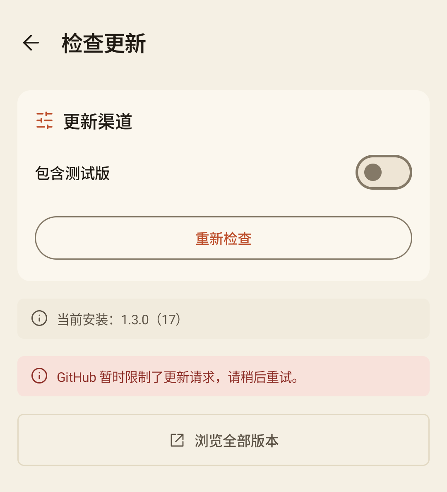
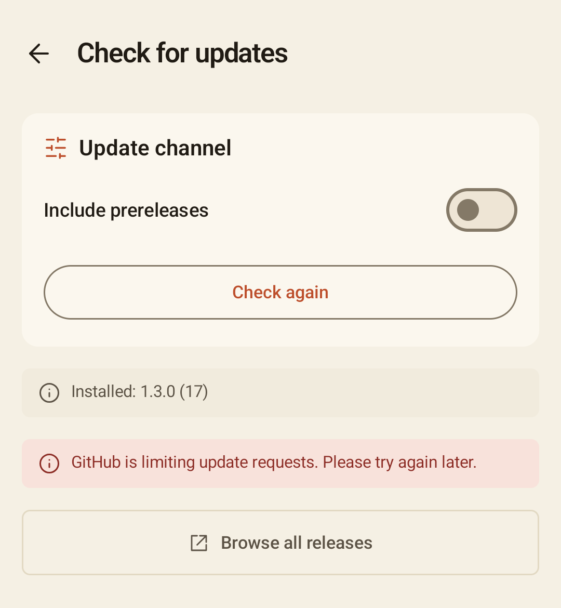

# 安装与升级 / Installation and Upgrades

[English](#english) · [1.3.0 更新说明](release/1.3.0/RELEASE_NOTES_ZH.md) · [使用指南](USER_GUIDE_ZH.md) · [兼容性与验证](COMPATIBILITY.md)

本指南说明如何下载、校验并**保留原有数据**升级至 **TS3 Mobile 1.3.0（versionCode 17）**。正式包名为 `io.github.ts3mobile.app`，沿用公开签名证书；实际可下载资产、摘要与签名证书以 [GitHub Releases](https://github.com/monet4070/ts3-mobile/releases) 上对应版本的 `BUILDINFO.json` 与 `SHA256SUMS.txt` 为准，1.3.0 最终签名包验收状态见[验收状态与发版门禁](release/CANDIDATE_STATUS_2026-11-25.md)。

> **请勿使用 Debug、旁装 QA APK、未签名构建或 CI 工件替代正式更新。** 旁装包使用独立应用 ID 或开发签名，不能替换正式包，也不会读取正式包的身份、收藏或设置。

## 下载与校验

1. 打开 [GitHub Releases](https://github.com/monet4070/ts3-mobile/releases)，确认目标版本与正式／测试版标识。
2. 从 **Assets** 下载正式安装包（例如 `ts3-mobile-1.3.0-release.apk`）、`SHA256SUMS.txt` 和 `BUILDINFO.json`。GitHub 自动附带的 `Source code.zip` / `.tar.gz` 是源码，不能直接安装。
3. 使用同一 Release 的 `SHA256SUMS.txt` 比对 APK 的 SHA-256 摘要，再通过可信浏览器或文件管理器安装。
4. 安装前请在应用内或通知栏正常**断开服务器**，**保留原应用**，按需允许该下载来源安装应用。

macOS：

```sh
shasum -a 256 ts3-mobile-1.3.0-release.apk
```

Linux：

```sh
sha256sum ts3-mobile-1.3.0-release.apk
```

Windows PowerShell：

```powershell
Get-FileHash .\ts3-mobile-1.3.0-release.apk -Algorithm SHA256
```

文件摘要标识 APK 字节，证书摘要标识签名；`BUILDINFO.json` 同时记录构建源码提交、发布提交、版本、ABI 和签名证书摘要。不要用其他版本的校验表核对新包。

## 系统要求

- **Android 8.0（API 26）及以上**；通用 APK 包含 `arm64-v8a`、`armeabi-v7a`、`x86`、`x86_64`。
- 可访问目标 TeamSpeak 3 语音端口（通常为 UDP `9987`）的网络；无需项目账号或 ServerQuery 凭据。
- 收听不要求开启麦克风；发言需要录音权限；通知权限控制连接状态、私信与戳一下提醒；浮窗 PTT 需要“在其他应用上层显示”权限。
- 首次启动不会自动连接或开启麦克风；设备覆盖范围见[兼容性与验证范围](COMPATIBILITY.md)。

## 保留原安装升级

Android 覆盖安装需要相同包名（`io.github.ts3mobile.app`）、兼容签名和更高的 `versionCode`：

| 现有安装 | 升级到 1.3.0（code 17）的方式 |
| --- | --- |
| **1.2.0 / code 16**（原公开签名） | 断开服务器后，使用应用内 **检查更新** 或从 GitHub Releases 下载同签名 1.3.0 / code 17 覆盖安装 |
| **1.1.0 / code 15**（原公开签名） | 断开服务器后，使用应用内 **检查更新** 或直接覆盖安装同签名 1.3.0 / code 17 |
| **1.0.0 / code 14**（原公开签名） | 该版本尚未内置检查更新，请从 GitHub Releases 手动下载同签名新版覆盖安装 |
| **0.11.1-m10 / code 12** 或更早公开版 | 先核对包来源与签名证书一致，再覆盖安装；升级前建议先备份必要服务器参数 |
| **TS3 Mobile UI / QA** 等旁装包 | 包名、身份和本地存储完全独立，不能与正式包互相升级或自动迁移数据 |
| 第三方重签包或来源不明的旧包 | 先核对来源与证书，不要通过盲目卸载解决冲突 |
| 更高 `versionCode` 的安装 | Android 默认拒绝降级，需等待更高 `versionCode` 的修复包 |

**切勿为解决安装冲突直接卸载应用或清除存储。** 卸载或清空数据会永久删除本机 TeamSpeak 身份、服务器收藏、连接表单、设置与本地聊天历史。

- 升级前建议在 **更多选项 → 设置 → 身份与备份** 主动导出自有 `.ts3mbak` 加密身份备份（保存后需确认页面显示“备份已保存并验证”，并单独保管口令）。
- 身份备份**不包含**服务器收藏或连接表单，也不兼容桌面版 `.ini` 格式；本地旧身份回退依赖原安装密钥，不能代替外部备份；Android 系统备份／换机同样不能替代应用内已验证备份。
- 如遇包名、签名或版本冲突，请保留原安装，按[获取支持](../SUPPORT.md)附脱敏错误信息与包来源反馈。

## 后续检查更新

在 **更多选项 → 设置 → 检查更新** 中默认检查正式版，也可开启 **包含测试版** 并保存偏好。应用仅在用户打开页面、切换渠道或重新检查时联网，不后台轮询，也不自动安装。关闭按钮固定在顶部，更新说明按 Markdown 渲染，展开后收起按钮保持可见并可返回原位置；点击 **下载 APK** 后交由浏览器下载。也可在 GitHub 仓库点击 **Watch → Custom → Releases** 订阅更新通知。



---

## English

[简体中文](#安装与升级--installation-and-upgrades) · [1.3.0 Release Notes](release/1.3.0/RELEASE_NOTES.md) · [User Guide](USER_GUIDE.md) · [Compatibility](COMPATIBILITY.md#english)

This guide explains how to download, verify, and perform an **in-place upgrade** to **TS3 Mobile 1.3.0 (versionCode 17)**. Official releases keep package ID `io.github.ts3mobile.app` and the public signing certificate. Always check `BUILDINFO.json` and `SHA256SUMS.txt` from the matching release on [GitHub Releases](https://github.com/monet4070/ts3-mobile/releases); see [1.3.0 verification status](release/CANDIDATE_STATUS_2026-11-25.md) for current release-gate tracking.

> **Do not install Debug, QA sideload APKs, unsigned builds, or CI artifacts as release updates.** Sideload test packages use separate application IDs or development keys and cannot migrate data into the official app.

### Download and verify

1. Open [GitHub Releases](https://github.com/monet4070/ts3-mobile/releases) and confirm the target version and release channel.
2. Download the release APK (for example `ts3-mobile-1.3.0-release.apk`), `SHA256SUMS.txt`, and `BUILDINFO.json` from **Assets**. GitHub's automatic Source code ZIP/TAR archives are not installers.
3. Verify the APK SHA-256 against `SHA256SUMS.txt` from the same release (`shasum -a 256` on macOS, `sha256sum` on Linux, or `Get-FileHash -Algorithm SHA256` on Windows PowerShell).
4. Disconnect cleanly from any active server first, **keep the existing app installed**, and install via a trusted browser or file manager.

### Requirements and in-place upgrades

- **Requirements:** **Android 8.0 (API 26)+**. The universal APK ships `arm64-v8a`, `armeabi-v7a`, `x86`, and `x86_64`. Packaging an ABI does not establish physical testing on every device; see [Compatibility & Validation](COMPATIBILITY.md#english).
- **Upgrading from 1.2.0 (code 16) or 1.1.0 (code 15):** Open **More options → Settings → Check for updates** (or download the matching signed APK from GitHub Releases), disconnect from the server, and install over the existing app to retain your identity, bookmarks, form memory, and settings.
- **Upgrading from 1.0.0 (code 14) or earlier:** Older builds predate the in-app update screen and require a manual download from GitHub Releases.
- **Never uninstall or clear storage to work around an install conflict.** That permanently deletes your local TeamSpeak identity, bookmarks, form snapshot, settings, and local chat history. Before major upgrades, export a verified `.ts3mbak` encrypted identity backup under **More options → Settings → Identity and backups** and store its passphrase separately (backups exclude bookmarks and connection forms; local rollback and Android backup/transfer are not substitutes for an external verified backup).

### In-app update checks

Open **More options → Settings → Check for updates** for stable releases and an optional remembered **Include prereleases** toggle. Checks run only when initiated by you—there is no background polling or automatic installation. Release notes render native Markdown with a fixed collapse control, and your browser handles APK downloads.


