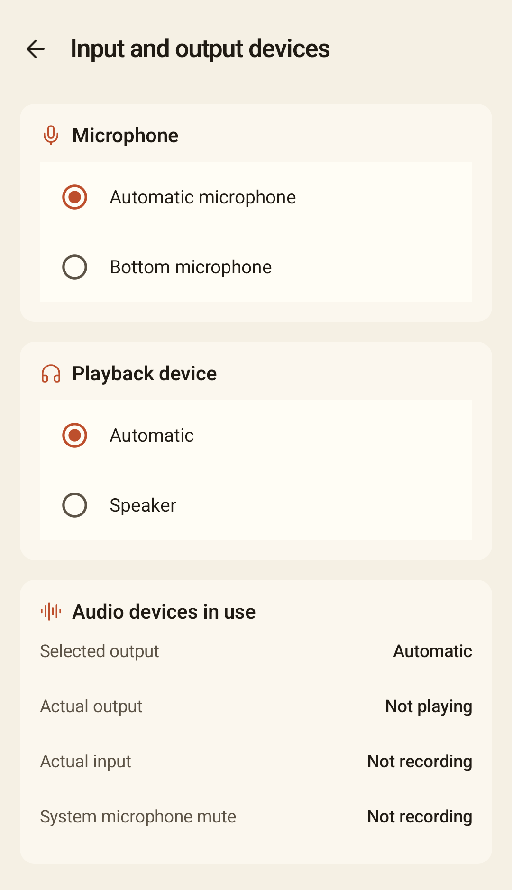
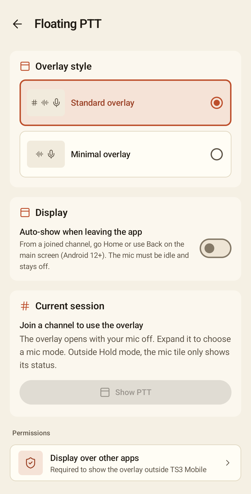
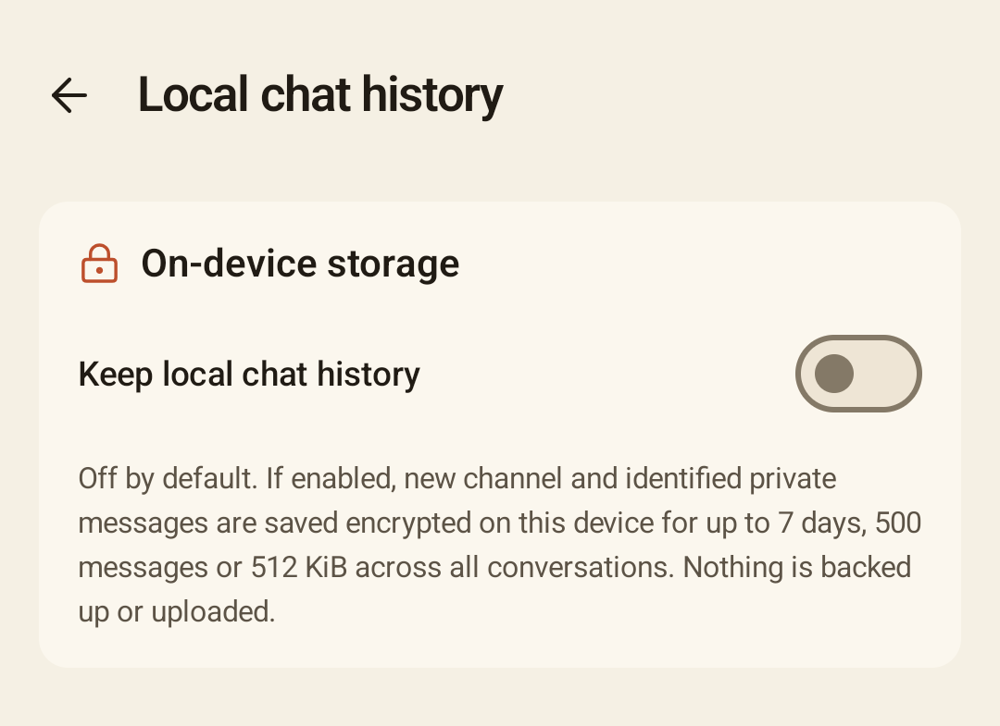
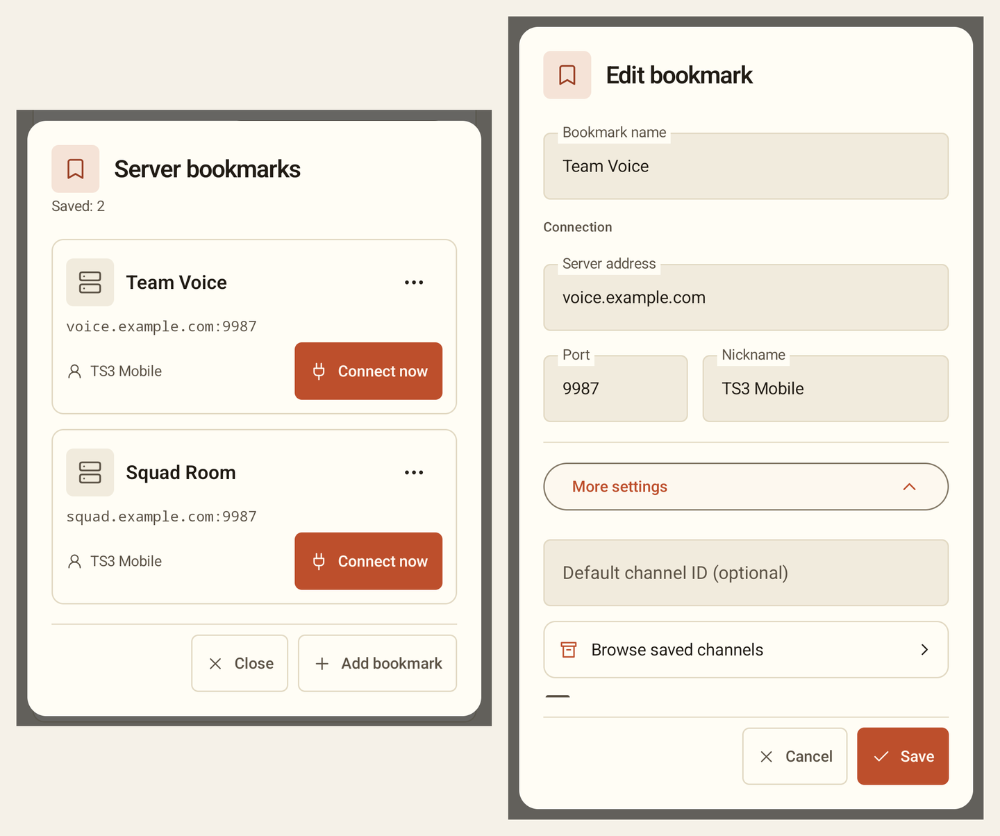
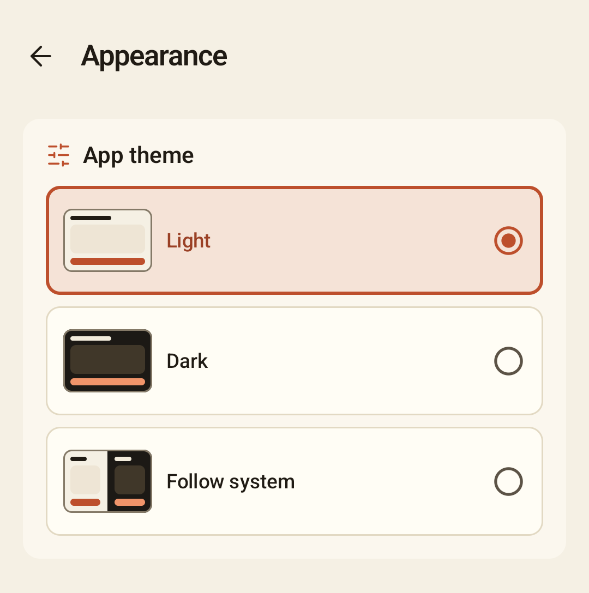
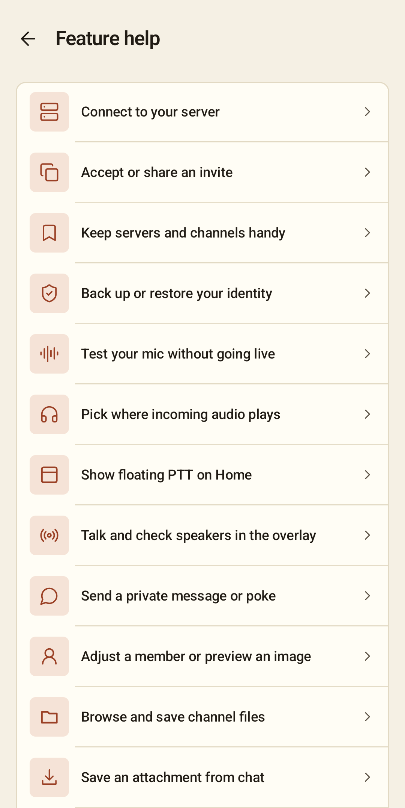
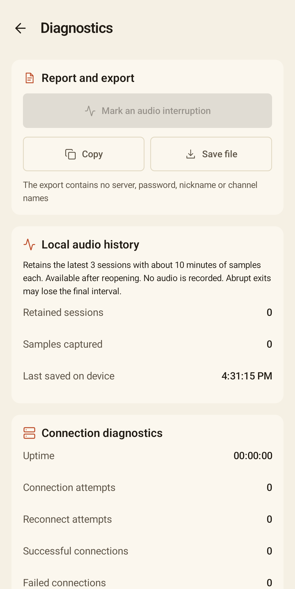

# User Guide

[简体中文](USER_GUIDE_ZH.md) · [1.3.0 Release Notes](release/1.3.0/RELEASE_NOTES.md) · [Install & Upgrade](INSTALLATION.md#english) · [Troubleshooting](TROUBLESHOOTING.md)

This guide covers **TS3 Mobile 1.3.0 (versionCode 17)**. See the [interface tour](../README.md#interface-tour) and [screenshot index](images/README.md) for current 1.3.0 UI captures, and the [releases index](release/README.md) for verification records.

## Contents

[Connect and invites](#connect-and-invites) · [Channels and members](#channels-and-members) · [Microphone and listening](#microphone-and-listening) · [Floating PTT](#floating-ptt) · [Messages, private chats and pokes](#messages-private-chats-and-pokes) · [Files and server images](#files-and-server-images) · [Server bookmarks](#server-bookmarks) · [Away, background and network handoff](#away-background-and-network-handoff) · [Appearance and feature help](#appearance-and-feature-help) · [Updates and identity backups](#updates-and-identity-backups) · [Offline audio diagnostics](#offline-audio-diagnostics) · [Privacy and feedback](#privacy-and-feedback)

---

## Connect and invites

### Connection form

Enter a server address, voice port, 3–30 character nickname, and server password if required, then tap **Connect**. The standard voice port is `9987`; use the administrator's configured voice port rather than a ServerQuery port. A local TeamSpeak identity is generated on first use—no project account is required.

- The separately encrypted form remembers edits (including its server password) and prefills on the next launch without connecting automatically.
- **Recent servers** record only previously successful endpoints (up to 10). Deleting a recent entry does not clear the form or bookmarks.
- TS3 Mobile maintains one active server session at a time; disconnect cleanly before switching to another server.

### Open, paste, and share invites

Open a TeamSpeak invite link or tap **Paste invite** on the connection screen. TS3 shows the destination server and channel for confirmation without disconnecting an active session or connecting automatically; enter any required password yourself. While connected, use **More options → Share invite** to share the current server or channel—passwords and identity data are never included.

---

## Channels and members

- **Browse and join:** On **Channels**, tap a row to expand or collapse its direct members. **Double-tap the channel row** or tap its visible **Join** button (also exposed as an accessibility action) to enter. Locked channels open the channel-password dialog; replacing the connection or target channel invalidates pending joins.
- **Search:** Tap the magnifier in the audio row or open **More options → Find channels and users** to search loaded channel names, topics, and nicknames locally. Joining a user's channel re-checks their current location against the live session.
- **Scope:** The current channel is clearly marked. Channel detail screens, permission editors, and server administration are not provided.

---

## Microphone and listening

### Microphone modes

| Mode | Capture and transmission |
| --- | --- |
| Off | Stops capture and discards buffered audio; listening remains available |
| Hold / push-to-talk | Captures and sends while the talk button is held; stops on release |
| Always on (continuous) | Captures and sends continuously |
| Volume gate | Captures continuously (including silence); sends above the threshold with short onset (120 ms) and tail (300 ms) buffers |

Capture requires Android microphone permission. **A quiet volume gate is still actively capturing**; choose **Off** to stop capture completely.

### Microphone tuning and local microphone test

Tap the microphone icon in the voice controls for a quick vertical input-volume slider, or open **More options → Settings → Microphone settings** to configure **Input volume (0–200%)**, **RNNoise**, **Device echo cancellation (AEC)**, and the **Gate threshold**.

- Once saved, those four tuning preferences survive restarts and disconnects. Loading, saving, or restoring defaults never starts capture, and a new service always starts in **Hold** mode.
- The screen distinguishes loading, unsaved changes, saving, saved, and save errors. Releasing a slider or closing the screen triggers a save; retry on error or tap **Restore tuning defaults** (never affects identity, bookmarks, or form memory).
- **Local microphone test:** Tap **Test microphone** offline or while connected (set microphone mode to **Off** first when connected) to verify input hardware, levels, and gate triggers. The test stops after 30 seconds and **never encodes, transmits, or saves audio**.
- **Live input level & Hold to talk:** While capture is already active, the tuning screen shows the post-denoise/post-gain pre-limiter RMS (up to 10 updates/sec, never saved). The **Hold to talk** button uses normal PTT and **transmits to the current channel**; in Continuous or Gate mode, tap **Stop microphone** to end capture.

### Playback profiles, routing, and Bluetooth safeguards

- **Voice playback profiles:** Under **More options → Settings → Voice playback**, switch live between **Stability first (default)** and **Balanced** (existing saved choices are preserved). Stability first buffers slightly longer to tolerate late packets; saving resets incoming playback immediately without disconnecting or restarting capture.
- **Audio devices in use:** Both **Voice playback** and **Input and output devices** display this read-only panel, separately reporting **Selected output**, **Confirmed actual output** (distinguishing Bluetooth media A2DP, Bluetooth call SCO, and Bluetooth LE Audio), **Actual recording input**, and **System microphone mute**. "Unknown" is never guessed from preferences, and "Not recording" is distinct from being muted.
- **Media mixing and Bluetooth protection:** By default, incoming voice mixes with videos, music, and games using Android media volume without taking audio focus or entering call mode. Available Bluetooth media headsets are selected at session start and hot-plug, with automatic microphone preferring the phone mic. Bluetooth first-utterance protection gives a waking headset extra time before rebuilding the track without delaying ready outputs. Device removal or unexpected Bluetooth fallback (including unnotified auto-route fallbacks) triggers a listening safety mute; confirm the route and unmute manually after reconnecting.
- **Input and output devices:** Open **More options → Settings → Input and output devices** to select a physical microphone and playback device separately and verify the actual routes below. Built-in microphones are labeled by position when known (Bottom/Rear/Front/Top), identical labels are numbered, and raw device addresses are never shown. Automatic microphone prefers the phone mic with Bluetooth media playback; where supported, **LE Audio headset microphone** and **Bluetooth LE Audio** output can be selected separately without entering call mode. Device IDs are session-temporary and not persisted; unplugging a selected microphone returns to automatic, while Bluetooth output loss retains safety muting.
- **Bluetooth call (use headset microphone):** When Android exposes a classic Bluetooth communication device, you may manually pick **Bluetooth call (use headset microphone)** under Playback device to route both playback and recording through the headset (never auto-selected or persisted across sessions). TS3 waits for SCO playback without transmitting from a fallback microphone; classic call mode may reduce audio quality. Pick the regular Bluetooth output to restore media mode and your previous microphone choice; disconnecting or output failure releases the call route automatically.
- **Per-user controls:** In **Users**, mute an individual participant or adjust their playback volume from 0–200% (below 100% follows an approximate perceptual loudness curve—50% targets roughly half perceived loudness). Muting one participant preserves other users' valid unmixed audio and decoders (the shared output still retires, so a brief gap is possible). Listening mute and turning your microphone off are independent; prefer headphones if speaker echo occurs.

---

## Floating PTT

While joined to a channel, open **More options → Settings → Floating PTT** and grant Android's **Display over other apps** permission to speak and monitor active speakers over other apps:

1. **Open and recall:** Show the overlay manually from Settings, recall it via **Show PTT** in the active connection notification, or enable **Auto-show when leaving the app** (off by default). With auto-show enabled, going Home or using Back on the main screen (Android 12+) while joined to a channel with the microphone idle automatically shows the overlay. **Showing or recalling the overlay never activates the microphone** or alters an active capture mode.
2. **Overlay styles:** Under **Overlay style**, pick **Standard overlay** (default; displays one active speaker's nickname when collapsed) or **Minimal overlay** (compact two-icon collapsed bar).
3. **Moving, speaker strip, and mode controls:** The left icon highlights when channel voice arrives. Drag it to move the overlay, or tap it to expand a fixed-height single strip showing up to three active speaker nicknames plus a `+N` overflow count (height stays constant when idle so mode buttons never shift) alongside microphone mode switches. Speaker indicators track received channel voice (excluding whispers) and clear about one second after the last frame.
4. **Talking and safety stops:** Only **Hold** mode transmits when pressing the right-hand target and stops on release. In Off, Continuous, and Gate modes, that target only shows live microphone status (distinguishing an open quiet gate from active transmission by color). Locking the screen, leaving the channel, or returning to the app ends floating capture, and an ongoing local microphone test blocks concurrent floating capture.

> The local-only microphone recorder lab remains Debug-only and is not included in standard release builds.

---

## Messages, private chats and pokes

### Channel and private chat

- **Send and switch:** Use **Chat** for the current channel. In **Users**, open a member's menu → **Send private message** to start a private chat; tap the chat header to switch conversations. Closing a private chat clears its in-memory messages and draft after confirmation.
- **BBCode and external links:** Basic TeamSpeak BBCode (bold, italic, code, and explicit HTTP(S) links) is rendered without fetching link previews. Tapping a link shows the destination URL for confirmation first; long-press **Copy message** preserves the original raw text.
- **Reading position and delivery status:** Switching tabs preserves scroll position and follow intent—new messages never pull you away from older history (use the new-message button to jump back). Send outcomes separate sending, server-accepted, rejected, and unknown (**server acceptance is not a read receipt**; unknown sends are never retried automatically). Single messages are capped at 1,024 UTF-8 bytes; up to 20 live conversations share a 500-message / 2 MiB in-memory budget.
- **Background private-message alerts:** Ordinary private messages received in the background use the dedicated **Private message alerts** channel with a generic summary after a 2-second window (no sender or body) and silent subsequent updates. Tapping opens the chat or list without marking messages read. Manage Android settings via **More options → Settings → Private message notifications**.

### Local chat history (off by default)

Open **More options → Settings → Local chat history** to opt in to a bounded local archive:

- Saves eligible new text messages (including while connected in the background) encrypted with a separate Android Keystore key, excluded from cloud backup and device transfer.
- Use **Browse saved messages** offline to read the current identity's saved records. On load or write, the archive automatically prunes entries older than 7 days or beyond 500 messages / 512 KiB encoded total.
- Delete individual saved conversations, clear all records, or turn the feature off and confirm deleting all saved records (never affects live chat or server copies). Does **not** backfill earlier messages, store drafts/pokes/unconfirmed sends/passwords/attachment contents, resend messages, or sync to the cloud.

### Poke a member

Tap the hand icon beside a channel member or choose **Poke** in their user menu. Check the recipient, enter an optional reason (up to 100 UTF-8 bytes), and confirm. Opening the dialog does not send; submitting keeps your active tab and shows brief feedback.

Foreground pokes show an in-app notice; background/locked pokes use the dedicated **Poke alerts** channel with generic text (no sender or reason). Returning to the app displays any retained pending notice.

---

## Files and server images

### Browse and save channel files & chat attachments

1. Join a channel and open **More options → Channel files** to browse and pick a file. For a supported same-server attachment in chat, tap **Download attachment** (only files on the currently connected server are allowed).
2. Wait for the download and exact byte-length verification to complete, then tap **Save verified file…** to pick a destination in Android's file picker. Verified downloads survive screen recreation; if TS3 warns that a destination write may be incomplete, inspect that file and retry to a different destination.
3. Downloads are capped at **20 MiB per file** and governed by server permissions. Uploads, renaming, deletion, automatic downloads, and cross-server retrieval are not supported. Reopen the file browser if you switch channels or reconnect.

### Preview avatars and channel icons

Tap an available avatar in its leading tile on the **Users** list, or tap a displayed custom channel icon, to preview it. Channel member rows retain their voice indicators. Images are fetched from the connected server and cached in memory for the current session only.

---

## Server bookmarks

Open **Choose a saved server** on the connection form or **More options → Server bookmarks** (up to 50 entries in a separate encrypted vault). Each card's primary action is **Connect now** (will not replace an active session); the top-right **…** menu offers **Fill form** (replaces form inputs without connecting), **Edit**, and **Delete** (requires confirmation).

- **Add or save current connection:** **Add bookmark** prefills address, port, and nickname from the form **without copying the form password**. While connected, **Save current connection** captures the active endpoint, nickname, and current channel even if you edited the form meanwhile.
- **Credential isolation:** Changing a bookmark's host or port clears the old default channel and both saved passwords from the draft. Changing or clearing only the default channel (including the numeric field) clears only the channel password while preserving the server password. Reverting the address does not restore cleared passwords; canceling the edit preserves the original bookmark. Disabling **Save passwords** clears only that bookmark's passwords, not the separate connection form.
- **Online channel picker & offline channel lists:** When a bookmark matches the active connection, **More settings** offers **Choose default channel**, **Use current channel**, and **Save channel list for offline use** (stores up to 100 channel IDs and paths per endpoint, up to 6 endpoints, separately encrypted with no credentials or messages). Use **Browse saved channels** offline to pick a default channel or forget the list.

---

## Away, background and network handoff

- **Away status:** Tap the coffee-cup/clock icon to set Away and an optional message; warm emphasis appears after server confirmation. Away never stops voice capture or listening.
- **Background sessions & battery check:** Home, switching apps, and screen lock retain the session. Open **More options → Settings → Background voice check** to inspect battery restrictions, open Android battery settings, and optionally enable **CPU awake** (cannot override all OEM power policies). Background reconnect restores listening first; stopped capture resumes when returning to the app.
- **Wi-Fi ↔ mobile data handoff:** During brief default-network drops (up to 2 seconds unless explicitly blocked by Android), TS3 keeps the existing session, channel snapshot, and audio, then probes the original session once a usable network returns. If the server responds, the session continues without reconnecting (voice may pause briefly). Otherwise normal recovery runs; if a confirmed network-switch reconnect receives a server clone-limit refusal (`521`), TS3 waits 60 seconds and retries once cleanly.
- **Clean exit:** Always disconnect via the app or connection notification rather than swiping the task away (OEM task killers can bypass exit callbacks). After an identity connection-limit refusal, wait at least 60 seconds before retrying manually.

---

## Appearance and feature help

### Appearance

Open **More options → Settings → Appearance** to choose **Light (default)**, **Dark**, or **Follow system** using live preview cards. The choice is saved in a separate backup-excluded preferences file and applies across main, identity, and settings screens without starting the microphone. Only **Follow system** reacts to Android theme changes; read/save errors remain visible with Retry and explicit Reset options.

### On-demand feature help

Open **More options → Settings → Help and about → Feature help** at any time for offline guides covering connection setup, invites, bookmarks, identity backups, mic testing, playback routing, floating PTT, chat, files, local chat history, and diagnostics.

- Where supported, selecting a topic highlights the target control directly in the app; tap the highlighted control to jump there, or tap **Close tip** to dismiss it.
- Feature help **never opens automatically on launch** and never connects, requests permissions, transmits, or downloads on your behalf.

---

## Updates and identity backups

### Check for updates

Open **More options → Settings → Check for updates** for stable releases and an optional remembered prerelease channel. Release notes render native Markdown with a fixed collapse action returning to your prior scroll position; your browser handles APK downloads, and there is no background polling or automatic install. Disconnect before installing. See [Installation & Updates](INSTALLATION.md#english).

### Identity backups and restore

Open **More options → Settings → Identity and backups** to choose **Create encrypted backup** or **Restore from backup** directly (**Restore previous identity** appears only when a local verified rollback copy exists). Backups use TS3 Mobile's passphrase-encrypted `.ts3mbak` format with readback verification and exclude bookmarks and connection forms; keep the passphrase separately. See [README — Identity backup and restore](../README.md#identity-backup-and-restore) and [Installation & Upgrades](INSTALLATION.md#english).

> Standard release builds keep desktop TS3 `.ini` import disabled. Debug and explicit opt-in QA builds offer a separate **Import desktop identity** preview entry. Never share an `.ini` file—it contains a private key.

---

## Offline audio diagnostics

To investigate weak-network dropouts or Bluetooth issues without USB, open **More options → Settings → Diagnostics**:

1. Listen under the network or Bluetooth conditions that reproduce the issue—no computer required.
2. When you hear an interruption, tap **Mark interruption** promptly (or note the time).
3. Disconnect cleanly afterward and tap **Copy** or **Save file** to export the redacted JSON report.
4. Even after an abrupt exit, reopen the app and export persisted records without reconnecting.

The latest three audio sessions retain up to 120 samples (normally ~10 minutes) and 64 events each, recording numeric receive/playback counters, redacted protocol timing buckets, and coarse route/network categories—**with no audio or private connection data**.

---

## Privacy and feedback

**Give the project a Star** opens the public repository via Android's external HTTPS handler without starring automatically or sending session data. Diagnostics leave the app only when you choose to copy, save, or share them; inspect logs, screenshots, and clipboard content first. See [Privacy](../PRIVACY.md), [Support](../SUPPORT.md#english), and [Compatibility & Validation](COMPATIBILITY.md#english).
