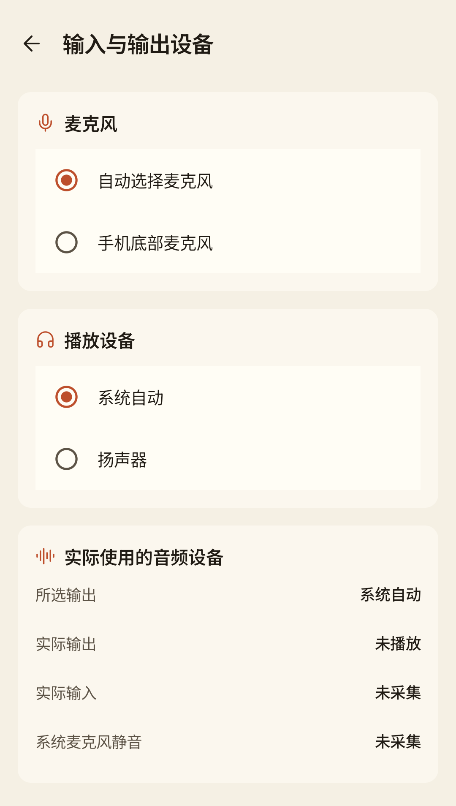
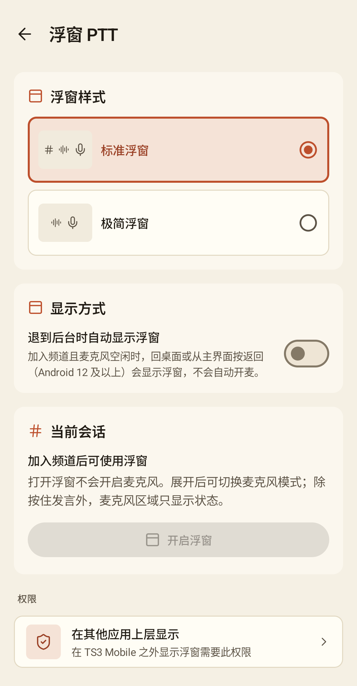
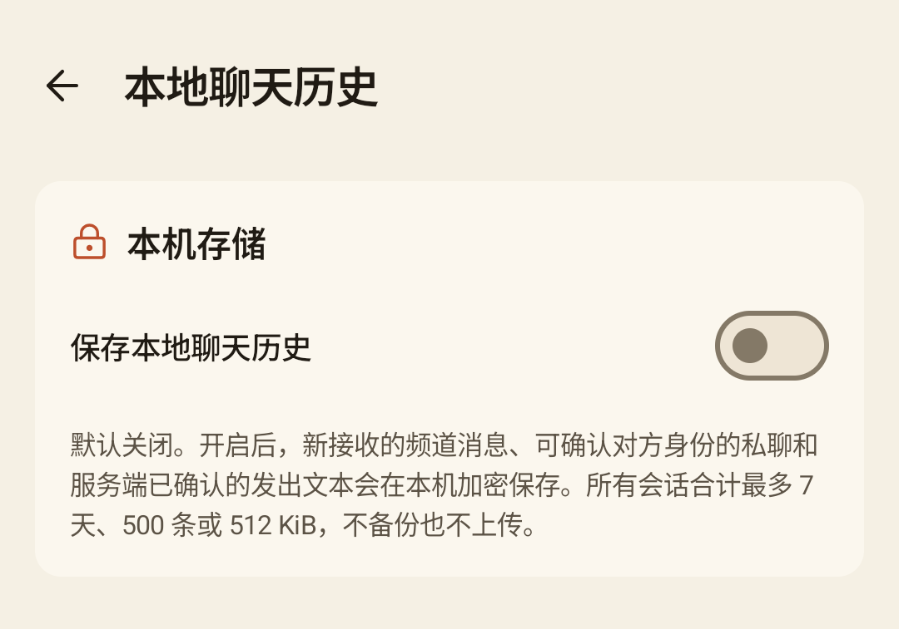
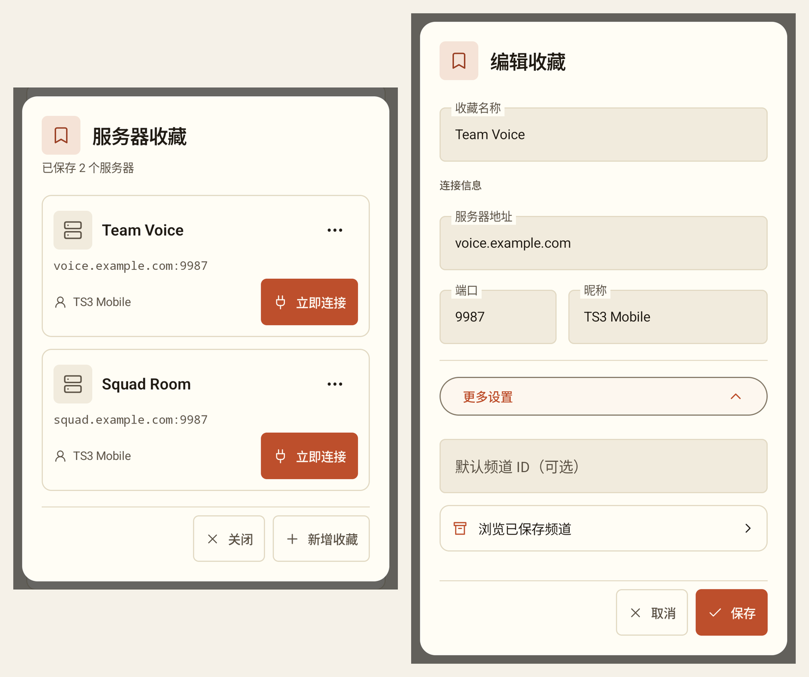
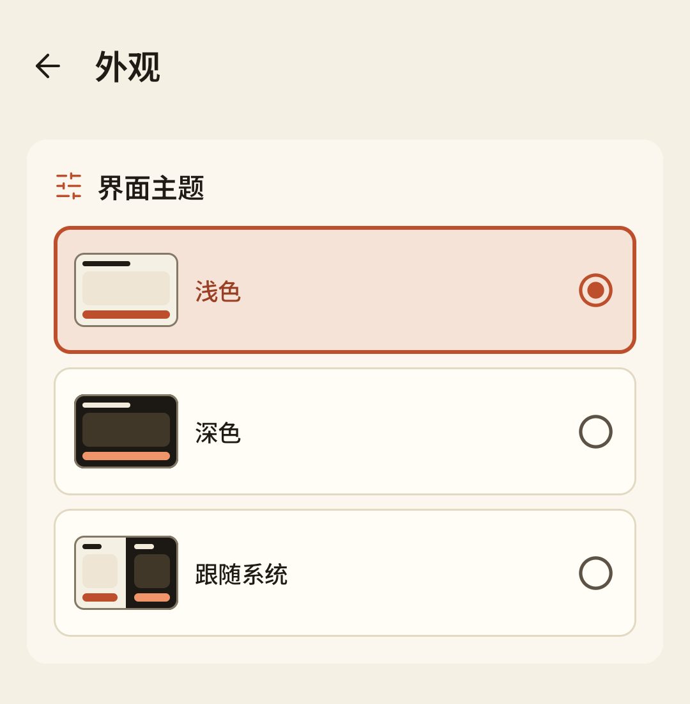
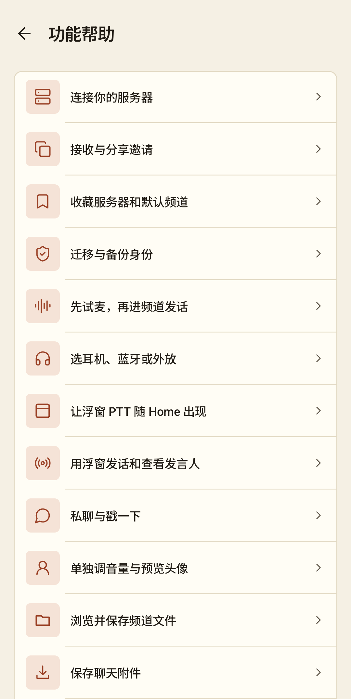
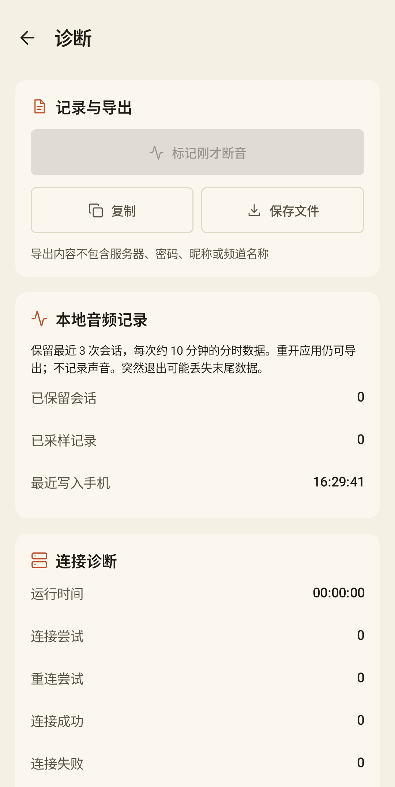

# 使用指南

[English](USER_GUIDE.md) · [1.3.0 更新说明](release/1.3.0/RELEASE_NOTES_ZH.md) · [安装与升级](INSTALLATION.md) · [常见问题](TROUBLESHOOTING_ZH.md)

本指南对应 **TS3 Mobile 1.3.0（versionCode 17）**。如需浏览完整界面总览，可参见[界面导览](../README_ZH.md#认识界面)与[文档截图索引](images/README.md)；发布验收进展见[发布资料索引](release/README.md)。

## 目录

[连接服务器与邀请](#连接服务器与邀请) · [频道与成员](#频道与成员) · [麦克风与收听](#麦克风与收听) · [浮窗 PTT](#浮窗-ptt) · [聊天、私聊与戳一下](#聊天私聊与戳一下) · [文件与服务端图片](#文件与服务端图片) · [收藏服务器](#收藏服务器) · [暂离、后台与切网保护](#暂离后台与切网保护) · [外观与功能帮助](#外观与功能帮助) · [检查更新与身份备份](#检查更新与身份备份) · [离线音频诊断](#离线音频诊断) · [隐私与反馈](#隐私与反馈)

---

## 连接服务器与邀请

### 填写连接表单

填写服务器地址、语音端口、昵称（3–30 个字符）和服务器密码（如需要）后点击 **连接**。常规语音端口为 `9987`，若管理员自定义了端口请按实际配置填写；ServerQuery 端口不能用于语音连接。首次使用会自动创建本机 TeamSpeak 身份，无需注册项目账号。

- 表单会独立加密记住地址、端口、昵称和服务器密码（包括尚未提交的修改），下次打开时自动预填，但不会自动连接。
- **最近连接**仅记录曾经成功连接过的地址与端口（最多 10 条）。删除某条最近记录不会清空表单或收藏。
- 应用同时仅维护一个活动服务器会话；切换到其他服务器前，请先主动断开当前连接。

### 打开、粘贴与分享邀请

直接打开 TeamSpeak 邀请链接，或在连接页点 **粘贴邀请**。应用会先展示目标服务器与频道供核对，不会自动断开当前会话，也不会自动发起连接；密码需自行填写。已连接时可通过 **更多选项 → 分享邀请** 分享当前服务器或频道，链接不包含密码或身份信息。

---

## 频道与成员

- **浏览与加入**：在 **频道** 页单击频道行可展开或收起直接成员；**双击频道行**或点击该行右侧可见的 **加入** 按钮（支持无障碍操作）即可请求加入。带锁频道会弹出频道密码框；若连接或目标频道发生变更，旧目标自动失效。
- **搜索**：点击音频栏的放大镜图标或 **更多选项 → 查找频道与用户**，在当前已加载的频道名、主题和昵称快照中本地搜索。选择加入某位用户所在频道时，会按当前会话重新核对对方位置。
- **范围边界**：当前频道有清晰状态标识；应用不提供频道详情页、权限管理或服务器管理。

---

## 麦克风与收听

### 麦克风模式

| 模式 | 采集与发送方式 |
| --- | --- |
| 关闭 | 停止采集并丢弃缓存音频；收听不受影响 |
| 按住 | 按住说话按钮时采集并发送，松开立即停止 |
| 常开 | 持续采集并发送 |
| 音量门控 | 持续采集（含安静时）；达到阈值才发送，带短暂起声（120 ms）和收尾（300 ms）缓存 |

使用采集模式需要录音权限。**门控安静时的“监听”不是麦克风关闭**；要完全停止采集请选择 **关闭**。

### 麦克风调音与本机试麦

点语音栏左侧的麦克风图标可用竖向滑杆快捷调节输入音量；打开 **更多选项 → 设置 → 麦克风设置** 可完整调整 **输入音量（0–200%）**、**RNNoise 降噪**、**设备回声消除（AEC）** 和 **门控阈值**。

- 这四项调音参数在保存完成后可跨重启与断开恢复；加载、保存或恢复默认都不会开启麦克风，新服务始终从 **按住** 模式启动。
- 设置页会清晰区分载入、未保存、保存中、已保存和失败状态；松开滑杆或退出页面时会请求保存，失败可重试，或点击 **恢复调音默认值**（不会影响身份、收藏或连接表单）。
- **本机试麦**：在连接前后均可点击 **本机试麦** 检查输入设备、电平和门控触发（已连接时请先把麦克风模式设为 **关闭**）。试麦最长 30 秒，**不编码、不发送、不保存录音**。
- **实时电平与按住说话**：当麦克风已在采集时，调音页会显示降噪／增益后、限幅前的实时门控 RMS（每秒最多刷新 10 次，不落盘）。页面内的 **按住说话** 复用正常 PTT，**会向当前频道发送语音**；常开／门控下可直接点 **停止麦克风**。

### 音频播放档位、路由与蓝牙保护

- **语音播放档位**：进入 **更多选项 → 设置 → 语音播放**，可在 **稳定优先（默认）** 与 **平衡** 之间即时切换（不会覆盖之前已保存的选择）。稳定优先用少量额外缓冲换取对晚到语音包的更高容忍度；切换后立即重置收听，可能短暂停顿，但不断开服务器也不改变麦克风设置。
- **实际使用的音频设备**：**语音播放** 与 **输入与输出设备** 页面均提供只读面板，分别显示 **所选输出**、**已确认实际输出**（可区分蓝牙媒体 A2DP、蓝牙通话 SCO 与蓝牙 LE Audio）、**实际录音输入** 和 **系统麦克风静音**；未知状态不靠偏好推测，未采集也不误显示为已静音。
- **媒体混播与蓝牙防护**：默认模式下，收听语音与视频、音乐和游戏混播，使用系统媒体音量，不抢占音频焦点，也不把系统切进通话模式。会话开始或连接蓝牙耳机时优先选用蓝牙媒体输出，自动麦克风优先使用手机麦克风。蓝牙首播保护会在耳机从待机唤醒时给予起播时间；所选设备断开或蓝牙路由意外回退（包括系统无回调回退）时会自动触发收听安全静音以防外放，重连后请确认输出路由并手动取消静音。
- **输入与输出设备**：在 **更多选项 → 设置 → 输入与输出设备** 中可分别选择物理麦克风与播放设备，并核对下方实际使用的音频设备。系统已知的内置麦克风会标注位置（手机底部／顶部／正面／背部），同名输入会自动编号，不显示原始设备地址。自动麦克风在蓝牙媒体播放时优先使用手机麦克风；若手机和耳机支持，也可分别选择 **LE Audio 耳机麦克风** 与 **蓝牙 LE Audio** 输出而不切入通话模式。设备 ID 仅在当前会话生效、不持久化保存；所选麦克风断开时自动切回自动选择，蓝牙输出断开仍触发防外放静音。
- **蓝牙通话（使用耳机麦克风）**：当系统暴露传统蓝牙通话设备时，可在 **播放设备** 中手动选择 **蓝牙通话（使用耳机麦克风）**，让耳机同时负责通话播放和收音（应用绝不自动选择该项，也不会在下次连接自动启用）。选择后等待 SCO 播放确认且不回退使用手机麦；传统蓝牙通话模式可能导致音质下降。选回普通蓝牙播放即可恢复媒体模式与先前麦克风选择；断开服务器或输出失败会自动退出蓝牙通话。
- **个人音量与静音**：在 **用户** 页可对单个成员单独静音或调节 0–200% 播放音量（100% 以下按听感近似调节，50% 约等于一半响度）。对单人静音会保留其他成员的有效未混音音频和解码器（共用输出仍需重建，可能存在短暂间隙）。总收听静音与关闭麦克风互不替代；外放有回声时优先使用耳机。

---

## 浮窗 PTT

已加入频道后，打开 **更多选项 → 设置 → 浮窗 PTT**，授予 Android **在其他应用上层显示** 权限，即可在其他应用上方控制发言与查看当前发言人：

1. **打开与召回**：在设置页手动开启，或通过连接通知栏的 **开启浮窗** 召回；也可开启 **退到后台时自动显示浮窗**（默认关闭）。开启自动显示后，在已加入频道且麦克风空闲时，回桌面或从主界面按返回（Android 12+）会自动弹出浮窗。**显示或召回浮窗本身绝不会开麦**，也不会改变已在运行的采集模式。
2. **浮窗样式**：在 **浮窗样式** 预览卡片中选择 **标准浮窗**（默认，收起时显示当前发言者昵称）或 **极简浮窗**（收起后仅保留两个图标）。
3. **移动、发言人提示与模式切换**：左侧图标收到频道语音时会高亮；拖动左侧可移动浮窗，轻点可展开。两种样式展开后均用固定高度的单行显示实时发言者（最多 3 个昵称，更多显示 `+N`，无人发言时保持高度稳定、按钮不跳动），并可直接切换麦克风模式。发言提示基于本机收到的频道语音，不含私语，停止收到约 1 秒后清除。
4. **发言与安全停止**：仅 **按住** 模式下按住右侧目标才开麦发话、松手停止；关闭、常开和门控模式下，右侧仅用颜色与图标实时展示麦克风状态（区分静默门控监听与实际发话）。锁屏、离开频道或返回应用会自动停止浮窗采集；本机试麦占用输入时，浮窗不会同时采集。

> 仅本机录音的测试实验室保留在 Debug 构建中，不包含在标准正式包内。

---

## 聊天、私聊与戳一下

### 频道聊天与私聊

- **发送与切换**：在 **聊天** 页向当前频道发消息；在 **用户** 页打开成员菜单 → **发送私信** 开启私聊；点击聊天顶部的会话名称／下箭头切换会话。关闭私聊会清除该会话的内存消息与草稿。
- **BBCode 与外链确认**：聊天支持基础 TeamSpeak BBCode（粗体、斜体、代码与显式 HTTP(S) 链接），不自动加载外链预览。点击链接前会先弹出目标地址供核对；长按 **复制消息** 保留含标记的原文。
- **阅读位置与发送状态**：切到 **频道** 或 **用户** 页再返回会保留阅读位置与滚动意愿，读旧消息时不会被新消息强行拉到底部（可点新消息按钮跳回最新）。发送状态区分发送中、服务器接受、拒绝与结果未知——**服务器接受不代表对方已读**，结果未知时绝不自动重发。单条上限 1,024 UTF-8 字节；实时会话最多 20 个，共享 500 条 / 2 MiB 内存预算。
- **后台私信通知**：应用在后台收到新普通私信时，使用独立 **私信提醒** 通知频道，2 秒汇总后推送通用提醒（不含发送者和正文），后续更新静默刷新。点击单个会话直达对应私聊，多个会话打开列表，点击通知本身不标记已读。可在 **更多选项 → 设置 → 私信通知设置** 进入系统通知管理。

### 本地聊天历史（默认关闭）

进入 **更多选项 → 设置 → 本地聊天历史** 可按需开启加密本地存档：

- 开启后仅保存符合条件的新文本（含后台连接期间收到的消息），使用独立 Android Keystore 密钥加密，排除云备份与换机迁移。
- 断开连接后仍可点 **浏览已保存消息** 查看当前身份的记录；系统在加载或写入时自动清理超过 7 天或超出总计 500 条 / 512 KiB 编码上限的较早记录。
- 支持删除单个会话、清空全部，或确认关闭并删除全部记录（不影响实时会话或服务器副本）。**不会**补存开启前的旧消息，不保存草稿、戳一下、未确认发送、密码或附件文件内容，也不云同步。

### 戳一下提醒对方

点击频道成员右侧的手势图标，或在用户操作菜单选 **戳一下**。核对接收者并可填写最多 100 UTF-8 字节的留言，确认后发送（打开弹窗不会发送，发送后保留原页签并给出简短反馈）。

前台收到戳一下显示应用内弹窗；后台或锁屏时通过独立 **戳一下提醒** 通知频道推送通用提醒（不含发送者与留言）。返回应用可查看保留的待处理提醒。

---

## 文件与服务端图片

### 浏览与下载频道文件／聊天附件

1. 加入频道后打开 **更多选项 → 频道文件**，浏览并选择需要下载的文件；聊天中支持的同服附件可直接点 **下载附件**（仅允许从当前已连接服务器取件）。
2. 等待下载与字节长度校验完成后，点 **保存已验证文件…**，通过 Android 系统文件选择器指定保存位置。界面旋转或重建后仍可继续完成保存；若应用提示目标文件可能不完整，请检查该文件并改存到其他位置。
3. 单个文件上限 **20 MiB**，能否浏览与下载取决于服务器权限。不支持上传、改名、删除、自动下载或跨服取件；若切换频道或会话变更，请重新打开文件列表。

### 预览头像与频道图标

在 **用户** 列表左侧点击已有头像可放大预览；界面上显示的自定义频道图标也可点按预览。频道成员行继续保留语音状态图标。图片来自当前已连接服务器，仅在当前会话内存中缓存。

---

## 收藏服务器

从连接页 **选择收藏服务器** 或 **更多选项 → 服务器收藏** 打开列表（最多保存 50 项，独立加密存储）。每张卡片的主操作为 **立即连接**（不会打断或替换当前活动会话）；右上角 **…** 提供 **填入表单**（仅替换参数，不连接）、**编辑** 与 **删除**（需确认）。

- **新增与保存当前连接**：底部 **新增收藏** 会预填当前表单的地址、端口与昵称，但**不自动复制表单密码**；已连接时 **保存当前连接** 会取当前活动会话的端点、昵称和所在频道（即使表单已被改过也不会取错）。
- **凭据隔离**：编辑收藏时，修改服务器地址或端口会自动清除草稿中的旧默认频道以及服务器／频道两种密码；仅修改或清除默认频道（包括手填数字 ID）则仅清除频道密码、保留服务器密码。改回原目标不会恢复已清除的密码，取消整个编辑会保留原收藏。关闭 **保存密码** 仅删除该收藏的密码，不影响独立连接表单。
- **在线选择与离线保存频道列表**：当收藏与当前已连接服务器匹配时，可在 **更多设置** 中按名称／父级路径 **选择默认频道** 或 **使用当前频道**，也可点 **保存频道列表供离线使用**（按地址与端口独立加密保存，最多 6 个端点，每个最多 100 个频道 ID 与路径，不含密码与消息）。未连接时可用 **浏览已保存频道** 离线选择或清除列表。

---

## 暂离、后台与切网保护

- **暂离状态**：点咖啡杯＋小钟打开暂离设置，服务器确认后图标暖色强调。暂离不停止麦克风或收听，离开座位前请另行关闭采集。
- **后台会话与后台语音运行检查**：按 Home、切换应用和锁屏均保留后台会话。进入 **更多选项 → 设置 → 后台语音运行检查** 可查看电池优化状态、跳转系统电池设置，或按需启用 **CPU 保持唤醒**（无法绕过全部系统或厂商省电策略）。后台重连优先恢复收听，已停止的麦克风采集需回到前台恢复。
- **Wi-Fi ↔ 移动数据切网保活**：遇到短暂默认网络中断（最长 2 秒，系统明确阻断除外）时，应用会先保留原服务器会话、频道快照和音频，待新网络就绪后向原会话发送探测；若原会话应答则直接沿用，无需重连（语音可能短暂停顿）。若无法维持原会话则进入断线恢复；当已确认切网后的自动重连遇到服务器同身份拒绝（`521`）时，应用会等待 60 秒后自动再试一次，避免快速连续失败。
- **规范断开**：离开服务器请使用应用内或连接通知栏的 **断开连接**，不要依靠划掉最近任务（部分厂商会直接杀进程导致旧会话残留在服务器）。若收到同一身份连接限制拒绝，按提示等待至少 60 秒后再手动重连。

---

## 外观与功能帮助

### 外观主题

进入 **更多选项 → 设置 → 外观**，可选择 **浅色（默认）**、**深色** 或 **跟随系统**，通过预览卡片即时生效并保存在独立本机偏好文件中（排除云备份）。仅 **跟随系统** 响应系统深浅切换；切换外观不会开启麦克风。若保存或读取报错可重试或显式重置外观，不可读文件会被保留而非静默清除。

### 按需功能帮助

进入 **更多选项 → 设置 → 帮助与关于 → 功能帮助**，可随时离线查阅连接设置、邀请、收藏、身份备份、本机试麦、音频路由、浮窗 PTT、聊天、文件下载、本地聊天历史与排障指引。

- 当某个主题支持界面引导时，应用会直接高亮对应控件，点击高亮控件即可跳转；点 **关闭提示** 仅关闭当前提示。
- 功能帮助**绝不在启动时自动弹出**，也绝不代用户连接服务器、申请权限、发送语音或下载文件。

---

## 检查更新与身份备份

### 检查更新

进入 **更多选项 → 设置 → 检查更新**，默认检查正式版，也可开启 **包含测试版** 并记住选择。更新说明按 Markdown 渲染，展开后收起按钮保持可见并可返回原位置；点击下载后交由浏览器处理，安装前请先正常断开服务器。无后台轮询或自动安装。界面示意参见[安装指南 — 后续检查更新](INSTALLATION.md#后续检查更新)。

### 身份备份与恢复

进入 **更多选项 → 设置 → 身份与备份**，可直接选择 **创建加密备份** 或 **从备份恢复**（仅本机留有可用副本时显示 **恢复上一个身份**）。备份采用自有 `.ts3mbak` 口令加密格式，保存后经回读校验，口令需单独保管且无法找回；备份不包含收藏或连接表单。完整步骤与异常处理见 [README — 身份备份与恢复](../README_ZH.md#身份备份与恢复)与[安装与升级](INSTALLATION.md)。

> 标准正式包默认关闭桌面 TS3 `.ini` 导入；仅 Debug 或显式开启的 QA 包提供独立的 **导入电脑版身份** 预览入口。`.ini` 文件含私钥，切勿分享。

---

## 离线音频诊断

遇到弱网断音或蓝牙异常时，在 **更多选项 → 设置 → 诊断** 中可脱离电脑采集脱敏证据：

1. 在复现问题的网络或蓝牙环境下正常收听，无需连接 USB。
2. 听到卡顿时，尽快点击 **标记刚才断音**（来不及操作也可记下时间）。
3. 测试结束后正常断开连接，点 **复制** 或 **保存文件** 导出 JSON 报告发给维护者。
4. 即使应用曾意外退出，重新打开后仍可直接导出已落盘的记录，无需重新连接服务器。

系统自动保留最近 3 次音频会话，每次最多 120 条采样（通常约 10 分钟）及 64 条事件，记录过期／迟到、补帧、缓冲、输出、脱敏协议计时桶、粗路由与网络类型，**不含声音内容或私人连接资料**。

---

## 隐私与反馈

**给项目点个 Star** 会通过系统浏览器或 GitHub 应用打开公开仓库，不会自动 Star 或发送任何会话数据。诊断报告仅在你主动复制、保存或分享后离开应用；分享前请检查截图、剪贴板和日志。更多信息见[隐私说明](../PRIVACY_ZH.md)、[获取支持](../SUPPORT.md)与[兼容性与验证范围](COMPATIBILITY.md)。
