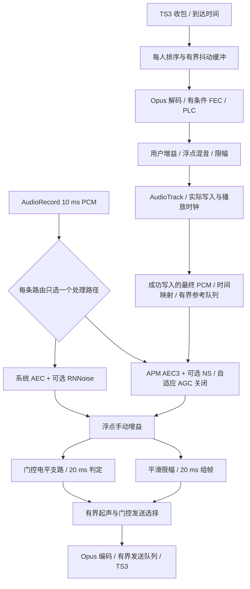

# 音频质量升级设计与执行方案

日期：2026-10-24。状态：**A0–A4b 分阶段实现及审查修复已有离线门禁记录；A3 实际采集接线及 A5 真机验收待完成**。
决策摘要见 [ADR-0018](../decisions/0018-staged-audio-quality-upgrade.md)，
当前实现、离线证据及未完成项见 [A0/A1 执行记录](../testing/AUDIO_A0_A1_2026-10-24.md)。
审查修复设计与逐项验收见 [音频审查修复方案](AUDIO_REVIEW_FIXES_2026-10-24_ZH.md)。

本方案承接当前工作区的麦克风音量、RNNoise、设备 AEC、音量门控和接收混音实现。推荐保留 TS3 协议和 Opus，按“播放连续性 → 增益与限幅 → APM 对照实验 → 编解码与抖动适应”推进。AudioRecord/AudioTrack 继续作为首选 I/O；WebRTC Audio Processing Module（APM）是待验证的处理引擎候选。

原始设计已获准开始分阶段实施。当前开发仅使用合成信号、fake 时钟和离线模拟网络；
真实服务器、实体麦克风录制、真人语音及外部消息发送不属于本轮验证。已有功能范围不因此扩展。

## 1. 实施前链路与证据

下表冻结实施前基线，不描述 A1 修复后的播放行为；后续阶段未实现的限制仍然存在。

| 环节 | 已核对的实现 | 影响与证据边界 |
| --- | --- | --- |
| 采集 | `VOICE_COMMUNICATION`，48 kHz 单声道 PCM16，480 样本/10 ms | 应用采样率不能证明蓝牙麦克风具有 24 kHz 有效带宽 |
| 前处理 | 请求系统 AEC；尽力禁用可控系统 NS/AGC；可选 RNNoise v0.2 | OEM 仍可能处理音频；“启用成功”不代表已验证消回声效果 |
| 发声控制 | 20 ms 手动增益、PCM16 硬饱和、RMS gate、Opus；起声缓存 120 ms，编码队列上限 180 ms | 200% 约为 +6 dB；放大不能恢复源信噪比，过载时会削波 |
| 编码 | libopus 1.3.1，48 kHz/mono/20 ms/64 kbps，VOIP、受限 VBR、complexity 10、fullband 上限 | 编码配置已有合理基础，fullband 上限也不保证每包实际采用全带宽；单纯加码率不是优先项 |
| 输入排队 | `INPUT_QUEUE_CAPACITY = 256`，由所有说话者共享；满时丢最旧包并标记对应流断层 | 单人、每包 20 ms 时可累计 5.12 s 媒体；多人并发、可变包时长下不能直接换算为播放延迟。当前缺少按驻留年龄淘汰，见 §7.2 |
| 接收 | 每人独立解码；固定起播等待 60 ms、PCM 目标 60 ms/容量 120 ms，最多连续隐藏 3 包 | 空 pending 不做 PLC；没有自适应时延、FEC 或时钟漂移校正；长包填充接近满的 FIFO 时存在部分样本被截弃的风险 |
| 混音 | 每人 0–200% 增益；N 为当拍 `gain > 0 && samples.isNotEmpty()` 的输入路数，多路按 `1/sqrt(N)` 归一，再硬限幅 | 全零但非空的路也计入 N；短块的有效样本结束后补零，归一系数整拍不变。路数切换和边界波形需用例/试听评估 |
| 输出 | AudioTrack 每 10 ms 写入，申请低延迟；没有混音数据时立即 pause/flush | 静态代码显示可能丢掉已写入但未播放的尾音，并把短时缺包当结束；尚未测定用户实际听感影响 |

依据：[当前架构](../../ARCHITECTURE.md)、[麦克风实现决策](../decisions/0016-microphone-processing-and-volume-gate.md)、[离线验证](../testing/MICROPHONE_2026-10-23.md)、[本轮代码审查](../testing/REVIEW_2026-10-24.md)。代码入口为 `OpusMicrophoneCapture`、`MicrophoneCapturePipeline`、`MicrophoneFrameProcessor`、`OpusAudioPlayer`、`TalkerJitterPipeline`、`ParticipantGainMixer` 和 `opus_jni.cpp`。

[2026-10-13 真机诊断](../testing/AUDIO_QUALITY_DIAGNOSIS_2026-10-13.md)在小米 14 内置麦克风上测到通信音源比 MIC 低约 10.6–11 dB，差异发生在 RNNoise 之前；有限样本未证明 RNNoise 严重压制干净语音。该轮测得 RNNoise 约 20 ms 算法延迟、RNNoise + Opus 约 26.42 ms，RNNoise P95 约 221 μs/10 ms、Opus P95 约 467–475 μs/20 ms。这些是历史样本结果，不能代替新版本基线，也不是端到端时延。该轮没有建立 AirPods 音频路由，不能把“发闷”归因于某一个算法。

### 1.1 A0/A1 提前建立采集音源基线

音源对照不依赖 APM，应在 A0 设计、A1 前后具备受控验证条件。对照 `VOICE_COMMUNICATION`、`VOICE_RECOGNITION`、受支持的 `UNPROCESSED`，并保留 MIC 作为历史复现参照。已有的约 11 dB 证据仅比较了通信音源与 MIC，包含系统前处理差异，尚未证明另两种音源更好。

- **A0 离线部分**：有原始成对录音时复析历史样本，否则仅引用现有报告并标记原始数据缺失；用合成/授权素材验证电平、频谱、削波、时延对齐与不同输入电平的统计方法。现有 probe 只提供 MIC/通信音源对照，扩充 recognition/unprocessed 及不支持状态属于后续测试代码工作，不改变生产默认音源。
- **A0/A1 可提前安排的真机部分**：在后续授权的本地采集中，固定设备、实际路由、外部播放素材、声压/距离和应用增益，交替音源顺序并重复测量。记录每次实际 AEC/NS/AGC 状态，在 RNNoise 和手动增益前取测量点；无法控制的 OEM 效果标为混杂因素，不能全部归因于音源常量。`UNPROCESSED` 不支持或被回退时标为不可用，不当作成功对照。
- 同时报告原始电平/SNR/频谱/削波和响度匹配后的可懂度；匹配响度只用于听感比较，不掩盖原始电平差异。新硬件采集不能由模拟器、合成 PCM 或离线重放代替。本轮不启动任何新采集，也不自动读取私有录音。

A2 可先完成现有音源下的透明增益、限幅正确性与输入电平敏感性验证；缺少新音源数据时，参数保留实验状态，不宣称已完成输入校准。音源默认值仍须结合 AEC、全双工路由和功耗验收决定，不能只选 RMS 最大的一项；A1 播放修复无需等待这些硬件测量。

## 2. 目标、选择与暂缓项

目标依次是：保住起声和尾音；降低断续、爆音和削波；在保留中文辅音、轻声与双讲的条件下降噪和消回声；让收听时延有界且可测。任何声学改进都必须同时检查 CPU、功耗和路由兼容性。

| 组件 | 本方案选择 | 进入默认路径的条件 |
| --- | --- | --- |
| TS3 + Opus | 保留协议、包格式、语音模式和现有互通边界 | 旧编码/新解码、新编码/旧解码的离线 fixture 均通过；线上互通另行验收 |
| AudioRecord / AudioTrack | 保留，先修正调度、写入与排空 | 路由、焦点、停止和后台规则回归通过 |
| 系统 AEC + RNNoise | 继续作默认基线和可回退路径 | 效果状态如实报告，保留用户开关 |
| WebRTC APM | 独立处理模块原型；优先验证 AEC3 + NS | 参考流和时延可靠、可控平台效果已关闭，声学/性能对照过关；按路由启用 |
| 新版 libopus | 以官方 1.6.1 为首个升级候选，固定版本验证 | 可复现构建、既有 ABI、许可证和 codec 回归通过；初次升级关闭新增神经功能 |
| AGC2 | 候选能力，首轮 APM 关闭自适应增益 | 门控旁路取样位置可实现、噪声不被持续放大、保留手动模式，再单独决定 |
| Oboe / AAudio | 暂缓替换 I/O | 修复当前链路后，仍有可复现的 I/O 时延或 underrun 瓶颈，原型有实测收益 |
| DeepFilterNet、神经 PLC、DRED、带宽扩展 | 后续实验备选，不作为本方案首批交付 | 分别证明手机耗电/中文清晰度、包兼容性、模型与时延预算；不因版本升级自动启用 |

不引入完整 WebRTC 通话栈、RTP/ICE/SDP、服务端改造或云端语音处理。NetEQ 依赖的时序和接口不能直接套进现有 TS3 包。语音转文字、录音、音乐立体声升级和连接质量面板均不在范围内；内部测试计数不扩展产品功能范围。

## 3. 目标结构与模块边界

- `audio-opus` 拥有 DSP、帧组装、输出时钟、参考流和原生资源。复用现有生命周期标识，明确区分会话、采集、输出设备代次与设置修订；旧代次数据不得进入新处理器。
- `app` 继续拥有权限、前台服务、路由选择和 UI 状态，仅传设置、接收有界状态；不在 Service/Compose 中运行 DSP 或缓存 PCM。
- `ts3-protocol` 保持纯 JVM。首批不改 `VoiceFrame`、`EncodedVoiceSource` 或 TS3 线格式；维持 `OpusAudioPlayer.submit()` 已有的 `System.nanoTime()` 到达时间记录。它是音频提交边界的单调时间，不是 UDP 内核收包时间；后续仅注入可测试时钟并补齐输出代次校验，不重复新增计时边界。若确需传递结束标记，必须先核对固定 ts3j 源码和 fixture，再提出兼容扩展。
- 不创建全局音频单例。每条活动音频链路拥有资源和队列，退出时失效并释放。暂时无音频与明确停止是不同事件。

### 3.1 最小内部接口

| 组件（拟新增或提取） | 唯一职责 | 测试替身 |
| --- | --- | --- |
| `PlaybackOutput` / Android 实现 | 创建、开始、部分写入、播放位置、立即丢弃、释放；写入返回实际样本数 | 可控制部分写入、回绕、停滞和错误的 fake sink |
| `PlaybackTimeline` | 用单调时钟和样本计数决定等待、恢复、排空和结束 | fake 时钟；不依赖 Android |
| `GainEnvelope` / `PcmLimiter` | 平滑增益与防过载，参数集中定义 | 确定性浮点 PCM |
| `CaptureProcessor` | 一个会话内的 10 ms 前处理、重置和关闭；分别适配当前路径/APM | identity/failure 处理器 |
| `RenderReferenceBuffer` / `AudioDelayEstimator` | 已写入 PCM、样本位置与时间的有界交接；输出时延可信度 | fake 输入/输出时间戳 |
| `JitterDelayPolicy` | 在已知包时长与到达时间下给出有界目标 | 种子固定的网络轨迹 |

仅在对应阶段添加接口，不先搭建通用插件框架。JNI 使用实例句柄并校验已关闭状态；频繁路径复用缓冲，不新增每 10 ms 的无界分配、磁盘 IO 或日志。

## 4. 接收播放：先修连续性与尾音

### 4.1 状态与结束判定

| 状态 | 行为与转移 |
| --- | --- |
| `IDLE` | 无输出、无焦点；有新包进入 `BUFFERING` |
| `BUFFERING` | 满足起播等待后申请焦点；获准进入 `PLAYING`，拒绝时按现有策略清理 |
| `PLAYING` | 按 10 ms 节拍写入；一时无 PCM 进入 `RECOVERING`，不立即 flush |
| `RECOVERING` | 保留解码和输出状态；按缺失帧的播放截止时间做有限 PLC，必要时短暂补零；可用数据到达即恢复；超过恢复窗口则 `DRAINING` |
| `DRAINING` | 停止追加补零，等待已提交样本实际播放；新有效语音可恢复，完成或超时后释放焦点并回到 `IDLE` |
| 强制停止 | 静音、失去焦点、断连、设备重建立即失效旧数据并 pause/flush；不等待排空，再按相应生命周期进入空闲或关闭 |

初始实验参数：恢复窗口 60 ms；连续 PLC 同时受“最多 3 个缺包”和“最多 60 ms”限制，避免大包把隐藏时间放大。已用 PLC 与补零共用恢复预算，不叠加多轮等待。无后续包时，PLC 不得凭循环次数无限生成；过期包不重放。

当前 `VoiceFrame` 没有明确的接收端 talkspurt 结束字段。队列暂空不能证明结束；先用上述有界窗口推断。零长度、DTX、结束标记的解释列入 A0 fixture 核查，不凭猜测映射为可解码音频或结束事件。结束一个说话者不应打断仍活跃的其他人。

### 4.2 排空、写入和时钟

1. 按 AudioTrack **实际接受**的帧数累计 `submittedFrames`；部分写入、返回零、错误都明确处理，不把整块视为已写入。连续零写入也须有 deadline，避免 worker 忙转。
2. 同一输出代次中，把 playback head 的无符号回绕展开；可用时结合 AudioTimestamp 估计已播放位置。flush、重新建轨和路由改变重建原点，不能让旧时间戳宣告新尾音已完成。
3. 自然结束在 `playedFrames >= submittedFrames` 后才 pause/flush 和放弃焦点。时间戳不可用时使用同代 playback head；若两者停滞，以未播放时长加余量计算 deadline，上限暂定 500 ms，并记录超时/可能截尾，不能宣称正常排空。
4. 强制停止先让后续写入失效，并打断阻塞写入。确认旧 worker 不再写入后才能启动新代次。实际声学静音还受设备硬件缓冲限制，离线测试只保证应用不再提交旧 PCM。
5. 输入队列和每人 FIFO 继续有界。先消除“满 FIFO 静默截掉一个解码块后半段”的行为：按完整块/明确样本范围处理，过载明确计数、重置或丢弃旧数据；不把丢弃伪装成成功写入。

采集 OFF/PTT 松开等原有明确停止语义不随播放排空改变；门控关闭时仅允许现有有界发送尾帧排完。

## 5. 增益、混音与音量门控

### 5.1 手动增益与限幅

手动音量仍为 0–200%，默认 100%，参与者音量范围和静音含义不变。中间运算用 float，最后一次转 PCM16；安全饱和只作最后保护，常规过载应由限幅器处理。非静音音量变化先用 20 ms 斜坡，避免跳变；明确静音绕过斜坡立即生效。

限幅原型比较低失真峰值限幅器，初始峰值目标 -1 dBFS、lookahead 不超过 5 ms、释放约 80 ms。系数按采样率计算，检查软辅音、爆破音、持续响声和多人叠加；这些数值是实验起点。缓存只计一次，明确纳入延迟预算。100% 干净低电平信号应近似透明；不能以整体压低音量冒充质量改善。

自然结束时先有限排出限幅器中尚未交付的有效尾样本，再进入设备排空；明确停止直接丢弃其内部缓存。采集端同样按样本索引处理限幅尾部和门控选择，不用无限补零延长 talkspurt。

混音先保持单人 100% 的标称增益。当前 N 是当拍通过 `gain > 0 && samples.isNotEmpty()` 筛选的输入路数，包含全零非空块，不是原始数组长度，也不是按能量判定的实际发声人数。评估按活跃信号能量平滑调节 headroom，取代路数变化时瞬时切换 `1/sqrt(N)`；新加入的全零路不改变其他人音量，响声加入/离开不产生阶跃。若动态归一有明显抽吸，使用稳定 headroom + 总线限幅，保留独立用户增益。多路同相最坏情况必须有限、无 NaN、无整数溢出。

当一路不足 480 样本时，现有 `sampleIndex < input.samples.size` 使该路剩余位置贡献为零；这是固定 10 ms 输出 tick 的补齐行为，本身不证明丢音，但边界可能出现突变，该路仍参与整拍归一。A1 固定有效尾样本恰好输出一次、其余补零、下一拍不重放/错位的语义，覆盖 120/240/479/480 样本、跨块拼接及一短一长两路。A2 在相同用例中检查其他路音量、边界波形和归一切换；如需自然结束淡化，仅在有效尾样本内处理并明确窗口，不重复最后一个样本或增加一拍尾音。强制静音仍立即生效。

### 5.2 门控语义与自动音量

保留 -60 至 -15 dBFS 阈值、默认 -40、连续 2 帧 attack（20 ms 组帧下为 40 ms）、6 dB hysteresis、连续 15 帧 hold（300 ms）和 120 ms 起声缓存。检测点仍是**降噪后、用户增益后**。限幅前分出电平支路：用等价 PCM16 饱和值计算 RMS，保持旧阈值的静态解释；主信号保留浮点余量供限幅。20 ms 组帧、门控决定和限幅输出通过样本索引对齐，lookahead 不得丢掉起声或错配上一帧的判定。

即使 gate 关闭，正在采集的前处理/AEC 仍连续运行；只控制哪些帧进入编码发送。设置修订、OFF、失败和路由重建必须清空旧起声/组帧/限幅缓存，防止旧声音随后补发。音量 0 不得被任何自动增益重新放大。

首轮 APM 关闭 AGC2 的 adaptive digital，使用上述手动增益和独立限幅。APM 的普通 `ProcessStream` 输出不能直接假定能提供“同次处理、AGC 前”的独立 PCM。自动音量必须先证明能取得 AEC/NS 后、AGC 前的电平支路，或用独立增益阶段实现；不为取样重复跑两套 AEC。

后续自动音量实验只在检测到近端语音时缓慢抬升，静音/纯噪声不积累增益；与手动模式分开，保留原手动值，gate 始终读自动增益前的信号。AGC2 若无法在固定源码接口下满足这一顺序，就暂缓启用，不移动现有门控阈值的含义。限幅、可懂度和噪声上升测试必须独立于“平均响度提高”判定。

## 6. APM 原型：参考流比开关更重要

### 6.1 路由策略

| 路由 | 默认/回退路径 | 可比较的实验路径 |
| --- | --- | --- |
| 内置扬声器/听筒 | 当前通信音源 + 系统 AEC + 可选 RNNoise | 经验证的采集音源 + AEC3 + APM NS；禁用可控系统 AEC/NS/AGC |
| 有线/USB 耳麦 | 先保持现有策略，记录实际效果可用性 | 关闭不必要 AEC 的降噪路径与基线比较，不能只按设备类型断言无回声 |
| Bluetooth SCO/BLE、AirPods | 使用平台通信路由，保留已验证路径 | 先核实路由、输入带宽和效果；未知硬件预处理时不自动叠加 AEC3 |

一个软件降噪路径只能选 RNNoise 或 APM NS。一个可控回声路径只能选系统 AEC 或 AEC3；如系统拒绝禁用效果，不进入默认 AEC3 路径。`VOICE_RECOGNITION`/`UNPROCESSED` 的初始对照前移至 §1.1 的 A0/A1，A3 再验证与 APM 的组合；受设备支持及全双工路由约束，不全局改成 MIC，也不把关闭 API 效果等同于绕过所有 OEM 处理。

用户的“降噪/回声消除”开关继续表达意图；状态区分请求值、实际引擎、禁用/不可用/失败与降级原因。未经声学验证不能显示“回声已消除”。首批实验选择仅供开发验证；现有默认不切换，后续才决定是否提供用户可见的处理模式。

### 6.2 参考信号与线程

- 参考信号取所有远端声音经过每人音量、静音、混音、软件限幅后的**最终播放 PCM**。AudioTrack 部分写入时只确认已接受的样本；参考组帧器跨写入拼成 480 样本，不喂尚未提交、写入失败或已丢弃的数据。
- 参考块携带输出代次、样本起止位置、单调时间及估计呈现时间。系统音量变化作为标量变化/重适应事件处理；软件拿不到 DAC 后波形，不能声称参考与扬声器声压完全一致。
- 输出 worker 只向有界参考环写入。采集/DSP worker 顺序调用 `ProcessReverseStream` 与 `ProcessStream`，每次采集前消费有界数量参考块；不让 AEC 锁阻塞 AudioTrack，不在 UI 线程调用 APM。
- 单个采集 tick 最多处理 5 个参考块作为初始 CPU 预算；若仍追不上，报告参考断层并重置，不在一次 tick 排空整个 500 ms 历史。晚于有效对齐窗口的块不再用于当前 AEC。
- 参考环原型上限 50 个 10 ms 块（500 ms）；这是历史对齐容量，不是额外播放延迟。溢出、断层、flush 或路由变化使参考失效并重置 AEC，不能把旧块接到新声场。没有采集时不积累参考；明确没有播放时提供一致的静音/空闲状态，不循环旧声音。
- AEC 参考包括恢复阶段实际提交的 PLC/补零。强制 flush 后处理器必须知道这些已提交帧未继续播放，废弃旧时间映射并重置，避免把它们当新回声来源。

### 6.3 时延估计与失败策略

使用 AudioRecord/AudioTrack 时间戳和样本位置映射到同一单调时钟。对匹配的参考与采集样本，APM 延迟估计为：

`D = (预计参考样本被设备播放的时刻 - 送入 ReverseStream 的时刻) + (调用 ProcessStream 的时刻 - 采集样本到达 ADC 的时刻)`。

排队时长由实际未播放/未处理样本数计算，不能只拿配置 buffer 大小或一个固定常数；不得把同一段排队时间重复加入。处理器自身内部延迟也不能误算成设备传输延迟。用可控回声延迟的 fixture 交叉验证估计方向和误差，并遵守选定 APM revision 的 API 范围。

每次估计输出“有效/估算/不可用”，并做边界检查与变化平滑。无法获得可靠时间映射、参考持续溢出或 CPU 超时的路径不得升级为默认。短暂缺失先用有界估计；持续异常停用实验处理器，按路由策略恢复基线并报告一次状态。切换先清空旧代次再重建；若需要重启采集，必须通过现有前台/权限策略，后台不能借降级自动重启已停止的麦克风。基线也初始化失败时明确停止采集并报错，不静默退成未经说明的无处理外放。

APM 没有在本方案中被当作现成稳定 Android SDK。A3 首先选定一个可复现的上游 revision，构建其音频处理模块及必要依赖，记录 GN/工具链到本项目 JNI/CMake 的产物边界、补丁和许可证；不引入完整通话栈。若裁剪、ABI 或维护成本不可接受，可结束原型并保留当前路径。

## 7. Opus 升级、自适应缓冲与丢包恢复

### 7.1 先独立升级 codec

当前依赖为 Prefab `com.fpliu.ndk.pkg.prefab.android.21:opus:1.3.1`。候选 1.6.1 必须有可复现的来源：固定上游版本/提交、下载校验和、补丁、构建参数及所有现有 ABI；优先项目可维护的源码构建或自建 Prefab，不能假定原 Maven 坐标存在新版本。保留 minSdk 26，核查 NDK/CMake、符号、共享 C++ runtime、16 KB 页兼容、Debug/Release/R8 打包和第三方声明。

版本存在性已于 2026-10-24 复核：[官方 1.6.1 发布记录](https://opus-codec.org/release/stable/2026/01/14/libopus-1_6_1.html)的发布日期为 2026-01-14，并给出源码包和 SHA-256。该事实不代表上述第三方 Prefab 坐标提供 1.6.1；A4a 仍须核实实际构建来源和校验和。

先保留 48 kHz/mono/20 ms/64 kbps 及既有编码参数，以隔离版本收益和风险。码率、complexity、FEC 等作为之后独立实验变量。新版并不自动启用神经增强；神经 PLC 是解码侧候选，DRED 还需要发送支持与额外冗余，带宽扩展生成的高频也不等于恢复麦克风丢失的细节。

当前接收端让 `OPUS_VOICE` 与 `OPUS_MUSIC` 共用 libopus decoder，输出固定为 48 kHz 单声道。Opus 从包内信息识别编码模式，并支持将立体声码流下混为单声道；没有独立 music 分支不能据此认定误解码。现有能力是音乐包单声道接收，不保留立体声空间信息。A0 补充两种 codec、单/双声道及模式切换 fixture，验证左右声道贡献、样本数量和异常包处理；A4a 在升级前后运行相同 fixture。仅对实际损坏或不支持的载荷显式丢弃/计数，不把全部 `OPUS_MUSIC` 改为拒收。

### 7.2 自适应目标与容量

保留 16 位序号展开、去重、旧包拒绝和大跳变重置。使用单调到达时间及 `opus_packet_get_nb_samples` 等实际包时长信息，首批目标从 60 ms 起，在 **40–120 ms** 区间调整。缺失包时长只能估计；有丢包、DTX、变帧长或新 talkspurt 的不确定区间不用于更新抖动统计，不能用“序号差 × 20 ms”当真实发送时间。

初始估计策略：对连续已知包计算到达间隔与媒体间隔的偏差，维护有界窗口的高分位值；连续晚到时以 10 ms 步长提高目标，稳定窗口后每次最多下降 10 ms。A4 fixture 决定窗口与系数，再集中写入一处配置。目标变化优先在下一个 talkspurt 生效；长谈话只有达到明确的欠载/积压边界才执行有界重缓冲或带短淡化的整块丢弃，单独计数。首批不自制高风险时间伸缩算法，也不在正常语音中随意复制/删除样本。

容量按**媒体时长、包数和字节数**共同限制。每人未播放媒体初始上限 240 ms，容纳最长 120 ms 合法 Opus 包与目标缓冲，避免部分截包；可解析时长的全局输入排队、pending 和 decoded 共用预算，不让数据转移队列后重新获得一份容量。40–120 ms 是接收调度目标，240 ms 是安全容量，都不等于端到端时延承诺。

全局输入队列的 `INPUT_QUEUE_CAPACITY = 256` 只保留为内存安全的包数护栏，不能沿用为时延预算。单人 20 ms 包下的 5.12 s 媒体累计是容量风险，不代表当前正常播放必然延迟 5.12 s。A4b 明确增加以下规则，参数作为初始实验值与 A0 压力基线对照：

1. 全局队列允许交付的驻留年龄上限为 **60 ms**，依据同代次的 `now - arrivalNanos` 判断；入队时清理过龄旧包、出队转入每人缓冲前再次检查，不等到满 256 包才淘汰。worker 暂停超过该时间后，恢复时先丢弃超龄包，不能先解码播放旧积压。
2. 在总容量或年龄超限时优先淘汰旧内容，合并标记受影响说话者的断层；恢复从该流仍新鲜的包开始，不让 PLC 补回已经主动丢弃的长段积压。一个人的过载不重置所有人的解码器；队列转移保留最初的时间戳与媒体预算。
3. 可解析包同时受包时长预算约束；损坏/未知时长的包不能绕过年龄、包数和字节限制，校验失败明确丢弃。驻留年龄只度量应用提交后的排队，不冒充发送端采集年龄或网络时延。即使队列与抖动缓冲各自达标，也要检查从首次提交到输出提交的合计等待，避免叠加隐藏延迟。
4. A0 建立单人/8 人、短包/120 ms 长包和 worker 停顿 100/500/5,000 ms 的轨迹；A4b 证明恢复后超龄全局输入先被丢弃、不进入每人 pipeline，没有数秒旧声音补播，断层重置仅影响对应流且无饥饿。60 ms 限制针对全局队列驻留，之后合理的每人抖动等待另计；记录两阶段年龄与合计等待。是否进一步调低 256 由这些结果决定，不用调高年龄上限掩盖欠载。

### 7.3 FEC / PLC 条件

内部 `OpusPacketDecoder` 扩展普通解码、PLC、从下一包恢复前一包及包时长查询；现有公开协议口不变。仅在缺失时长可确定、下一包按播放 deadline 已到达且模式支持时尝试 in-band FEC：先用下一包恢复前一缺包，再普通解码下一包一次。超过等待预算就 PLC，不为 FEC 无限延迟。

`decode_fec=1` 不保证包内真有冗余；无 FEC 时 decoder 可以输出隐藏结果。分别记录尝试次数与 fixture 证实的恢复结果，不能用调用次数冒充 FEC 成功率。当前 64 kbps/fullband 配置可能使用不承载该 FEC 的模式；必须有“确认含 FEC / 无 FEC / 损坏 / 丢两包”的原生 fixture。发送侧 FEC/packet-loss-percentage 另做参数对照，不从接收端丢包率直接推定上行丢包率，不引入不存在的远端反馈。

## 8. 拆分与兼容迁移

| 现有文件 | 评估与计划 |
| --- | --- |
| `OpusAudioPlayer.kt`（492 行） | A1 先提取输出端和纯播放状态机，再改排空；保留原构造/调用入口。本项提前为本方案首个拆分项，无需等待连接协调器的大型拆分，已同步到 ARCHITECTURE 拆分表和顺序说明 |
| `OpusMicrophoneCapture.kt`（301 行） | 保留采集生命周期；A3 把处理器和设备效果选择放入独立协作者，必要时提取 AudioRecord 工厂 |
| `MicrophoneFrameProcessor` / `MicrophoneCapturePipeline` | A2 保持短小职责，提取增益/限幅；A3 替换前处理接口，门控规则只保留一份 |
| `TalkerJitterPipeline.kt`（202 行） | A4 提取时延策略与统计，不把测量、decoder 和调度全部写成一个类 |
| `TeamSpeakService.kt`（558 行） / `ConnectionCoordinator.kt`（1044 行） | 本任务只作必要接线，沿用原拆分计划；不向其中加入 DSP、播放状态机和参考缓存 |
| `AudioDeviceRouter.kt`（317 行） | 保留路由职责；效果策略放到独立策略类，不在路由器堆叠算法分支 |
| `opus_jni.cpp`（202 行） | codec 接口继续独立；APM 单独 JNI/CMake target，禁止塞入 codec 桥接文件 |

以上是修改前评估，不要求现在完成所有拆分。新增内部类各有独立测试；保持 public 构造和默认行为兼容。当前设置只在服务内存保存，升级不新增磁盘 schema、权限或麦克风自动启动。若后续新增实验选项，默认采用当前路径、使用有默认值的配置并写等价说明；不擅自持久化。

回退按阶段隔离：A1 播放修复、A2 增益、A3 APM、A4 codec/抖动各独立变更。APM 运行失败可退回同版本基线路径；native codec 装载失败是构建/运行错误，不用吞异常掩盖。codec 版本回退通过重新构建先前依赖完成；默认不把两套 Opus 一起装入 APK。A4 自适应策略保留固定 60 ms 模式作对照与回退。

## 9. 分阶段执行与退出条件

| 阶段 | 交付与依赖 | 最小验证及进入下一阶段的条件 |
| --- | --- | --- |
| A0 基线与 fixture | 冻结当前工作区版本/差异、依赖锁文件和 RNNoise 来源/模型指纹（见下文）；建立 §1.1 音源 A/B 基线方法和离线素材分析；合成信号、确定性收包轨迹与 fake sink | 复现暂空立即 flush、部分写入、短块尾音、FIFO 边界与 256 包积压；核对固定 ts3j 结束/DTX 语义及 voice/music 接收策略。真机音源数据缺失明确标注，无新增生产行为 |
| A1 连续播放 | 输出/状态机拆分，有限恢复，尾音排空，溢出显式处理；音源真机对照可独立提前安排 | 暂空 10/20/40 ms 不清旧 PCM；短块有效尾样本恰好输出一次并补零；自然结束全量播放；500 ms 停滞超时；强制停止无旧代次后续写入；焦点与路由回归。完成即可独立交付 |
| A2 增益与限幅 | 依赖 A0/A1；参考音源基线，完成浮点增益、平滑混音、限幅及门控支路对齐 | 静音额外路不改现有音量；短/长块混合的尾部与归一切换；低电平透明、过载无整数削波；门控/起声/hold/0%/设置修订回归。音源未校准时不定最终增益参数，自动增益仍关闭 |
| A3 APM 对照原型 | 依赖稳定 A1/A2；固定 APM 源码及构建、参考流、时延估计、路由策略和明确降级 | 原生合成回声/双讲、参考断层、时延变化、native 失败、CPU 测试；通过离线后仍保留实验状态，真机声学/功耗过关才改相应路由默认 |
| A4a Opus 升级 | 依赖 A0，单独变更以免与 APM 效果混淆 | 全 ABI 新旧交叉 codec fixture、损坏包、native 释放、Release 打包与许可证；参数不同时改动 |
| A4b 抖动与恢复 | 依赖 A1/A4a；自适应策略、包时长、条件 FEC、容量控制，执行 §7.2 全局输入年龄规则 | 固定随机种子的乱序/丢包/长包/时钟偏差/序号回绕；worker 停顿后丢弃超龄输入而不补播积压；多人隔离、合计等待有界且无重复解码；无 FEC 自然回落 PLC |
| A5 路由验收与默认决策 | 汇总前阶段；后续单独安排手机和受控互通 | 内置、有线、USB、SCO/BLE 的清晰度、双讲、切路由、焦点、后台、温度/功耗。只把有证据的组合设为默认；其余保留基线 |

建议实际顺序：**A0 → A1 → A2 → A3 → A4a → A4b → A5**。A3 不通过可以停留基线继续 A4；不把全套技术替换绑定为一次发布。Oboe、DeepFilterNet、DRED 不占首批里程碑。

2026-10-24 执行进度：A0/A1 的离线实现与遗留基线项见
[A0/A1 记录](../testing/AUDIO_A0_A1_2026-10-24.md)；A2 已完成实现与离线验证，
采用固定单位增益混音、零前视峰值限幅原型，以保持门控与短尾的样本对齐。
参数和实测结果见 [A2 记录](../testing/AUDIO_A2_2026-10-24.md)。真机音源校准和声学验收仍待完成。
A3 已加入按开发参数构建的 standalone APM 原型和有界参考/时钟/降级链路，
见 [A3 执行记录](../testing/AUDIO_A3_2026-10-24.md)。默认包不含实验原生库；
真机采集接入、效果控制和时钟映射仍待设备验证。
A4a 已完成 Opus 1.6.1 固定源码构建与新旧 codec 离线兼容验证，
见 [A4a 执行记录](../testing/AUDIO_A4A_2026-10-24.md)。本轮保留原编码控制参数，神经特性仍关闭。
A4b 已接入输入年龄淘汰、跨队列媒体预算、自适应目标与条件 FEC，
验证与实际启用边界见 [A4b 记录](../testing/AUDIO_A4B_2026-10-24.md)。
TS3 没有媒体时间戳/固定帧长承诺，默认不从相邻包推断缺包时长，故该未确认场景继续有界 PLC。

A0 基线清单必须包含 Git 提交与工作区差异指纹、`gradle/libs.versions.toml`、`settings-gradle.lockfile`、`app/gradle.lockfile`、`audio-opus/gradle.lockfile`、`ts3-protocol/gradle.lockfile`，以及 [RNNoise VERSION.md](../../audio-opus/src/main/cpp/third_party/rnnoise/VERSION.md) 与实际 vendored 源码/模型文件的校验和。RNNoise 声明的 v0.2、提交 `904a876dce1f9ab8860c0a5000ed151f9f6eef58`、模型 `0b50c45` 和归档 SHA-256 一并记录；版本声明与实际文件不能相互替代。补充 JDK/AGP/NDK/CMake、ABI 和 native 编译参数，使 STRICT 依赖锁之外的原生构建也可追溯。

## 10. 验收指标与测试分层

下列数字均是**初始实验门槛，不是已取得结果**。A0 固定素材、设备/模拟器、ABI、构建类型、运行时长和测量脚本；结果必须与同条件基线成对比较。指标调整需在报告中解释，不能为了通过而隐藏退化。

| 维度 | 验收方法与目标 |
| --- | --- |
| 正确性 | fake sink 中正常排空无丢样/重复样本；强制停止不写旧代次；队列/参考/原生句柄始终有界；错误可见 |
| 采集音源 | A0/A1 按 §1.1 分开记录离线分析与真机采集；确认实际音源/路由/系统效果，比较前处理前电平、SNR、频谱及削波。未支持的音源和未取得的设备证据不能计为验证通过 |
| 增益与质量 | 未触发限幅时，100% 低电平链路幅度误差目标 <0.1 dB；过载输出峰值约束在 -1 dBFS 目标内；静音/换人无阶跃；短块尾部有效样本不丢失/重复，其他路归一平滑；限幅失真另测，不能只数溢出 |
| 门控 | 覆盖阈值上下 1 dB、连续 2 帧 attack（20 ms 组帧下为 40 ms）、短暂停顿、连续 15 帧 hold（300 ms）、噪声脉冲和 0%；新处理器不得产生因 AGC 抬噪而误开门的回归 |
| 降噪与可懂度 | 用中文清辅音、轻声、低音量、键盘/风扇/街噪素材；同延迟对齐、同响度盲听；有合法工具时测 STOI/ESTOI，干净语音下降 >0.02 作为阻断候选，不用单项分数替代试听 |
| AEC | 合成已知回声路径下，收敛后仅远端发声的 ERLE 中位数初始目标 ≥15 dB；双讲近端语音不能被明显吞掉；检查时延 20/60/120/200 ms、路径突变和静音。真机另测，不能用合成 ERLE 代替 |
| 网络 | 10 分钟种子固定轨迹：无损、随机 1/3/5% 丢包、2–3 包突发丢失、乱序/重复、抖动和长包；停顿恢复后不交付全局驻留年龄 >60 ms 的输入；相比固定基线减少截止时间前可恢复却被丢的包；健康网络不额外增加 >20 ms 接收调度时延 |
| 延迟 | 分列采集缓冲、DSP lookahead、20 ms 组帧、起声/编码排队、网络、接收调度与设备输出；A1 不增加固定前视；A2 新增算法延迟 ≤5 ms；A3 相对基线额外算法延迟目标 ≤10 ms。端到端单向时延需后续回环测量 |
| 实时性 | 目标手机 Release 上前处理每 10 ms P95 <2 ms、P99 <5 ms；Opus 每 20 ms P95 <2 ms；8 路混音/解码/提交每 10 ms P95 <5 ms。统计稳态、GC、热降频与 missed deadline，不能拿模拟器速度代替 |
| 资源 | 先做 10 分钟离线压力、再做 30 分钟真机对照；目标无持续内存/句柄增长，APM native 包单 ABI 增量预算 8 MiB 内、同路由平均功耗增量目标 ≤15%。超限需取舍或保持可选，不默默提高预算 |

延迟指标不把 gate 的 300 ms 关闭 hold 算成整段语音额外延迟：它决定停止发送的时机；起声缓存被集中编码/排队的实际时延则必须测量。缓冲目标、容量和端到端时延分别报告。

- **JVM**：状态机、时钟回绕、FIFO、混音、gate、策略与代次隔离；使用 fake 时钟推进，不依赖 wall-clock sleep 或执行顺序。
- **原生/模拟器**：Opus 新旧交叉、FEC 真实冗余、RNNoise/APM 合成信号、JNI 生命周期和错误；测试源与生产代码物理分离。音频样本必须合成或有可再分发授权并记录来源/校验和。
- **Android 离线**：焦点打断、设备能力降级、权限、停止、设置 UI 与服务生命周期。模拟器不能验证真实声学回声、AirPods 带宽或功耗。
- **后续真机**：记录实际路由/采集源和系统效果，不从 48 kHz 配置推导物理带宽；系统拿不到蓝牙协商 codec 时标为未知。对照素材录制、真实发送及双端回环须在后续明确授权的验证中进行。

实现阶段运行相关 `quality`、JVM 测试、Android Lint、Debug/Release 构建；改 JNI/依赖时跑原生仪器测试和实际 minified APK 的离线身份回归，改 UI/生命周期时跑对应 Compose/服务测试，并执行隐私检查。完整命令沿用 [CONTRIBUTING](../../CONTRIBUTING.md)，结果写入阶段验证记录。纯设计阶段只检查文档链接、空白格式与隐私扫描。

## 11. 诊断、隐私和交付说明

仅记录有界聚合计数：丢弃/晚到/PLC/FEC 尝试、缓冲水位、播放排空超时、参考有效性、效果状态、处理耗时分位数和 underrun。指标默认在内存累计，必要时输出固定类别/数值；不新增用户面板，不记录 PCM、语音内容、参与者身份、完整服务器地址或协议载荷，不自动保存录音。

后续每阶段交付分别列出生产代码、测试、文档、配置与依赖变化，以及“离线通过/设备待验收”的边界。失败回退必须写明原因，未达到声学门槛的算法保留实验状态。本方案的完成条件是决策、边界、顺序与验收可执行；它不代表 A1–A5 已完成。

## 12. 选型依据

资料核对日期：2026-10-24。下列官方页面用于理解能力；实际构建必须固定源码 revision，不能跟随 main 自动变化。

- [WebRTC APM 独立处理模块说明](https://webrtc.googlesource.com/src/+/refs/heads/main/modules/audio_processing/g3doc/audio_processing_module.md)：10 ms 帧、capture/render 双向处理。
- [WebRTC AudioProcessing API](https://webrtc.googlesource.com/src/+/refs/heads/main/api/audio/audio_processing.h)：`ProcessStream`、`ProcessReverseStream`、`set_stream_delay_ms`、AEC 与 GainController2 配置。
- [Opus 官方下载](https://opus-codec.org/downloads/)：[1.6 功能说明](https://opus-codec.org/demo/opus-1.6/)、[1.5 神经 PLC/DRED 说明](https://opus-codec.org/demo/opus-1.5/)。基础流兼容不等于新增增强已启用或对端支持冗余。
- [当前 Opus 1.3.1 decoder API 源码](https://github.com/xiph/opus/blob/v1.3.1/include/opus.h)与 [CELT 立体声下混实现](https://github.com/xiph/opus/blob/v1.3.1/celt/celt_decoder.c#L409)：decoder 的输出声道与码流声道是不同概念，voice/music 共用解码器不等于误解码。
- [Google Oboe](https://github.com/google/oboe)：Android 原生低延迟 I/O，不能替代 AEC/NS 或修复源端带宽损失。
- [DeepFilterNet](https://github.com/Rikorose/DeepFilterNet)：48 kHz 语音增强候选，移动端性能与素材质量需要本项目验证。

引入依赖前核对许可证、传递依赖、模型授权、源码来源、更新维护成本与安全公告，并同步 [THIRD_PARTY_NOTICES](../../THIRD_PARTY_NOTICES.md) 及构建配置说明。
