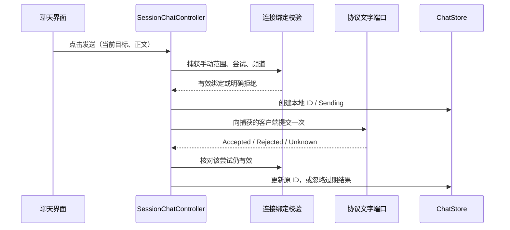

# TS3 Mobile 功能迭代详细执行方案

日期：2026-10-23（Asia/Shanghai）

代码基线：`main` / `c83aa45051bdc32cf8a090c082363bca16e356fa`

最新范围（2026-10-23，用户选择 1/3/4）：当前仅推进服务器收藏、暂离/静音状态同步、频道信息和快速搜索。
身份导入导出、好友/屏蔽、管理操作、连接质量面板及文件传输均移出当前范围；下方原路线中的其他候选
保留作历史参考，不构成继续执行授权。F3 音量门控已交付；收藏与本次新增状态/查找的结果见
[1/3/4 交付记录](../testing/FEATURES_134_2026-10-23.md)。

执行状态（2026-10-23）：F0 与 F1a（F1-01 至 F1-06）已在工作区完成开发和离线验证，频道聊天随后通过 Android 16 独立 Debug 包真实互通。用户追加要求私聊后，已接入 F1b（P1–P4），验证结果见[私聊交付记录](../testing/F1B_PRIVATE_CHAT_2026-10-23.md)。尚未提交或创建 PR；Release 文字互通待补，此前 F2/F3/F4 的计划状态以顶部最新范围及各交付报告为准。详见[F1a 交付记录](../testing/F1A_CHANNEL_CHAT_2026-10-23.md)和[真机记录](../testing/F1A_DEVICE_2026-10-23.md)。

用户随后追加的“戳一下”已接入开发工作区，范围和离线验证见[独立交付记录](../testing/POKE_2026-10-23.md)。

关联资料：[功能路线图](NEXT_PHASE_2026-10-23_ZH.md)、[范围决策 ADR-0012](../decisions/0012-feature-roadmap-with-deferred-device-acceptance.md)。

## 1. 交付顺序和范围

| 交付 | 可见成果 | 包含 | 留给之后 |
| --- | --- | --- | --- |
| F1a | 当前频道文字聊天 | 收发、发送状态、未读、复制、滚动、重连期间只读 | 私聊、通知、历史落盘 |
| F1b | 私聊与会话切换 | 用户入口、私聊列表、稳定目标映射、分会话未读 | 通知栏回复、已读回执 |
| F2 | 常用服务器收藏 | 命名、编辑、排序、从历史保存、快捷连接、可选加密密码 | 多服务器并发、云同步、多身份 |
| F3 | 语音激活 | RMS 音量门控、输入增益、降噪/AEC 控制、监听/发送状态 | 真实环境听感调校、自动音质预设 |
| F4 | 个性化设置 | 主题、语言、本地数据清理，各自独立交付 | 身份导入导出 |

先交付 F1a，再推进 F1b、F2、F3。F4 可在 F2 期间穿插。每次只推进一项可审查的改动，不为启动文字聊天而先重构整个连接或音频模块。

后台连接和切网恢复是已有实现，按受影响路径回归。当前不要求用户提供手机、耳机、第二台设备、测试服务器或发声条件。真机长时、耗电和服务器互通暂列后续验证，开发不以这些条件齐备为前提。正式发布的质量声明继续由原 M11 清单维护。

## 2. 开工准备：F0

| 编号 | 动作 | 输出 | 退出条件 |
| --- | --- | --- | --- |
| F0-01 | 记录 HEAD、工作区改动、JDK/SDK 状态，保留本轮未提交文档 | 基线记录 | 不覆盖现有改动；实施基线可追溯 |
| F0-02 | 按 README 配置 JDK 17、SDK 35、Build Tools 35.0.0、NDK 27.0.12077973、CMake 3.22.1、PowerShell 7 | 可复现构建环境 | Gradle 可启动并解析已锁依赖；本地路径保持忽略 |
| F0-03 | 运行现有适用门禁，记录原有失败和测试数量 | 基线检查记录 | 原有问题与新增问题可区分，不以削弱测试解锁 |
| F0-04 | 配置可用的 Android 模拟器或 CI 仪器入口 | 离线 UI 执行方式 | 采用与宿主匹配的模拟器架构；不依赖用户手机 |

方案制定时探测的 Mac 环境为 JDK 11，未发现默认 Android SDK 和 `pwsh`。本轮 F0 已准备 JDK 17、完整 Android 工具链、PowerShell 7 和 ARM64 API 35 模拟器，实际结果见交付记录。若某一模拟器后端暂不可用，先做协议/状态逻辑与 UI fixture，明确记录尚未运行的仪器项；不能把“未执行”记成通过。

本方案不指定必须新建 worktree。开工时检查现有工作区并选择可保留当前文档的分支或合适隔离方式；不在本次写方案时执行安装、切分支、提交或推送。

## 3. 已核对的实现入口

| 位置 | 当前状态 | 本轮接入方式 |
| --- | --- | --- |
| `ts3-protocol/.../Ts3SessionClient.kt` | 状态/快照/语音监听，尚无文字 API | 新增文字事件和有明确结果的发送端口 |
| `ts3-protocol/.../Ts3jClientSocket.kt` | 窄 socket 端口，已有 liveness 限时命令和操作跟踪 | 新增文字命令适配，沿用参数编码和 socket 所有权 |
| `ts3-protocol/.../Ts3jEventAdapter.kt` | 映射频道和成员事件 | 文字映射放独立类型，在既有事件入口转发 |
| `ts3-protocol/.../Ts3jSessionClient.kt` | 门面约 528 行，有协议 generation gate | 只增加必要入口、捕获目标与校验；不承担消息列表 |
| `app/.../service/ConnectionCoordinator.kt` | 约 979 行，拥有 active listener、连接尝试和 session | 增加窄转发和绑定校验；文字状态放独立控制器 |
| `app/.../service/TeamSpeakService.kt` | 持有组件和 binder，使用 StateFlow | 创建文字组件、转发生命周期、扩展 binder |
| `app/.../MainActivity.kt` | 直接绑定服务并收集服务状态 | 按现有方式接入聊天状态与动作 |
| `app/.../MainViewModel.kt` | 主要管理连接表单和历史 | 不把聊天业务硬塞入现有表单逻辑 |
| `app/.../ui/ConnectedPanel.kt`、`NavigationTabs.kt` | 频道/用户两个页签 | 加入聊天页，使用明确页签类型代替 else 分支兜底 |
| `app/src/androidTest/.../ui/UiFixture.kt` | 已有离线 Compose fixture | 扩展消息/发送回调，不新建一套框架 |

表中 `...` 仅缩短展示：协议包根为 `src/main/kotlin/io/github/ts3mobile/protocol/`，App 包根为 `src/main/java/io/github/ts3mobile/app/`。后续文件表中的新类型都是拟新增文件。

上游固定提交已具备 `sendChannelMessage`、`sendPrivateMessage`、`onTextMessage`。还核对了两个影响实施的事实：

- 文字发送便捷方法调用 `CommandResponse.complete()`，内部无界等待；不能直接套用后就声称已有五秒超时。
- `CommandResponse.get(timeoutMillis)` 能限制响应等待，但不会自动撤销已经进入 ts3j 队列的命令。应用超时/取消与协议命令撤销必须区分。

源文件：[LocalTeamspeakClientSocket](https://github.com/Manevolent/ts3j/blob/db57d60c989e399626aa16d921390f5033e6cdeb/src/main/java/com/github/manevolent/ts3j/protocol/socket/client/LocalTeamspeakClientSocket.java)、[AbstractCommandResponse](https://github.com/Manevolent/ts3j/blob/db57d60c989e399626aa16d921390f5033e6cdeb/src/main/java/com/github/manevolent/ts3j/command/response/AbstractCommandResponse.java)、[TextMessageEvent](https://github.com/Manevolent/ts3j/blob/db57d60c989e399626aa16d921390f5033e6cdeb/src/main/java/com/github/manevolent/ts3j/event/TextMessageEvent.java)。

## 4. F1a 的产品行为约定

### 4.1 页面和操作

主页面沿用现有暖米白主题，导航扩展为“频道 / 用户 / 聊天”。聊天页上方显示当前频道，正文显示消息，底部为多行输入区和发送按钮。

| 场景 | 确定行为 |
| --- | --- |
| 已连接且频道明确 | 允许输入与发送；每次点击形成一个本地消息 ID |
| 空白输入 | 禁止发送；使用 isBlank 判断，不静默修改非空消息正文 |
| 输入超过本地上限 | 提示并禁止发送，不截断后偷偷发送 |
| 正在发送 | 允许编辑下一条草稿；首版最多一条发送任务进行中，不重复入队 |
| 频道正在切换 | 保留草稿，暂停发送；切换完成后明确显示新目标 |
| 普通断线/重连 | 保留本次手动会话的消息与草稿，只读消息、可编辑草稿、禁止发送 |
| 重连成功 | 更新当前频道，允许用户主动发送；不自动发送重连期间草稿 |
| 主动断开/新手动连接/终态结束 | 清空消息、未读和草稿，避免内容跨服务器或新会话残留 |
| 进程重启 | 无聊天历史恢复；不因恢复界面状态写出消息正文 |
| 输入区获得焦点或切换页签 | 释放 PTT 按住状态；不改变用户选择的常开模式 |
| 键盘展开 | 输入区可见；语音控制可用，必要时使用紧凑语音栏，不自动关闭或开启麦克风 |
| 长按消息 | 复制正文到系统剪贴板；不附带服务器或身份材料 |

当前 `MainScreen` 在非 CONNECTED 时回到表单。为支持查看重连前消息，新增“本次会话恢复中”的显示分支：保留服务器摘要与聊天，频道/用户列表为空态且不可操作。仅调整呈现，不新增连接状态机。

频道切换使用分隔行显示上下文变化，首版为一个会话内的频道消息流。事件没有可靠频道字段时不按接收瞬间的频道强行归档，可显示为频道归属未确认的会话消息。正文按纯文本显示，TeamSpeak 格式标签不执行；首版不做图片、文件、富文本或远端预览。

### 4.2 发送结果

| 状态 | 依据 | 界面操作 |
| --- | --- | --- |
| `Sending` | 已接收本地请求，等待明确结果 | 显示发送中，禁止重复提交此请求 |
| `Accepted` | 收到该命令的成功响应 | 显示服务器已接受；不显示对方已读/已送达 |
| `Failed` | 明确未提交，或服务器明确拒绝 | 显示固定类别原因；可由用户复制到草稿后再次发送 |
| `Unknown` | 提交后超时、取消或断线，无法确定是否处理 | 显示结果未知；不自动重发，不提供暗含“保证不重复”的重试 |

首版在操作预算结束后将原消息保留为 Unknown，晚到响应不再改变这个最终展示结果，也不新增消息。若只得到无法关联的回显，不推断成功。任何手动再发送都创建新 ID，不能把原未知请求当作未发送；后续如需补充迟到确认，应单独设计关联回调。

### 4.3 内存和未读

初始本地配置：消息上限 500 条、保留文本 UTF-8 负载预算 2 MiB、单个入站事件正文上限 16 KiB、输入上限 1,024 UTF-8 字节、单会话一条发送任务、发送操作目标预算五秒。以上是应用保护值，不是对 TeamSpeak 通用上限或严格网络截止的承诺；F1-01 确认实际编码与等待语义后才能定稿。

列表条数与字节预算同时生效，优先淘汰最旧已完成记录，待处理记录计入预算；溢出事件显示一次固定提示，记录数量类别，不记录正文。截断展示过长的入站消息必须标记，不能改变出站消息。新增序号单调递增，接收时间只用于展示，系统时钟回拨不改变消息顺序。

未读使用“本次会话的消息序号 + 已读位置”，不依赖可变列表下标。用户停在历史位置时不滚到底部也不清除未见消息；显示新消息入口和 99+ 上限徽标。切到聊天页只标记实际可见的内容；自己的发送和频道分隔行不增加未读。

消息和草稿由服务组件拥有，禁止经 DataStore、SavedStateHandle 或 `rememberSaveable` 保存正文。页签选择、滚动锚点可以独立恢复；正文随本次会话结束清空。用户主动复制是进入系统剪贴板的明确例外，需同步隐私说明。

## 5. F1a 数据流与接口设计

### 5.1 会话隔离

必须区分三个范围：

1. **手动会话范围**：对应用户一次连接意图。普通自动重连保留这一范围及内存消息；新手动连接或主动退出则重置。
2. **具体连接尝试**：对应 active listener/实际协议客户端。旧尝试的事件与结果不能进入同一手动会话下的新尝试。
3. **发送时频道上下文**：发送绑定点击时已确认的频道，实际提交前重新校验，不能排队后自动改投另一频道。

现有 App `SessionGeneration` 的 epoch 可能在普通自动重连中保持不变，因此单靠 epoch 不足。复用现有 active-listener 身份拒绝，必要时增加局部 attempt ID；不增加第二套通用会话框架。协议侧继续使用 `SessionGenerationGate` 和捕获的 socket 身份。

### 5.2 拟新增类型

| 模块/包 | 拟新增文件 | 唯一职责 |
| --- | --- | --- |
| `ts3-protocol/.../protocol` | `TextMessage.kt` | `TextTarget`、入站事件和发送结果；不包含 Android 类型 |
| 同上 | `Ts3jTextMessageMapper.kt` | 将上游 map 安全映射为类型，处理缺字段与未知 target mode |
| 同上 | `Ts3jTextCommands.kt` | 构造单次文字命令，参数编码、限时等待与结果分类 |
| `app/.../chat` | `ChatMessage.kt`、`ChatState.kt` | 展示模型、发送状态、scope/attempt/sequence 元数据 |
| 同上 | `ChatStore.kt` | 有界列表、草稿、未读与清理，纯状态逻辑 |
| 同上 | `SessionChatController.kt` | 生命周期、发送任务、绑定、取消与结果回填 |
| `app/.../ui` | `ChatPanel.kt`、`ChatMessageRow.kt`、`ChatComposer.kt` | 页面、消息呈现和输入控件 |
| 测试目录 | 对应独立 `*Test.kt` | 生产与测试物理分离 |

类型名可在实施前按现有命名调整，但不能把 Store、UI 和 socket 命令合并成一个大文件。携带正文/昵称的类型需要显式脱敏 `toString()`，不得把上游 map 或异常消息带入日志。

### 5.3 接口约定

以下是拟议签名，不是已实现代码：

```kotlin
// ts3-protocol：监听器新增回调可默认空实现。
fun onTextMessage(event: Ts3TextEvent) {}

// 发送不得默认返回成功；缺能力的实现显式返回 Unsupported。
suspend fun sendTextMessage(
    target: TextTarget,
    body: String,
    timeoutMs: Long,
): TextSendOutcome
```

首轮发送端只接入 Channel；Private 在 F1b 接入，服务器广播不接入。入站类型保留 target mode、可用目标 ID、发起者 ID/UID/名称和正文；字段缺失用明确可空/Unknown 表达，不能用昵称猜身份。接收时间由应用注入。

`TextSendOutcome` 至少包含 Accepted、Rejected、NotSent、Unknown 和 Unsupported。Rejected 携带固定原因类别及可选数值错误码，不携带服务器原始错误文本；是否已提交不明确时只能返回 Unknown。

服务 binder 暴露 `submitChannelText`、`updateChatDraft`、`markChatVisibleThrough` 等窄入口；Activity 按现有 binder/StateFlow 方式接入。`ConnectionCoordinator` 只负责捕获/核对当前连接绑定、转发文字事件与调用捕获客户端，不拥有列表或 Compose 状态。

### 5.4 发送链路与并发约束



- 在启动协程之前捕获绑定；开始 IO 和实际命令提交前再次校验。不能等协程运行后再从全局读“最新 session”而更换目标。
- 代次锁只做短状态校验/认领，不能持锁等待 IO、网络回应或 UI。文本等待不能占用全局 `sessionMutex` 阻塞断开预算。
- 文本提交与频道切换保持确定的提交顺序。F1-01 验证 pinned 命令队列后选择最小的提交协调方式，避免 UI 已切换而旧文本才被重新解释目标。
- 已经提交的命令可能在本地超时后仍被服务器处理。取消不宣称撤销；旧 socket 关闭后不迁移其命令到新 socket。
- 使用现有 `SocketOperations` 的跟踪与关闭中断能力；限时等待、线程退出和命令队列状态分别测试。不能仅用外层 `withTimeout` 就声称阻塞调用已停止。
- 正常预算内的响应只更新同一 ID 和同一尝试的记录；预算结束后及手动退出后的所有完成回调均失效。

入站同样经过协议 generation gate、App active listener 和 Store 范围校验。自己客户端的回显先作为本地出站项的附加事件处理，不再无条件追加一条；若无可靠关联则保持原状态，不按正文去重所有人的合法重复发言。

## 6. F1a 可执行任务清单

### F1-01：验证文字协议适配路径

- [x] 核对入站字段、频道目标语义、命令参数转义、回显与返回码；记录已知与无法离线确认的部分。
- [x] 用真实 pinned 命令编码/发送实现配合假 datagram 或 response，验证中文、空格、换行、竖线和反斜杠不被双重编码。
- [x] 验证五秒目标预算覆盖的实际区间，区分排队、提交和响应等待；证明等待任务能结束，且不自动重发。
- [x] 验证文本与 join 的提交顺序，以及超时后旧命令仍可能存活的边界。

输出：协议文字适配决策记录及确定性回归。退出条件：有界等待与 Unknown 规则可以实现；若原便捷方法无法满足，就在窄适配器中使用显式 `sendtextmessage` 和 `get(remainingMs)`，不更换协议依赖或弱化断开要求。服务器特有行为保留为待互通项，不要求用户提供服务器。

### F1-02：增加协议模型和门面

- [x] 新增第 5 节协议类型、文字 mapper 与命令适配。
- [x] 扩展 `Ts3SessionListener`、`Ts3SessionClient` 和窄 socket；所有 fake 明确支持或返回 Unsupported。
- [x] 在 `Ts3jEventAdapter` 入口转发，保留原频道/成员行为。
- [x] 在 `Ts3jSessionClient` 捕获 socket，拒绝旧 token 与旧实例，保持取消传播和脱敏失败。

输出：协议 API 与测试，可单独审查。退出条件：协议测试和格式检查通过，原有会话/语音测试未回退；没有真实服务依赖。

### F1-03：实现有界消息状态

- [x] 新增 ChatStore、ChatState 和脱敏消息模型，注入序号/时钟/ID 生成。
- [x] 实现消息和字节预算、单发送任务、草稿、已读位置和频道分隔。
- [x] 实现普通重连保留、终态/手动退出清空、旧尝试结果拒绝。

输出：纯状态逻辑与单元测试。退出条件：第 7 节 Store 与生命周期用例通过；没有 Android Context、文件写入或全局可变单例。

### F1-04：接入服务与会话生命周期

- [x] 服务创建 SessionChatController 并公开只读状态；binder 接收明确的聊天动作。
- [x] 手动连接时初始化范围，具体尝试连接时更新绑定；快照更新频道上下文。
- [x] 重连暂停发送，手动/终态退出立即使绑定失效并清理任务和消息。
- [x] 按现有 active listener 守卫转发入站；不把 IO 放进代次锁。

输出：离线 service/controller 集成测试。退出条件：fake 会话可完成一轮收发、重连、迟到回调和退出，未改变既有重连策略与退出预算。

### F1-05：交付聊天页面

- [x] 增加明确页签类型和聊天页；保留频道/用户既有功能。
- [x] 实现消息状态、复制、输入字节校验、未读徽标、滚动位置与新消息入口。
- [x] 增加重连期间只读呈现、键盘布局、PTT 释放和紧凑语音栏。
- [x] 所有文案加入 `values/` 与 `values-zh/`，复用现有主题和图标规范。

输出：可在离线 fixture 中操作的界面与仪器测试。退出条件：中英文、大字体、键盘、发送异常和原频道/用户流程检查通过；fixture 不连接真实服务。

### F1-06：离线集成与开发交付

- [x] 运行第 10 节适用门禁和可用模拟器 UI 套件，记录提交与实际结果。
- [x] 更新 CHANGELOG Unreleased、双语 README、ARCHITECTURE、PRIVACY 和文字协议 ADR。
- [x] 检查日志、诊断、系统恢复状态与默认数据存储，确认没有聊天正文意外落盘。
- [x] 交付当前频道聊天的开发构建/代码说明并列明边界；后续已补 Debug 真机互通记录，Release 文字互通待补。

输出：F1a 交付记录与未验证事项。退出条件：下面的 F1a 完成标准满足后进入 F1b，不等待用户安排真机长时测试。

## 7. F1a 验收矩阵和完成标准

| ID | 类别 | 用例与必须结果 |
| --- | --- | --- |
| T01 | 协议 | 中文、Emoji、空格、换行、竖线、反斜杠恰好编码一次，目标参数正确 |
| T02 | 协议 | 缺 msg/target、未知 mode、超大事件不会破坏接收线程；有固定分类处理 |
| T03 | 发送 | 成功回应只标 Accepted；权限/参数拒绝映射固定类别，原始错误不出日志 |
| T04 | 发送 | 提交前失效为 NotSent；提交后超时/取消为 Unknown，没有二次调用 |
| T05 | 发送 | 重复点击同一请求不创建两次实际发送；完成后可主动发送相同文字 |
| T06 | 并发 | 旧 listener 在同一手动 epoch 下晚到，也不能向新尝试写消息 |
| T07 | 并发 | 排队后频道变化，在真正提交前拒绝；已提交项不会被改成新目标 |
| T08 | 并发 | 断开期间仍在等待的命令不占住断开预算、不重投新 socket、线程可收尾 |
| T09 | 回显 | 自回显不重复出站行；两名用户相同正文和连续合法重复发言均保留 |
| T10 | Store | 条数/字节预算同时生效；序号和已读位置不受淘汰或时钟回拨破坏 |
| T11 | 生命周期 | 普通重连保留消息/草稿且禁止发送；新手动连接、终态和退出清空 |
| T12 | 未读 | 未见内容才计未读；滚在历史位置时保留未读，跳到底部后正确减少 |
| T13 | UI | 断线、空白、超限、切换频道、发送中五种禁用/提示状态正确 |
| T14 | UI | 复制、新消息入口、滚动锚点、重新绑定 Activity 后的内存消息呈现正确 |
| T15 | UI | 中文/英文、1.8 倍字体、窄屏与键盘展开时目标和发送/停止控件可用 |
| T16 | 音频边界 | 聊天输入和页签切换释放 PTT；常开模式不被文字操作改变 |
| T17 | 隐私 | 模型字符串、异常、日志、诊断、SavedState 与默认存储不泄露正文/昵称 |
| T18 | 既有能力 | 原频道加入、用户增益、手动断开、连接限制提示和语音回归仍通过 |

用例优先使用 fake、受控 latch 和虚拟时间；避免靠固定 sleep、真实网络或执行顺序通过。接口/状态错误要能在实现中引入缺陷时被测试发现，不用复述实现的测试凑数量。

F1a 完成意味着：频道聊天从事件到界面、从输入到协议适配均已接通；适用自动化门禁与可执行的离线 UI 检查有记录；已知未验证项有清楚边界。若仪器环境不可用，只能报告逻辑和 UI 源码完成、UI 执行待补，不能宣称全部离线验收通过。真实服务器互通、物理语音听感和长期稳定性不包含在这一完成声明中。

## 8. 后续功能执行包

### F1b：私聊与会话列表

| 编号 | 实施内容 | 交付/验收 |
| --- | --- | --- |
| P1 | 增加 Private 发送与入站目标映射 | 私聊目标与当前频道命令分离，fixture 验证双方方向 |
| P2 | 以稳定 UID 建会话；缺 UID 时限定当前尝试 | 客户端 ID 被复用不会把消息发给另一个人；昵称不作为身份键 |
| P3 | 用户菜单“发送私信”、会话列表和分会话未读 | 打开用户会话、返回频道、草稿切换和未读正确 |
| P4 | 将 500 条/2 MiB 总预算扩展为全会话共享 | 关闭空会话、目标离线、重连映射失效和总量淘汰可验证 |

重连后有可靠新映射才允许再次发送；离线目标保留只读内容和草稿。缺 UID 的旧尝试私聊在尝试结束后关闭。入站未注册私聊会话采用有界建会话策略；总会话上限初始 20，满额时保留固定新会话提示，避免无限内存增长。暂不添加通知栏回复或外部推送。

### F2：常用服务器收藏

本轮已实现命名/编辑/删除、从当前表单（可先选择历史）新增、可选密码、默认频道 ID 和快捷连接。
切换采用先明确断开当前服务器、再快捷连接的流程；列表保持保存顺序，本轮不扩展手动排序。
这是用户选定范围下的实现调整，具体兼容和验证见 ADR-0017/1-3-4 交付记录；下表保留最初拆分参考。

| 编号 | 实施内容 | 交付/验收 |
| --- | --- | --- |
| B1 | 定义 `ServerBookmark`、版本化 codec、独立加密 Store | 严格解码、损坏/未知版本可见报错、往返与旧数据保留 |
| B2 | 新增/编辑/删除/排序及“从历史保存” | 手动名称、同端点不同昵称、删除确认范围和空列表正确 |
| B3 | 收藏填表、可选记住密码、快捷连接 | 迟到加载不串密码；未勾选时不持久化该收藏密码 |
| B4 | 已连接时切换服务器的显式流程 | 先使旧聊天/目标失效，再正常退出旧会话，再创建一次新连接 |

拟议字段：`id`、`name`、`host`、`port`、可选 `nickname`、`rememberPassword`、条件保存的 `password`、`sortOrder`。初始上限 50 项；保存在独立版本化 AES-GCM 快照及独立 Keystore 键下，整个快照排除备份。

旧安装首次加载为空收藏，不自动搬运最近密码，不改写现有表单/历史/身份格式。删除收藏不删除其他三类数据；关闭“记住密码”后持久化删除该项密码，进程重启验证。切换/保存/删除使用条目 ID 与修订号拒绝迟到回写。

先独立提交存储与迁移，再交付 UI 和快捷连接。具体 schema、备份排除与兼容规则写入新增 ADR；不引入数据库或多服务器并发。

### F3：语音激活

2026-10-23 用户追加要求以 **volume gate（音量门控）** 为准：本轮使用降噪和增益后的
RMS dBFS，而非仅凭 RNNoise 概率决定发声。新增输入音量、降噪/回声消除开关及实际状态，
门控初始值调整为 40 ms 连续触发、6 dB 迟滞、300 ms 收尾和 120 ms 起声缓存。
[ADR-0016](../decisions/0016-microphone-processing-and-volume-gate.md) 和
[交付验证](../testing/MICROPHONE_2026-10-23.md) 记录本轮实现与结果；以下表格保留原计划参考。

| 编号 | 实施内容 | 交付/验收 |
| --- | --- | --- |
| V1 | 纯 Kotlin `VoiceActivationGate`、时钟和参数策略 | 阈值、短语音、噪声尖峰、暂停、关闭和重置均有确定性回归 |
| V2 | RNNoise 概率与有界起声缓存接入采集 | 采集/检测/讲话/队列分离，旧队列空隙回归保持通过 |
| V3 | `MicrophoneMode` 增加激活模式、灵敏度与监听/发送 UI | 权限、前台类型、通知停麦、后台延迟恢复规则一致 |
| V4 | fake 概率序列、编码帧及 pinned 发送器离线链路 | 结束包时序正确、缓存有界、断开不补发旧帧 |

初始参数按可调整配置记录：两阈值迟滞、约 30 毫秒连续触发、约 300 毫秒结束延迟、约 120 毫秒起声缓存。数值只是首轮离线用值，不能写成已经校准的听感参数。

激活模式沉默时仍在采集/检测，麦克风前台类型继续生效；保持现有“已停采集需要回到应用恢复”的规则。显式关闭立即取消讲话并清空缓存。既有 ADR-0011 空队列不提前结束讲话回归必须继续覆盖。新增设置不让应用重启后自行开始采集。

生产文件重点为 `MicrophoneMode`、`MicrophoneCapturePolicy`、`MicrophoneController`、`OpusMicrophoneCapture` 和独立门控类型。先完成策略与测试，再单独接入 JNI/采集，真实噪声误触发和蓝牙听感暂列后续调校，不阻止前述开发。

### F4：主题、语言与本地数据

| 编号 | 实施内容 | 交付/验收 |
| --- | --- | --- |
| S1 | 独立偏好 Store，主题跟随系统/浅色/深色 | 复用既有深色配色；重启恢复，系统主题变化正确 |
| S2 | 跟随系统/中文/英文的版本兼容方案 | Activity、Compose、系统 View 弹窗及服务通知语言一致 |
| S3 | 分别清理表单、历史、收藏 | 删除后的迟到读取/保存不恢复旧值，身份保持不变 |

S1 可先交付，不等待 S2。语言实现先比较 Android 13+ 系统 API 与旧版资源上下文方案，记录选择及重建行为，避免只更新 Compose。普通清理不包含身份重置；身份导入导出继续独立设计。

## 9. 变更拆分、估算与节奏

| 建议变更 | 任务范围 | 依赖 |
| --- | --- | --- |
| C1 协议文字能力 | F1-01、F1-02 | F0 构建可用 |
| C2 服务聊天状态 | F1-03、F1-04 | C1 |
| C3 当前频道聊天交付 | F1-05、F1-06 | C2 |
| C4 私聊 | P1–P4 | C3 |
| C5 收藏存储 | B1 | C3 后可独立推进 |
| C6 收藏界面与连接交接 | B2–B4 | C5；UI 主线在 C4 后 |
| C7 激活策略 | V1 | C6 后进入本轮优先队列 |
| C8 激活模式接入 | V2–V4 | C7 |
| 独立设置改动 | S1、S2、S3 分开 | 可穿插 C5/C6；S3 需要已定存储清理规则 |

每个变更保持可编译，包含独立测试和对应文档。确认为 bug 时先增加失败回归，再修复。任何结构抽出只为本次职责落位，不加入全量架构重写、依赖升级、ts3j fork 或正式签名迁移。

按单开发者估算：F1a 3–5 日、F1b 2–3 日、F2 3–5 日、F3 4–6 日；F4 主题约 1 日，语言与清理各约 1–2 日。工具链、协议排队/取消适配和返工另计；在 F1-01 完成后重新估算首轮，不以估算代替实际完成标准。

## 10. 验证命令与记录

实施时分层执行，不为文档或低影响 UI 修改重复全部真机测试。协议改动先跑协议测试；Store/controller 改动跑 App 单元测试；UI 改动跑相应 Compose 仪器包，再运行适用完整门禁。

```sh
./gradlew :ts3-protocol:test
./gradlew :app:testDebugUnitTest
./gradlew :app:connectedDebugAndroidTest
```

最后一条在已启动的可用模拟器执行，使用虚构 fixture，不连接真实服务器。若现有全套含环境限定项，按测试类/包筛选并记录范围，不能悄悄删除测试。

适用完整门禁：

```sh
./gradlew quality :ts3-protocol:test :audio-opus:testDebugUnitTest \
  :audio-opus:lintDebug :app:testDebugUnitTest :app:lintDebug \
  :app:lintRelease :app:assembleDebug :app:assembleRelease \
  --max-workers=2 --stacktrace
pwsh -NoProfile -File tools/check-repository-privacy.ps1
git diff --check
```

Release 包装或依赖改变时，按既有工具对确切混淆 APK 运行离线身份/INI 探针。当前 CI 已有该门禁；不要用一次 Debug 通过替代 Release 结果。

每次交付记录：源提交、任务 ID、生产/测试/文档/配置变更分类、实际命令和退出结果、测试数量及未执行项、已知限制。构建日志和本地产物放忽略的 `build/` 子目录，不提交 APK、端点、密码、身份或聊天内容。

## 11. 风险和遇到问题时的处理

| 问题 | 开发处理方式 |
| --- | --- |
| 上游无界等待/超时不撤销 | 先完成 F1-01；使用窄限时适配、Unknown 和命令所有权回归，不默认调用 complete |
| 同一 epoch 下旧连接回调 | 同时核对 active listener/attempt 与 Store 范围，使用 latch 重现 |
| 频道发送和切换交错 | 固定发送目标并验证提交顺序；上下文失效则拒绝，不改投 |
| 消息内容进入日志 | 脱敏模型字符串、固定错误类别与隐私回归；禁止输出上游原始异常/map |
| 大文件继续膨胀 | 本计划已记录迁移边界；独立 mapper、命令、Store、controller 和页面，只留窄入口 |
| 私聊 ID 被复用 | 稳定 UID 和当前尝试映射双重核对，缺信息只读，不按昵称重绑 |
| 记忆清理/收藏保存竞态 | ID/修订号、串行写入和重启测试；旧格式保持，不清空数据解错 |
| VAD 重新引入讲话结束 bug | 保留现有真实发送器离线回归，显式区分采集、讲话和队列 |
| 无手机/耳机/服务器 | 继续离线实现，明确留下互通/听感待验证；不向用户反复索要条件 |

## 12. 开工指令与本次交付

后续开始实施时，可直接使用以下任务边界：

> 按本方案先实施 F0 和 F1a，仅覆盖 F1-01 至 F1-06。保留现有未提交文档，阅读根 AGENTS.md 和受影响源码。先确认 pinned ts3j 的限时发送、排队和会话隔离，再实现有界聊天状态与当前频道聊天界面。用 fake 协议、确定性并发回归及离线 Compose fixture 验证，不依赖用户现场手机或服务器。未明确进入下一阶段前不实施私聊、收藏或语音激活。交付时分别报告实现、已执行验证和未验证的真实互通，保持现有身份、存储和后台恢复行为。

方案编写阶段只编写文档并同步入口。随后按用户要求推进 F0/F1a、真机频道互通和 F1b；以各自交付记录为准。听感、长期稳定性、Release 文字互通和 F2/F3/F4 不标为完成。
