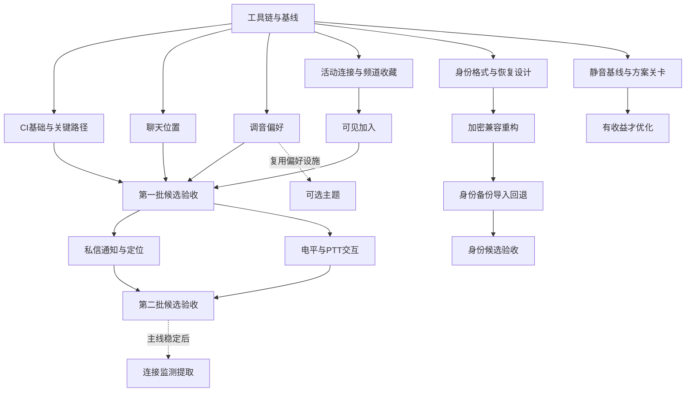

# TS3 Mobile 提升执行计划：代码核查、收益与工作量评估

日期：2026-11-07（Asia/Shanghai）

基线：`main` / `7a1e36e`；应用 `1.0.0` / `versionCode 14`。

状态：执行中；维护者于2026-11-07要求逐阶段完成。实际状态见[执行进度](IMPROVEMENT_PROGRESS_2026-11-07_ZH.md)。原始输入见[提升计划](IMPROVEMENT_PLAN_2026-11-07_ZH.md)。

本文把原计划作为待评估材料，结合代码和实验制定执行建议。原调研阶段没有修改应用行为；当前实施依据是维护者随后提出的逐阶段执行请求，原文中的复选框不代表已完成。下述估算与调研证据保留其编写时范围，新增结果写入执行进度与阶段记录。

## 1. 建议采用的执行方案

建议保留原计划的目标，改成四批交付，并把高不确定性项目设置为有退出条件的专项：

1. **第一批：减少每天重复操作。** P0、Q1、A1、A2、A3。先让聊天位置、调音参数和频道收藏可靠；按最可能估算约 **15 人日**，包含本批候选验收。
2. **第二批：完成提醒和调音反馈。** A4、A5。约 **10 人日**，包含本批候选验收。与第一批合计 **25 人日**；加权估算和风险余量后，为核心体验范围准备约 **29–30 人日**。
3. **第三批：身份可备份、可恢复。** C1 → C0 → C2。约 **14.5 人日**，包含本批候选验收。第一版优先保证 TS3 Mobile 自有加密备份跨安装恢复；桌面格式兼容根据实验另立范围。
4. **第四批：有证据再投入。** B1、D1、D2，约 **13 人日**，包含本批候选验收。B1 先量化静音干扰，D2 在主线稳定后进行，D1 可以独立提前。

全范围最可能为 **52.5 人日**，三点加权约 **54.2 人日**，另留约 15% 的项目余量后约 **62 人日**。这些是工程估算，不是统计置信区间。按一名熟悉项目的开发者每周提供 4 个有效项目日计算，核心体验约 **7.5 周**，全部范围约 **15.5–16 周**；设备、签名评审等外部等待若不能重叠，再另加 **1–3 周**。没有足够资料把它们承诺成具体发布日期。

**最值得先做的是 A1、A2、A3 和 Q1。** 它们收益直接、边界较清楚，适合尽早验证交付能力。A4 是完整系统功能，C2 是数据恢复功能，B1 涉及并发音频输出；三者都不适合按“加一个入口”的工作量安排。

## 2. 调研方法与当前证据

### 2.1 已核查的范围

阅读了项目约定、架构、贡献指南、构建配置、CI、相关 ADR 与历史验收记录，并检查以下生产路径及其测试：

| 领域 | 主要证据入口 | 本次核实的事实 |
| --- | --- | --- |
| 会话与界面 | [ConnectedPanel](../../app/src/main/java/io/github/ts3mobile/app/ui/ConnectedPanel.kt)、[ChatConversationContent](../../app/src/main/java/io/github/ts3mobile/app/ui/ChatConversationContent.kt)、[ChatPanel](../../app/src/main/java/io/github/ts3mobile/app/ui/ChatPanel.kt) | 聊天只在 CHAT 分支挂载；保存容器也处于该分支内部 |
| 聊天模型 | [ChatStore](../../app/src/main/java/io/github/ts3mobile/app/chat/ChatStore.kt)、[ChatState](../../app/src/main/java/io/github/ts3mobile/app/chat/ChatState.kt)、[ChatMessage](../../app/src/main/java/io/github/ts3mobile/app/chat/ChatMessage.kt) | 有手动会话 scope、attempt、消息 sequence、会话标识与已读进度，可复用这些语义 |
| 调音与采集 | [MicrophoneController](../../app/src/main/java/io/github/ts3mobile/app/service/MicrophoneController.kt)、[MicrophoneSettings](../../audio-opus/src/main/java/io/github/ts3mobile/audio/opus/MicrophoneSettings.kt)、[MicrophoneFrameProcessor](../../audio-opus/src/main/java/io/github/ts3mobile/audio/opus/MicrophoneFrameProcessor.kt)、[VolumeGate](../../audio-opus/src/main/java/io/github/ts3mobile/audio/opus/VolumeGate.kt) | 设置仅内存；门控按增益后的信号计算 RMS；采集状态没有电平遥测 |
| 收藏 | [BookmarkDialogs](../../app/src/main/java/io/github/ts3mobile/app/ui/BookmarkDialogs.kt)、[BookmarkEditor](../../app/src/main/java/io/github/ts3mobile/app/ui/BookmarkEditor.kt)、[BookmarkController](../../app/src/main/java/io/github/ts3mobile/app/bookmarks/BookmarkController.kt) | 新增收藏从表单预填；默认频道为数字输入；已有 revision 和串行存储控制 |
| 通知入口 | [PokeAlertObserver](../../app/src/main/java/io/github/ts3mobile/app/service/PokeAlertObserver.kt)、[PokeNotifications](../../app/src/main/java/io/github/ts3mobile/app/service/PokeNotifications.kt)、[MainActivity](../../app/src/main/java/io/github/ts3mobile/app/MainActivity.kt) | 戳一下有通用后台提醒；Activity 尚无私信定位的 `onNewIntent` 处理 |
| 静音播放 | [OpusAudioPlayer](../../audio-opus/src/main/java/io/github/ts3mobile/audio/opus/OpusAudioPlayer.kt)、[PlaybackSession](../../audio-opus/src/main/java/io/github/ts3mobile/audio/opus/PlaybackSession.kt)、[PlaybackTimeline](../../audio-opus/src/main/java/io/github/ts3mobile/audio/opus/PlaybackTimeline.kt) | 参与者跨越零增益会触发全局输入清理、流重置与输出退役 |
| 身份与加密 | [IdentityVault](../../app/src/main/java/io/github/ts3mobile/app/identity/IdentityVault.kt)、[Ts3IdentityCodec](../../ts3-protocol/src/main/kotlin/io/github/ts3mobile/protocol/Ts3IdentityCodec.kt)、另两套 Vault | 身份仅有 `getOrCreate()`；三个 Vault 重复 AES-GCM/Keystore 逻辑；读取时也可能创建缺失密钥 |
| 连接监测 | [ConnectionCoordinator](../../app/src/main/java/io/github/ts3mobile/app/service/ConnectionCoordinator.kt)、[SessionGeneration](../../app/src/main/java/io/github/ts3mobile/app/service/SessionGeneration.kt) | 网络切换探测、传输活性观察和会话退出决策共处协调器；scope 数值会在新服务实例中重新计数 |
| 质量门禁 | [Android CI](../../.github/workflows/android.yml)、[CONTRIBUTING](../../CONTRIBUTING.md)、[Release 身份探针](../../app/src/releaseSmokeTest/java/io/github/ts3mobile/app/release/IdentityRoundTripProbe.java) | CI 已有 JVM/Lint/构建和模拟器，但 app 仅选跑麦克风控制及播放失败类；身份探针不经过 Vault 或文件选择器 |

统计范围为 Kotlin/Java：生产代码 179 个文件、17,083 行；JVM 测试 101 个文件、12,332 行；Android 测试 35 个文件、5,165 行。不含 C/C++、资源、第三方与构建产物。这说明已有较多测试基础，也说明不能用“已有测试很多”代替缺失的组合路径验收。

### 2.2 本次实际执行与限制

| 检查／实验 | 本次结果 | 能支持的结论 |
| --- | --- | --- |
| Git、版本与工作区核对 | HEAD 为 `7a1e36e`，版本为 1.0.0 / 14；开始时已有导航修改和未跟踪的原计划 | 排期绑定当前基线；保留用户已有改动 |
| 默认 Java 与工具路径检查 | 默认 Java 11；当前 PATH 未找到 `pwsh`、`adb` | 当前 shell 还不能直接执行完整 Android 验收；不等于整台机器没有 SDK |
| `./gradlew --offline --no-daemon --max-workers=2 help` | 失败：AGP 8.7.0 要求 Java 17 | P0 是实际阻断；本次没有新的 Gradle 测试通过记录 |
| 固定 ts3j 缓存 JAR 的 `javap` 检查 | `LocalIdentity.export/read` 使用 `[Identity]` INI 与混淆编码，包含 key offset | 现有导出不是口令加密备份；可研究复用其内部身份载荷 |
| 新生成合成身份离线往返 | 8/8 通过；比较 UID、私钥相等性、key offset、安全等级 | 当前锁定 JAR 的自有格式可往返；身份仅在内存，没有输出或保存私钥 |
| Android 官方资料核对 | 通知导航、通知权限、SAF、DataStore 四页访问成功 | 用于约束设计；不能代替项目与设备验证 |

身份实验直接调用缓存中的 `ts3j-ts3mobile-1.jar` 及其缓存依赖，在临时目录编译 Java 11 探针后运行并删除临时源文件。它绕过 Android/Gradle，**不是协议模块测试、Release 测试、桌面互通测试或跨设备恢复测试**。复现方法见附录 A。

A1 的界面故障、B1 的可闻影响尚未在本次运行中复现。相应结论仍分别是“高置信度生命周期风险”和“已确认调用链、待量化体验”，不写成已复测的故障。

## 3. 对原计划的调整

| 原计划处理 | 本执行版建议 | 理由与影响 |
| --- | --- | --- |
| 第一轮 A1–A5 + Q1 为 11–17 日，另计 P0 | 按完整交付重估为最可能 25 日，含 P0 与两次候选验收 | 原估算对跨生命周期、错误流程、设备与整体验收计入不足 |
| A3 合并频道选择和可见加入 | 拆成 A3a 收藏上下文／频道选择、A3b 可见加入 | 两条路径复用接口，但 UI、风险与验收不同；可独立回退 |
| A4 接在 A1 后面 | 保留实施顺序，但不称为技术硬依赖 | A4 需要可定位的聊天页面状态；不应把通知策略本身绑死在 A1 实现上 |
| A5 只约束低频发布 | 明确独立电平流，避免沿采集状态通知链高频刷新 | 当前 `onCaptureState` 会触发通知更新；直接往该状态加电平可能制造系统与 UI 负担 |
| B1 4–7 日并列为高价值 | 先用 1.5 日量化，再决定是否投入后续预算 | 影响频率和可听缺口未量化；保留其他流也不能消除已混合输出的损失 |
| C1 1–2 日，C2 4–7 日 | C1 最可能 3 日，C2 最可能 8 日；缩小第一版格式承诺 | 加密容器、SAF、身份使用互斥、崩溃恢复与升级各有独立工作量 |
| C0 是 C2 的前置 | 建议顺序 C1 → C0 → C2；C0 是工程选择，不是协议硬依赖 | 如果通用重构风险扩大，可只在身份路径收敛必需能力，另两套 Vault 后移 |
| D2 偏向减少协调器体积 | 用行为等价与测试隔离作为验收 | 当前 1,044 行，但监测仍受监听器、请求所有权与退出规则约束，机械搬文件不足以减风险 |
| 总开发日不含长期实测和外部等待 | 每项包含适用的主动验证；跨项候选验收单列 R；外部等待另列 | 避免把“代码完成”误认为“可以交付”，也避免测试重复计价 |

原表全部项目合计 **24.5–42.5 人日**，并不是全部工作都能在第一轮 11–17 日内完成。该范围与本版统计口径不完全相同，不能直接解释为实现速度下降。

## 4. 收益评估：投入依据与量化方式

### 4.1 相对价值

目前没有活跃用户数、使用频率、任务耗时、音频切换数据或支持工单分布。下表是基于现有流程的相对判断，不是实测转化率，也不把工程改动折算成虚构收入。

| 项目 | 主要受益场景 | 收益及其边界 | 当前把握 | 排序建议 |
| --- | --- | --- | --- | --- |
| A1 | 阅读聊天时切去频道／用户页 | 避免重新找消息和误跳到最新；使用频繁时收益高 | 中高，待失败用例确认 | 第一批 |
| A2 | 服务／进程重建后继续使用 | 不再重复调音；保存的是偏好，不能使 AEC 从不可用变成可用 | 高 | 第一批 |
| A3a | 新用户配置默认频道、保存活动连接 | 免查内部编号，减少错服收藏；常换收藏者收益更大 | 高 | 第一批 |
| A3b | 不知道双击规则、无障碍操作 | 加入入口可发现、可操作；已有搜索加入入口可作为复用基础 | 高 | 第一批中的小交付 |
| A4 | 锁屏／后台接收私信 | 避免漏看沟通，单次价值可能高；Android 权限和 OEM 策略仍限制提醒 | 中高 | 第二批 |
| A5 | 调门限、输入音量、判断是否正常采集 | 能解释开闭门，降低盲调与误报；PTT 对话框占用操作空间须先验证 | 中 | 第二批，先过交互关卡 |
| Q1 | 每次后续功能变更 | 在评审前发现组合路径回归，减少重复人工验收 | 高；节省多少时间待测 | 从第一批持续接入 |
| C1/C2 | 换机、误卸载、设备损坏 | 保护权限所依赖的身份，低频但损失可能很大；未导出或忘记口令仍无法恢复 | 价值高，成本把握中低 | 独立第三批，可按维护者需求提前 |
| C0 | 三套加密逻辑维护 | 一处修复、三处受益；不直接增加用户能力，也不解决 Keystore 丢失 | 高 | 随身份阶段安排 |
| B1 | 多人同时讲话时反复静音某人 | 减少其他人的非必要重缓冲；当前是否常见、改善多少未知 | 中低 | 量化后决定 |
| D1 | 夜间／系统深色偏好 | 成本低、易独立交付；不解决核心可靠性 | 高 | 有明确需求即可插入 |
| D2 | 后续修改重连和网络策略 | 降低理解与回归成本；不保证运行时更稳定或更省电 | 中 | 主要功能稳定后 |

默认先身份后 B1，是对数据损失后果的判断。如果 P0/B1 测量发现频繁、明显的语音中断，B1 可提前为第二批后的专项；若维护者正准备换机，C1/C2 可以提前到 A4/A5 之前。无需为这些排序选择提前实现复杂的功能开关系统。

### 4.2 可核对的收益指标

| 项目 | 基线怎么取 | 完成后看什么 | 建议验收目标 |
| --- | --- | --- | --- |
| A1 | 同一份 30+ 消息 fixture、相同窗口记录消息 ID／偏移 | 返回后的锚点、偏移、readThrough | 无布局变化时锚点不变，偏移误差不超过 2 dp；变化时锚点仍可见；隐藏页面不推进已读 |
| A2 | 固定四项非默认参数，重建服务／测试进程 | 读取值、保存状态、采集调用 | 参数精确恢复；只加载不开始采集；保存失败明确显示 |
| A3 | 同一组同名／嵌套频道完成“收藏当前频道” | 是否查编号、保存目标是否正确 | 标准在线流程不要求数字 ID；错服／过期 revision 写入为零 |
| A4 | 合成入站事件和虚拟时间；指定设备通知测试 | 漏发、重响、错误定位、已读 | 合格事件按策略汇总；发送回显等零提醒；所有失效 token 零错误定位 |
| A5 | 相同合成 PCM 与同设备前后性能采样 | RMS 一致性、采集耗时、分配、显示延迟 | ≤10 次/秒发布；正常负载下显示 p95 ≤250 ms；采集处理 p95 增量≤1 ms且≤基线10% |
| Q1 | 首三次有效代码 CI 记录任务耗时／失败原因 | 流程覆盖、断言有效性、运行时间 | 人为引入目标回归可使门禁失败；同配置三次通过；每 PR 比现有模拟器段新增目标≤5分钟 |
| B1 | 相同双流输入、相同静音时间表和 fake output | B 的解码器重建、丢失样本、缺口、延迟 | B 未混音有效队列零额外丢弃；非硬件 flush 情形无因 A 造成的 B 解码器重建；其他目标见专项 |
| C2 | 独立安装／Keystore 的合成身份与失败注入 | UID、offset、安全等级、可恢复状态 | 跨安装一致；失败输入不改 active；受支持崩溃点能恢复至少一个原本有效身份 |
| D2 | 可控时钟与旧行为测试 | 决策结果、晚到回调、所有权 | 既有策略和时间参数不变；新监测组件可单独测试 |

数值是**拟定门槛**，不是本次测量结果。A5 性能在 P0 冻结设备和测量方式后再确认；若基线不足以稳定测量，应报告样本与噪声，不能选择有利的一次运行。Q1 同样先实测现有 12 分钟模拟器步骤余量，再决定扩容或拆 job。

财务或时间收益可用简单场景分析：`每月节省分钟 = 每月发生次数 × 每次节省秒数 ÷ 60`。例如某用户每月 15 次返回历史位置，每次少找 30 秒，对应 7.5 分钟/月；这只是输入假设，不能据此证明总体 ROI。身份备份更适合评估“损失发生概率 × 恢复代价”，当前两者都未知，不给伪精确回本期。

## 5. 工作量口径与预算

### 5.1 三点估算

单位为一名熟悉项目的开发者的有效人日，按约 6 小时专注工程时间定义。O 为依赖顺利、复用充分；M 为最可能；P 为出现本文列出的主要困难时的保守情形。并不保证 P 覆盖所有未知问题。

每项已含阅读设计、实现、独立自动化测试、适用的主动设备检查、文档与一次常规评审修正。Q1 只计算共享 CI 接线、报告和耗时治理，各功能的测试实现已在各自项内；R 只计算跨功能、升级与最终候选组合验收，避免重复计价。设备取得、长时间等待、首次大体积下载、外部评审等待不计为有效人日。

这里统计的是主开发者投入。若身份阶段采用独立安全复核，建议另预留复核者1–2人日、维护者范围确认与签名验收0.5–1人日；这些支持投入不在52.5人日内。按团队总投入计，最可能约54–55.5人日；含主开发余量后约64–66人日。签名密钥仍由维护者按既有发布流程持有，不因排期交给开发工具。

| 工作包 | 原估算 | O | M | P | 估算把握／主要变数 |
| --- | --- | ---: | ---: | ---: | --- |
| P0 环境与基线 | 0.5–1.5 | 1 | 2 | 3 | 中；JDK、SDK、已有失败归因 |
| Q1 CI 与报告 | 1–2 | 1.5 | 2.5 | 4 | 中；模拟器耗时、截图类稳定性 |
| A1 聊天位置 | 1–2 | 1.5 | 2.5 | 4 | 中；恢复边界、消息淘汰与偏移 |
| A2 参数持久化 | 2–3 | 2 | 3.5 | 5 | 中高；字段级晚读、写失败与交互完成 |
| A3a + A3b | 2–3 | 2 | 3.5 | 5.5 | 中；活动上下文、频道路径、无障碍 |
| A4 私信通知 | 3–4 | 3 | 5 | 8 | 中低；事件语义、Activity 两入口、OEM |
| A5 电平反馈 | 2–3 | 2 | 3.5 | 5.5 | 中；PTT 交互、遥测隔离、性能采样 |
| B1 静音隔离 | 4–7 | 4 | 7 | 12 | 低；混音待写与 HAL 边界可能限制收益 |
| C0 加密收敛 | 1–2 | 1 | 2 | 3 | 中高；旧格式双向 fixture、缺钥错误 |
| C1 身份设计与原型 | 1–2 | 1.5 | 3 | 5 | 中低；格式、KDF、替换所有权与恢复 |
| C2 身份流程 | 4–7 | 5 | 8 | 13 | 低；SAF provider、进程终止、跨安装与 Release |
| D1 主题 | 1–2 | 1 | 1.5 | 2.5 | 高；复用 A2 偏好设施后的边际成本 |
| D2 监测提取 | 2–4 | 2 | 4 | 7 | 中低；并发所有权、测试可控时间 |
| R 四批跨项验收 | 原文未独立列项 | 3 | 4.5 | 7 | 中；分别预留 M 1 / 1.5 / 1.5 / 0.5 |
| **合计** | **24.5–42.5** | **30.5** | **52.5** | **84.5** | 不把 O/P 当成有统计依据的置信区间 |

用于排程的参考值为 `(O + 4M + P) / 6`：全部约 54.2 人日。它只是给估算分布一个统一权重，没有历史样本支持 P50/P80 等说法。

项目层面再留 15%（约 8.1 日），只用于估算遗漏、跨功能集成和基线未知项，已识别风险不能再次重复收费。外部等待单独记日历时间；如果风险已消除，应释放余量。若 D1 独立提前且 A2 基础不存在，另加 0.5–1 日轻量存储接入，不为它先构建通用框架。

### 5.2 范围与日历的关系

| 可选择的范围 | M 人日 | 三点加权约值 | 含15%余量预算 | 每周4有效日 |
| --- | ---: | ---: | ---: | ---: |
| 第一批：P0/Q1/A1/A2/A3/R1 | 15 | 15.3 | 17.5–18 | 约4.5周 |
| 核心体验：第一、二批 | 25 | 25.6 | 29–30 | 约7.5周 |
| 核心体验 + 身份 | 39.5 | 40.6 | 46.5–47 | 约12周 |
| 全部范围 | 52.5 | 54.2 | 62–63 | 约15.5–16周 |

分批加权值按 R 的 M 份额分摊其总加权值，取一位小数；四舍五入可能出现微小差异。日历未含不可重叠的 1–3 周外部等待。若只有每周 2 个有效日，全范围约 31 周；若每周 5 日，则约 12.5 周。多人不会按人数线性缩短：Activity、Service、聊天状态和音频接口都是交汇点，本计划也不假设多人同时工作。

建议每完成一个工作包记录实际的设计、实现、验证、返工时间；第一批验收后重新估算后续阶段。连续两个工作包实际耗时超过 M 的 30%，就重新排剩余计划，不继续沿用失真的发布日期。

## 6. 架构约束与大文件处置

保持 `app` 的 UI／生命周期／存储与通知编排、纯 JVM `ts3-protocol`、`audio-opus` 的音频基础设施边界。参数存储留在 app，音频只接收设置；通知不进入协议；音频线程不执行磁盘 IO 或直接驱动 Compose。

| 现有文件与行数 | 本轮处理原则 | 拆分／迁移安排 |
| --- | --- | --- |
| ConnectionCoordinator 1,044 行 | A3 只给出受会话约束的当前上下文，C2 只接入维护互斥 | 不顺带重写连接状态机；D2 单独提取监测并保留旧行为测试 |
| TeamSpeakService 589 行 | 只接线偏好、通知、身份控制器和小型 Binder 端口 | 新职责独立文件；不把策略与解析累积进 Service |
| MainActivity 303 行 | 只保留 ActivityResult、Intent、绑定与 UI 接线 | 通知定位协调、身份操作状态分别提取；公共生命周期行为不变 |
| OpusAudioPlayer 302 行 | B1 保留焦点、路由、worker 所有权 | 新命令／失效策略独立建模，不为减行数另造第二个 worker |
| ChatStore 309 行、MainScreen 266 行 | 只加必要语义和入口 | 提醒规则、保存状态、频道选择对话框单独文件；不重复聊天保留策略 |
| MicrophoneController 296 行 | 复用现有采集／发送互斥 | 偏好协调和电平遥测独立职责，避免将其扩为总设置中心 |

行数仅为当前基线观测。每个 PR 在变更说明里更新受影响大文件的拆分评估；不把全量拆文件设为 A1/A2 的前置任务。新内部端口尽量为 `internal`；如需增加跨模块 public 类型／方法，在 ADR 写清默认值、调用方、源／二进制兼容，不宣称所有接口变更天然兼容。

## 7. 第一批工作分解

### P0：环境、基线与测量条件，M 2 日

任务与产物：

1. 选择可执行的 JDK 17，确认 SDK 35、NDK `27.0.12077973`、CMake `3.22.1` 与模拟器。先检查现有安装，不自动升级依赖；PowerShell 用于既有隐私与身份探针。
2. macOS/Linux 不盲用 Windows 专用环境脚本：当前脚本含 `java.exe`、`sdkmanager.bat`、`gradlew.bat` 路径。可按对应工具命令逐项核对；若要让脚本跨平台，作为明确的小配置任务评审，不用脚本在 macOS 上的假失败误判项目。
3. 运行 JVM、格式、Lint、Debug/Release 构建，记录失败与缓存；启动离线仪器测试与既有 Release 探针，不连接真实服务器。
4. 冻结 fixture、API/ABI、窗口、字号与性能采样条件；记录已有警告。只保存合成 UI 与聚合指标，不保存真实聊天或语音。
5. 产出 `docs/testing/` 下的当前基线记录，以及 CI 现有各段耗时。未知项列明负责人和下一步。

**退出门槛：** 相关基线能够执行，失败归因清楚。超过 3 日仍阻塞，先提交工具链／现有失败的专项结论并重估；不能通过删测试或把旧 XML 当新结果进入功能验收。实体路由不齐不阻止纯 UI 项启动，但阻止相应设备结论。

### A1：聊天阅读状态，M 2.5 日

分配：复现与状态设计 0.5 日；实现 1 日；回归、设备 UI 检查与文档 1 日。

执行步骤：

1. 在 `UiFixture` 上补独立 `ChatNavigationStateTest`（拟名），经过 MainScreen/ConnectedContent 的真实主页面入口。现有 [PrivateChatPanelTest](../../app/src/androidTest/java/io/github/ts3mobile/app/ui/PrivateChatPanelTest.kt) 的历史位置测试只切换聊天会话，不能代替 Channels/Users 往返。
2. 用 30+ 多行消息、多个私聊，检查首可见消息 ID、偏移和跟随尾部意愿。先记录失败；若半日内证明原实现正确，改交付行为测试，取消无收益的状态迁移并缩减预算。
3. 将保存容器放到跨主页面持续存在的位置，key 绑定可验证的手动会话实例。普通重连保持桶，主动断开／切服／关闭会话清理；恢复时先确认服务实例，不能只使用从 1 重新计数的 scope。
4. 只保存可公开的消息序号／位置与选择元数据；正文、草稿、UID 留在服务内存。不通过一直挂载隐藏页保持状态，避免已读误更新。
5. 消息淘汰后采用仍存在的附近锚点；字体／窗口变化要求同一消息可见，不要求不可能的逐像素位置相同。

验收覆盖：Channels/Users 两条往返、离页追加、会话切换、Activity 状态恢复、普通重连、进程／服务重建、500 条／2 MiB 保留预算导致的淘汰、会话关闭与 ID 复用。隐藏页面不得推进 `readThrough`；保存状态检查不含正文／UID。只移动状态所有者，不引入聊天数据库。

### A2：调音偏好，M 3.5 日

分配：存储／竞态设计 0.5 日；实现 1.5 日；并发测试、Android 往返和文档 1.5 日。

设计建议：

- 新建单实例 Preferences DataStore，由 app 层提供窄接口。版本字段和四项字段独立，默认与 [MicrophoneSettings](../../audio-opus/src/main/java/io/github/ts3mobile/audio/opus/MicrophoneSettings.kt) 保持一致：音量 100%、降噪 true、AEC 意愿 true、门限 -40 dBFS；范围分别为 0–200%、布尔、布尔、-60 至 -15。
- 加载结果按字段编辑 revision 合并。用户先改音量时，晚到读取不得覆盖音量，但可恢复未编辑的门限。生成一个“加载完成”总开关不足以处理这个组合。
- 即时配置复用当前音频入口，不为了保存而启动采集。新服务仍默认 PTT；不持久化 mode、按键状态、采集中或实际 AEC 可用状态。
- 滑动期间合并写入；UI 增加交互完成事件，释放滑杆时提交最新值。持久化完成前是“未保存／保存中”；进程在落盘前被系统杀死时不能承诺保留最后一次拖动。
- 内存 revision 与 durable revision 分开。写入失败保留当前内存设置并可重试；未知版本／损坏不自动覆盖。读取错误、写入错误、恢复默认都要有确定 UI 行为。

拟新增偏好 store／codec（按实现需要）、协调器单测、DataStore 仪器测试，扩展 [MicrophoneSettingsTest](../../app/src/androidTest/java/io/github/ts3mobile/app/ui/MicrophoneSettingsTest.kt)。测试延迟读、字段级编辑、快速写、读写失败、未知版本、默认恢复、重建和不自动开麦。文档用新增 ADR 说明对 ADR-0016 的延伸，并同步双语指南和隐私说明中实际新增的偏好数据。

### A3a：活动连接收藏与频道选择，M 2.5 日

1. 新建只读的“当前连接收藏上下文”，包含会话实例、规范化 host/port、昵称、频道快照与当前频道；由 service/coordinator 在一致边界产生。**不暴露整个 `desiredConfig`，不带出密码。** 当前 `TeamSpeakServiceState.serverLabel` 不能代替端点。
2. 区分普通“新增收藏”和“保存当前连接”。前者可继续从表单预填；后者只使用活动上下文。端点比较沿用项目既有 trim／忽略主机大小写／端口规则，不额外做 DNS 等价推断。
3. 增加“使用当前频道”和按名称选择列表，同名频道用父路径区分；路径构造处理缺父节点／循环，选择结果仍保存旧 `defaultChannelId`。不改变持久化 schema。
4. 编辑器打开后断线、切服、频道删除或 revision 变化，保存时重新校验并保留未提交编辑；不悄悄换一个频道，也不覆盖新 revision。
5. 保持记住密码为显式选择。默认频道不可加入时仍由既有 join/restore 流程报告，不把“收藏成功”当作权限验证成功。

拟新增纯 JVM 的上下文／频道选择策略测试，扩展 BookmarkEditor 仪器测试。验收含另一服务器收藏、同名频道、离线保留数字编辑、密码 opt-in、条目并发修改与活动上下文过期。大型频道快照本地筛选并控制结果渲染，不引入服务端查询或新的频道树框架。

### A3b：可见加入入口，M 1 日

为频道行增加可见按钮或菜单动作，复用 MainScreen 的既有密码弹窗和 join 回调，保留双击快捷路径。当前频道不重复请求；连接恢复／切换中遵守原限制。测试窄屏、中英文 1.8 倍字号、TalkBack/键盘以及受密码保护频道。与 A3a 拆分评审，不同时重做频道树展开规则。

### Q1：共享 CI 基础，M 2.5 日

分配：测量与选套件 0.5 日；接线／报告 1 日；稳定性与负向验证 1 日。

- 第一批先选现有聊天、私聊、收藏核心类及新增 A1 回归，不一次把全部截图类塞入现有 12 分钟步骤。
- 如果完整类携带截图输出或不稳定布局检查，先测耗时，再拆出稳定的关键流程；不删原套件。各功能的用例开发计入功能项，后续 Q1 只增加接线。
- CI 增加 `always()` 的 JUnit XML／失败报告产物，限制日志范围和保留期；只含合成 fixture，日志不上传真实通知、身份或会话内容。
- 保留 Release 身份、codec 和音频生命周期探针。先利用现有模拟器，不先重构全部 workflow；预计超过步骤预算时拆 job 并记录总 runner 分钟成本。
- 用一次临时错误状态验证 A1 门禁确实失败，恢复后同环境连续三次成功。模拟器启动错误与业务断言失败分别归类，不靠无限重试求绿。

第一批完成后，执行 R1（M 1 日）核查三项功能组合、旧安装数据保留、PTT 释放和冷启动，形成独立候选记录。

## 8. 第二批工作分解

### A4：后台私信与通知定位，M 5 日

分配：事件／导航策略 1 日；系统接线 2 日；单测、仪器、设备矩阵和文档 2 日。

**PR A4.1：新消息与提醒策略。**

- 合格事件定义为当前手动会话中已接受的新普通入站私信；排除 outgoing、频道、POKE、旧快照和仅未读变化。观察器首次订阅只建立高水位，不能把服务里已有未读当新到达。
- 不直接照搬 `pokeNoticeId`，它只表达最后一次戳一下。优先用受接受消息更新驱动的、有界提醒摘要／revision；也可扫描现有有界 state，但必须证明 StateFlow 合并更新、消息淘汰、快速前后台切换不会丢失提醒意图或重响。
- 初版仅后台提醒，前台其他页签仍使用未读标记。先明确这一产品取舍，避免实现时扩张成前台弹窗系统。
- 合并窗口以 2 秒为初值；从首条事件起算固定期限，不用不断 debounce 造成持续聊天永远不提醒。持续流每窗口至多一次声音，实际仍受 Android 限制；已提醒汇总更新尽量 `onlyAlertOnce`。

**PR A4.2：Android 通知与端到端定位。**

- 独立频道与通知 ID；锁屏通用文案，不传正文、昵称、UID、端点。使用显式 Activity PendingIntent 和不可变标志。
- 为单个会话生成高熵、短生命周期 token，映射仅保存在服务内存并有容量／失效上限。不同通知动作必须有确定的 PendingIntent identity，不能只改 extras 却复用同一 PendingIntent 误定位。
- 单会话汇总可定位该会话；多会话汇总打开聊天会话列表，不猜测“最后某个人”。关闭会话、断开、切服、服务销毁即失效；无法解析的 token 只打开应用。
- 同时处理 `onCreate` 和 `onNewIntent`，绑定未就绪时暂存一次定位请求。消费时重新验证服务实例、手动会话与会话存在性；回调晚到不能覆盖用户已经执行的更新导航。
- 通知点击不标记已读，真实可见范围继续决定 `readThrough`。取消通知与清除未读分离。
- API 33+ 权限拒绝、通知总开关关闭、单频道关闭、勿扰和服务结束均有测试；不重复弹权限、不自动连接。

重点测试矩阵：新／已有 Activity × 服务未绑定／已绑定 × 有效／失效 token；再加入 client ID 复用、同一 UID 重连、无 UID 临时会话、连续多会话私信和权限拒绝。拟独立 `PrivateMessageAlertPolicyTest`、`ChatNotificationNavigationTest`、Android notification 构建／入口测试；保留戳一下回归。

实体设备至少覆盖一个 AOSP/Pixel 类系统和一个可获得的 OEM 系统的前后台、锁屏、通知点击、权限与频道关闭。没有第二类设备时明确限制，不宣称全面后台可靠。模拟器验证 API 26 和 API 33+/35 权限分支；不连接线上服务给用户发消息。

### A5：电平、门限与真实采集状态，M 3.5 日

分配：交互／测量点设计 0.5 日；实现 1.5 日；信号与性能测试、设备检查、文档 1.5 日。

**先过交互关卡：** 当前调音是模态对话框，PTT 按钮在底层页面，打开对话框后无法按住底层讲话；仅增加电平条可能对默认 PTT 用户没有实际帮助。先在 P0 设备验证选择一种方案：对话框内放一个明确标注“按住讲话”的 PTT 控件，复用正常发送路径、清楚说明会发送到当前频道；或把紧凑电平放到原 PTT 控件旁。推荐前者，保留“打开设置不采集”。这是正常 PTT，不是本地试音模式。

实现要求：

1. 复用 `VolumeGate.rmsDb(amplified)` 的测量定义：降噪／增益后、limiter 前，RMS 内部按 PCM16 范围限幅。不要用编码后或显示端另算的一套音量值。
2. 非 Gate 模式当前未执行这次 RMS，需要显式计算但不改变原门控。初版显示 dBFS、门限、门开闭／采集中／发送状态；若要“起声判定”必须来自真实 attack 计数，不能仅凭高于门限推测。
3. 以单调时间最多 10 Hz 发布最新快照，并携带采集代次；不每 20 ms 新建协程。状态流独立于触发前台通知的 `MicrophoneCaptureState` 链路，Compose 在局部收集，避免整屏与通知每次刷新。
4. 停止、路由代次、权限丢失、取消订阅或服务关闭清空；没有采集显示“麦克风未开启”。PTT 手势取消、对话框关闭、失焦和 Activity 暂停都释放发送。
5. 不保存音频和轨迹，屏幕阅读器使用稳定摘要而非逐帧 live announcement。测量耗时只记录聚合性能指标。

自动测试覆盖 -96 dBFS 静音、阈值附近、限幅、高增益、40 ms attack、6 dB 回差与300 ms hold；已有 onset/queue/DSP 连续性不变。设备侧比较同条件关闭／打开显示时的处理 p95、分配和欠载，检查 250 ms 显示延迟目标；性能未达标先减少分配／发布，不放宽音频预算。

第二批完成后执行 R2（M 1.5 日）：后台通知点击 → 正确聊天 → 调音 → PTT → 切页／返回前台的组合回归，加一次同签名覆盖升级。若 A5 的交互设计需要新增本地录音／回放，则已超本预算，应另列任务，不能临时塞入。

## 9. 第三批：身份与加密

### C1：格式、保护与恢复设计，M 3 日

分配：格式与兼容调查 1.25 日；离线原型 0.75 日；ADR、测试向量与评审 1 日。限时探索的产物是方案与证据，不是用户可见功能。

需要冻结的决定：

| 问题 | 推荐第一版 | 必须取得的证据 |
| --- | --- | --- |
| 支持什么格式 | 对外导出自有版本化加密备份；内部载荷复用已验证 ts3j INI | UID、私钥对应、key offset、安全等级往返与异常输入 |
| 桌面身份 | 暂不纳入 C2 承诺 | 若需要，用指定桌面客户端版本生成合成文件双向验证；另估2–4日，不以扩展名推断兼容 |
| 加密与 KDF | 候选为平台 AES-256-GCM + PBKDF2-HMAC-SHA256 | API26/35及低性能设备支持、耗时、篡改拒绝；不引入自创密码算法 |
| 参数与资源 | 候选：16字节随机 salt、12字节 nonce、128位 tag；文件≤1MiB、身份载荷≤64KiB | 实际正常文件范围；解析在分配／KDF之前拒绝超界 |
| KDF强度 | 以600,000次为候选，研究最高2,000,000次的导入边界；不因设备慢静默降级 | 平台实现与低端耗时；结合当前安全建议复核。参数未评审不进入C2 |
| 容器认证 | 固定格式标识、版本、算法、KDF参数及长度纳入认证语义 | 修改任一受保护字段或截断均失败；禁止未知算法自动回退 |
| 当前身份使用 | 一个活动身份，仅完全空闲时替换 | 连接开始、握手、重连、退出与维护操作的互斥设计 |
| 回退保留 | 保留最近一份可解密旧身份，直到下次明确替换或用户清理 | 不因读后验证成功立刻删除唯一回退；UI说明仍属同设备保护 |
| 密钥丢失 | 本地回退不构成跨设备备份 | Keystore丢失时从外部备份恢复；不能声称本地双份能挽救失效密钥 |

KDF候选值是设计起点，尚未在 Android 基准验证，也不是已完成的密码学评审。C1 必须形成明确参数、口令输入规则、资源上界与错误分类；若既有平台实现无法满足目标，先明确新增成熟依赖的代价并重估，不临时在协议层暴露密码学实现。

安全恢复流程还须区分“旧身份可解密”和“旧身份已不可解密”。正常替换保证可回退；损坏存储恢复只能保全原 blob 并导入已验证备份，不能承诺复活已丢失的密钥。口令遗失无法恢复，备份需在使用前由用户妥善保存。

**设计关卡：** 自有格式向量、跨独立密钥原型、错误口令／版本／超限输入测试、身份维护互斥与崩溃恢复时序全部可评审。超过5日仍不能冻结，先交研究结果与缩范围方案，不进入大规模UI实现。

### C0：兼容优先的加密收敛，M 2 日

分配：旧格式fixture 0.5 日；小组件提取0.75日；双向兼容与Keystore验证0.75日。

- 只提取 AES-GCM 封装与显式 `findExistingKey` / `getOrCreateKeyForNewData`；各 Vault 保留自己的序列化、事务、上界和错误语义。
- 三个 DataStore 名称、字段、key alias 和 `v1:iv:ciphertext` 布局逐项冻结。读取已有密文时缺钥，返回不可解密错误，不创建看似有效的新旧同名密钥。
- 用固定合成测试密钥生成旧格式样本；验证旧写→新读、新写→旧读。包括身份、表单、收藏三个 codec，而不是只测通用 helper。
- Android验证Keystore往返、错钥、标签损坏、未知版本和缺钥不改写原数据。收藏并发revision仍由原事务处理。

已有Release身份探针只验证ts3j解析与R8，不能证明Vault兼容。本项必须额外有真正经过三套存储的仪器回归；探针继续保留。不调整 alias、不批量重加密、不合并三份数据。

### C2：可恢复的身份管理，M 8 日

分配：交互／维护所有权1日；实现3.5日；崩溃注入、SAF、跨安装、Release和文档3.5日。建议拆三份PR，每份产物都可离线验收。

**C2.1 存储事务与维护互斥，约2.5日。**

- 引入小型身份仓储／控制器，保持 `getOrCreate()` 原调用可用。替换、读取摘要、回退有明确结果；连接使用和维护操作共享受控的所有权边界。
- 不能仅检查一次 `ConnectionPhase.DISCONNECTED`：新连接可能在导入解密期间开始，ERROR状态也可能仍在退出。导入预检可先进行，最终提交必须持有维护资格，确认所有握手／重连／退出任务空闲；提交期间新连接明确拒绝或等待。资格失效则保留导入结果并要求重新提交。
- 推荐在**同一DataStore事务**写入新active、旧rollback和pending验证元数据，继续保留旧 `encrypted_identity` 字段。避免两文件假装原子更新；全过程不把active暂时删空，防止旧代码误生成身份。
- 重启时pending状态先验证active，失败再验证rollback；不能自动生成新身份掩盖失败。读后验证完成再更新操作状态，最近一次有效rollback仍按策略保留。替换成功清理协调器缓存，下一次手动连接只读新身份。
- 崩溃保证以存储和Keystore仍可用为条件；外部备份是抵抗设备／密钥丢失的唯一规划内恢复手段。

**C2.2 导出与SAF，约2日。**

- 用系统 `CreateDocument` 选位置，用户设置并确认保护口令。加密、写入、关闭、重新读取与认证完成后才显示“备份已验证”。
- SAF provider可能是本地或云端，`close()`成功不等于云端已永久同步；无法回读时显示未验证并支持重试，不虚构持久化保证。失败清理仅作用于本次创建且有权限的目标，不删除用户既有文件。
- 输入框、操作状态、异常日志不含私钥或口令；不进入剪贴板、通知、诊断、saved state和自动备份。优先有界内存，必须暂存时使用no-backup位置并制定退出清理；JVM内存清零只能尽力，不能宣称绝对无残留。

**C2.3 导入、替换、回退与页面，约3.5日。**

- `OpenDocument` 流式有界读取，先验长度／参数再KDF，后台解密与身份校验，显示新旧身份摘要和权限影响；用户确认后执行C2.1的提交。导入或取消不会自动连接。
- 回退只恢复最近一次已验证旧身份，按同样空闲／确认／事务规则执行。UI不显示私钥，不把“本地可回退”写成“已外部备份”。
- 独立测试存储/Keystore或第二模拟器验证跨安装：设备A合成身份导出，设备B从文件恢复并核对UID、offset、安全等级。原安装保留数据；不能卸载用户应用来完成测试。
- 受支持的崩溃点逐个注入：写前、事务前后、读后验证前、pending清理前、UI结果交付前。错口令、文件损坏、超大／恶意KDF、未知版本、文件选择取消不得改active。
- 正式签名候选覆盖升级读取原身份／表单／收藏；真实minified Release验证导入解析、仓储和恢复路径。现有ART探针是底线，不能替代安装后的文件流程。

R3预留1.5日。同步身份ADR、双语指南、安装／升级、兼容性和隐私文档。若增加多个活动身份、桌面格式导出、云同步或云端口令恢复，属于新范围，需单独估算。

## 10. 第四批：专项与维护

### B1：单人静音隔离，M 7 日，先限时1.5日

现有完整链路为：`replaceParticipantGains` → `PlaybackControl.invalidate` → 清输入队列 → worker `PlaybackSession.invalidate` → `streams.reset`／输出退役。仅保留`discontinuityClients`或修改mixer，不能修复这个全局边界。

**B1.1 基线／技术关卡，1.5日：**

1. 从真实player入口输入A/B两路可区分的合成信号；固定在已混音待写、部分写入和阻塞写入时静音A，再解除静音。记录B解码器创建/关闭、尚未混音队列、已提交样本、输出重建和最大等待。
2. 明确B损失来自哪一段：未混音、混合待写、已交给系统。前者可隔离；后两者不能从混合PCM里安全“减掉A”就假定仍正确，limiter与部分写入已经引入状态。
3. 同条件设备比较可闻缺口，使用合成源和匿名指标。若无法重复观察到收益，先交测试／已知限制，暂停后续优化，不消耗完整7日。

**B1.2 有界方案实现，2.5日：**

- 区分全局失效与参与者失效，按worker串行命令处理。生产者准入需要相应的参与者代次，避免静音过程中已通过检查的旧A包晚到重新入队。
- A的未混音队列、decoder、预算租约和mixer状态清理；B的有效未混音状态保留。待写混合块按输出代次作废；如果必须flush，单独处理output/timeline而非重置全部streams。
- 审核flush后的播放头、submittedFrames、render reference、limiter与路由检查，不能只看重置次数。优先复用输出；确需重建时记录B损失边界。
- 全局静音、焦点、蓝牙安全保护、路由、停止仍保留全局失效。不得扩大接收延迟或缓存上界换取连续性。

**B1.3 自动与设备验证，3日：**

- 扩展 [PlaybackLifecycleTest](../../audio-opus/src/androidTest/java/io/github/ts3mobile/audio/opus/PlaybackLifecycleTest.kt) 里已有的`participantMuteInvalidatesPendingMixBeforeAnotherWrite`，保留其“禁止新的旧混音写入”语义；新增双流连续性，不能以改变旧断言掩盖静音退化。
- fake输出涵盖短写、零写、阻塞、异常，主线程静音不等待HAL；允许已经进入native write的那一次返回，之后不得开始旧代次写入。
- PCM损失按媒体样本守恒统计，不能只数decoder成功；关注未混音B队列零额外丢失、接收预算不放宽，以及B缺口相对基线的变化。
- 如果保留输出和硬件缓冲，拟要求稳定轨迹中B最大静音相关缺口至少降低50%；需要flush的轨迹单列，不能混在平均值里。目标先在B1.1根据可重复基线确认，不能为过关临时放宽。
- 旧播放节拍、负包龄、预算与十分钟模拟继续通过；物理扬声器、有线及可用蓝牙做相同条件对比，未取得路由记录为未验证。

**停止条件：** 前1.5日无法建立可靠基线，或方案需要引入逐人输出轨道／修改音频算法／改写接收调度，就先停止在研究交付；超12日上界前必须重估。回退到当前保守全局失效实现，保留测量与回归，不发布一半正确的优化。

### D1：主题，M1.5日

复用现有`Ts3MobileTheme(darkTheme=false)`和暖色深浅色token，新增独立偏好字段。未设置保持当前浅色默认；选择跟随系统后才响应系统。主题只改变Compose视觉，不重建Service、不触发采集。验证菜单、弹窗、IME、系统栏、中英文大字与状态恢复；不捆绑语言设置。

### D2：连接监测提取，M4日

分配：行为测试／接口0.75日；迁移1.5日；并发回归与评审1.75日。

提取网络切换探测、传输活性轮询与执行间隔观测，形成绑定session/listener/network generation的结果。监测不自行断开或重连；协调器保留请求所有权、会话替换和终态分类。保留当前1秒活性轮询间隔和其他源码时间常量，不在重构时修改策略。

先补可控时钟与fake回归，再搬实现。特别检查A→B→C网络切换、旧探测晚到、离线等待、transport关闭、终态拒绝与task removal竞争；保留既有listener原子认领规则。若新接口只是十余个Host转发，或理解监测仍需掌握整个协调器，则重新缩边界，不以文件缩短为完成。

R4预留0.5日用于最终组合候选审查；B1的设备验证与D2并发回归已在各项计入。B1、D1、D2不要求同一发布，是否各自发布取决于价值与验收，额外发布轮次需另计固定成本。

## 11. 依赖、节奏与交付门槛



图中的候选后继表示推荐顺序，不表示技术硬依赖；分支表示可以独立交付，不假设多人并行。每周4有效日的单人日程建议如下：

| 顺序 | 有效工作日区间，按M累计 | 本段结果 | 是否可以结束本轮投入 |
| --- | --- | --- | --- |
| 1 | 第1–2日 | P0基线和阻断清单 | 环境仍阻塞则先解决／重估 |
| 2 | 第3–7日左右 | A1与Q1起步；两个工作包共5日，串行推进 | A1不成立则只交回归与结论 |
| 3 | 第8–15日 | A2、A3a/b、R1；第一批候选 | 可以，已经得到独立收益 |
| 4 | 第16–25日 | A4、A5、R2；核心体验候选 | 可以，核心体验范围完成 |
| 5 | 第26–39.5日 | C1、C0、C2、R3；身份候选 | C1不通过则停在设计，不影响前两批 |
| 6 | 第39.5–52.5日 | B1、D1、D2、R4 | B1/D2按关卡缩范围或暂停 |

区间用来表达资源占用，不作为每日精确承诺；15%余量未塞进单个任务时间。日历假设另约1个工作日被其他维护与会议占用；本项目的评审修正和验证已计在4个有效日内，不再额外扣减，也不能把同一时间当作额外开发产能。

实施前按角色落实责任，无需预先增加全职人员：

| 角色 | 负责的交付／决定 | 需要投入的时间点 |
| --- | --- | --- |
| 主开发者 | 实现、离线回归、主动设备操作、文档、实际耗时与证据 | 每个工作包；所有预算表的主要资源 |
| 维护者／产品决定者 | 确认批次、A5发送交互、C1格式承诺、最终验收和签名 | 第一批启动、A5/C1设计关卡、每批候选 |
| 独立复核者，身份阶段建议安排 | C0兼容边界、C1密码容器、C2失败恢复与敏感信息检查 | C1冻结前及C2候选前；不把未进行的复核写成通过 |
| 设备提供者，可由同一维护者承担 | 提供测试专用设备／路由和时间窗口 | A4/A5/B1开始前；测试使用合成数据，不访问个人线上会话 |

至少在P0确定API26及API35可用模拟器、一个物理Android设备和适用路由；第二个OEM系统与第二独立安装在对应批次开始前落实。设备采购、CI runner费用和签名服务费用尚无价格资料，按实际资源单列，不虚构货币预算。需要货币预算时，用各角色人日乘相应日成本，再加实际设备／CI费用。

每批退出须同时满足：相关生产入口与失败路径接通、独立回归通过、适用设备与升级记录齐全、双语与隐私文档同步、回滚可执行。只有代码／JVM通过时标“离线完成、设备待验”，不能直接标最终完成。

## 12. 测试与发布执行清单

### 12.1 门禁分层

| 层级 | 适用项 | 要证明的内容 |
| --- | --- | --- |
| Kotlin格式、JVM | 所有生产变更 | 输入校验、状态归属、竞态时序、格式与可控fixture |
| Android Lint、编译 | app/audio受影响模块 | Android静态问题、Kotlin类型与实际构建；`quality`本身只是格式门禁 |
| Compose/仪器 | A1–A5、C0/C2、D1及音频生命周期 | 真实入口、保存恢复、权限、DataStore/Keystore/JNI |
| Minified Release | C0/C1/C2、身份/依赖/R8相关；B1适用codec探针 | 优化产物中的关键解析与JNI；不代替用户流程 |
| 物理设备 | A4、A5、B1；其他UI按适用范围 | OEM后台、锁屏、音频HAL、路由、交互可用性 |
| 同签名覆盖升级 | 每批候选，身份批重点 | 原身份、表单、收藏保留；新增存储兼容；不卸载证明升级 |

格式与相关检查命令以现有配置为准：

```sh
./gradlew --no-daemon --max-workers=2 --no-build-cache --rerun-tasks quality :ts3-protocol:test :audio-opus:testDebugUnitTest :app:testDebugUnitTest
./gradlew --max-workers=2 :audio-opus:lintDebug :app:lintDebug :app:lintRelease :app:assembleDebug :app:assembleRelease
./gradlew --max-workers=2 :app:connectedDebugAndroidTest
pwsh -NoProfile -File tools/check-repository-privacy.ps1
git diff --check
```

小PR先跑相关类，候选补全适用集。音频仪器测试按[贡献指南](../../CONTRIBUTING.md)选离线类，不能无差别运行含opt-in录音实验的整套。Release探针从当次`adb devices`选择设备，运行`tools/check-release-identity.ps1`和适用的`tools/check-release-codec.py`；不把示例serial当成环境事实。格式修改和检查顺序执行。

每份记录保存源SHA、工作区差异说明、命令、任务新执行/缓存、设备API/ABI/路由、结果摘要与未覆盖风险。CI产物只保留必要的合成数据。生产／测试／配置再次变更后，受影响证据需重新建立。

### 12.2 发布与回滚

- 每个工作包或明确子包一个可评审PR，分支用`codex/`。本文不创建分支、PR、提交或发布。
- 四批是四个候选边界，不强制四次公开发布。版本号在候选确定时决定；正式分发使用同签名、递增versionCode、精确源码与最终APK摘要。
- 无线程／存储迁移的UI变更可回退代码。新偏好旧版忽略、不降级删除；C0必须双向格式可读；通知回退清理本功能通知，但不删除用户的其他通知设置。
- B1用当前保守失效实现回退；保留复现测试和已知体验限制。
- 身份替换不会随着APK代码回退自动恢复；依赖C2验证过的rollback流程。导出备份必须独立于本机Keystore，防止“备份了内部blob却不能换机”。
- Android通常不允许安装更低versionCode；面向用户的回退是更高code重新发布已知实现，不能要求清空数据降级。

## 13. 风险清单、触发器与决策

| 风险 | 当前等级 | 触发信号 | 应对／不扩大损失的边界 |
| --- | --- | --- | --- |
| 环境隐藏问题使基线不可重现 | 高概率，中影响 | P0超过3日或相关测试持续失败 | 单独归因并重估，先不实施依赖该证据的功能 |
| A1实际故障与猜想不一致 | 中概率，低影响 | 新回归无法复现 | 保留证明行为的测试，取消猜想驱动迁移 |
| 参数保存与用户交互竞争 | 中概率，中影响 | 晚到读取覆盖字段、UI虚报已保存 | 字段revision、durable状态、失败注入 |
| 电平增加了UI但PTT无法使用 | 高置信度交互缺口，中影响 | 模态对话框阻挡原PTT | 先验证对话框PTT或主控旁紧凑电平，不引入隐藏采集 |
| 通知定位进入错误会话 | 中概率，高影响 | ID复用、服务新建、PendingIntent复用 | 随机token、服务内映射、消费时验证、失效只开应用 |
| OEM阻止声音或后台通知 | 中概率，中影响 | 策略正确但指定设备不提醒 | 公开验证范围、系统设置引导，不承诺绕过OS |
| B1变成大规模音频重写 | 中概率，高影响 | 需要独立输出轨道或更大缓冲 | 1.5日先验证，保留原实现并缩范围 |
| 三套加密重构损坏旧数据 | 低到中概率，高影响 | alias/字段/格式变化或缺钥自动新建 | 冻结格式、双向fixture、覆盖升级，禁止自动清空 |
| 身份替换与新连接抢所有权 | 中概率，高影响 | 只检查phase、提交时已有握手 | 共享维护资格／所有权，最终提交再次验证 |
| 外部备份“成功”却未可恢复 | 中概率，高影响 | 仅写内部blob、provider不可回读 | 独立密钥恢复测试，认证回读，未验证不标完成 |
| CI新增用例超时/不稳定 | 中概率，中影响 | 新增段>5分钟、非业务启动失败 | 选稳定套件、按测量拆job；保留失败报告不无限重试 |
| D2改动行为超出重构 | 中概率，高影响 | 时间常量、终态重试、退出权改变 | 机械迁移与行为回归，策略改动另开任务 |

所有“暂停／停止”是未来工程关卡的建议，本次只交计划，不表示已获实施或发布授权。安全评审、设备与签名支持需要在相应批次开始前有明确承担者；没有承担者时，不能把等待伪装成开发完成。

## 14. 下一次实施的启动包

可以直接按以下顺序开工，无需先一次性展开全部功能：

1. 记录当前分支、SHA和工作区，保留现有文档改动；确定本轮只交第一批。
2. P0选择JDK17／SDK并执行真实基线，产出证据与CI耗时；冻结设备fixture。
3. A1补失败用例，半日内作“确认修复／仅补测试”的判断。
4. Q1将这条路径和现有关键聊天／收藏测试接入，并检查失败产物。
5. A2按字段revision和保存状态完成闭环；A3a/b分别完成与验收。
6. R1候选覆盖升级、组合回归、更新实际人日，再决定第二批与身份批的排序。

**第一批预算控制点：** M15人日，项目预算约17.5–18人日；达到该预算仍不能通过第一批验收，应列明未完成项和剩余成本，再缩范围，不能用未验收状态宣称整批完成。

## 附录A：身份格式实验复现

使用当前Gradle缓存的固定`ts3mobile-1` JAR，以及其BouncyCastle 1.67、ini4j 0.5.1、commons-lang 2.6、dnsjava 2.1.8依赖组成classpath；Java源文件放临时目录，运行后删除。以下是实验核心，检查失败即抛错，不输出identity、UID或私钥：

```java
import com.github.manevolent.ts3j.identity.LocalIdentity;
import java.io.ByteArrayInputStream;
import java.nio.charset.StandardCharsets;

public class IdentityFormatProbe {
    public static void main(String[] args) throws Exception {
        for (int i = 0; i < 8; i++) {
            LocalIdentity before = LocalIdentity.generateNew(10);
            String material = before.export();
            LocalIdentity after = LocalIdentity.read(new ByteArrayInputStream(
                material.getBytes(StandardCharsets.UTF_8)));
            if (!before.getUid().toString().equals(after.getUid().toString())
                || !before.getPrivateKey().equals(after.getPrivateKey())
                || before.getKeyOffset() != after.getKeyOffset()
                || before.getSecurityLevel() != after.getSecurityLevel()
                || !material.contains("[Identity]")
                || !material.contains("identity=")) {
                throw new AssertionError("Identity format roundtrip mismatch");
            }
        }
        System.out.println("Synthetic identity roundtrips passed: 8");
    }
}
```

临时目录与classpath分别由环境解析，不把开发者本机路径写入仓库。用`javac -cp "$probe_classpath" "$probe_dir/IdentityFormatProbe.java"`编译，再用`java -cp "$probe_dir:$probe_classpath" IdentityFormatProbe`运行。不得把真实身份替换为实验输入。

## 附录B：外部与历史依据

2026-11-07访问的Android官方资料，用于本次设计核对：

- [DataStore](https://developer.android.com/topic/libraries/architecture/datastore)：同文件单实例、不可变数据、原子事务；原子范围不延伸到多个文件或外部provider。
- [从通知启动Activity](https://developer.android.com/develop/ui/views/notifications/navigation)：PendingIntent、任务栈与不可变标志；本项目的单Activity两入口仍需实际回归。
- [通知运行时权限](https://developer.android.com/develop/ui/views/notifications/notification-permission)：API33+的POST_NOTIFICATIONS及拒绝语义。
- [SAF文档访问](https://developer.android.com/training/data-storage/shared/documents-files)：系统选择器、创建／打开文档和provider边界；CreateDocument不会直接覆盖已有同名文件。

项目历史依据：

- [音频播放回归](../testing/AUDIO_PLAYBACK_REGRESSION_2026-11-05_ZH.md)：节拍器与负包龄错误说明为何必须测试组合路径和样本吞吐。
- [音频维护跟进](../testing/AUDIO_REVIEW_FOLLOWUP_2026-10-24_ZH.md)：单人静音的保守全局失效取舍。
- [ADR-0016](../decisions/0016-microphone-processing-and-volume-gate.md)、[ADR-0017](../decisions/0017-bookmarks-presence-channel-discovery.md)：当前参数与功能边界。
- [ADR-0011](../decisions/0011-manual-refusal-and-form-memory.md)：不重新引入clone-limit自动恢复引擎。
- [1.0.0重发记录](../release/1.0.0/REISSUE_2026-11-05.md)：当前code14与产物／覆盖升级证据；不把旧code13检查表当当前APK验收。

## 附录C：本次交付与校验范围

- 生产代码：无修改。
- 测试代码：无修改；执行了临时离线格式实验，不计为仓库新回归。
- 文档：新增本执行计划，并在文档导航加入入口；原计划保留。
- 配置／依赖：无修改。

本次已核对新增执行计划及导航的68个本地链接目标（没有本地锚点链接）、代码围栏、估算汇总与空白，结果通过。Python按原PowerShell脚本的文件名／扩展名、URI scheme和IPv4规则扫描544个仓库文本文件，零命中；PowerShell不在PATH，因此未声称原脚本运行通过。该扫描不替代后续实现的安全评审。

Gradle环境探测被Java11阻断，没有重新运行应用格式、Lint、类型编译、单元或仪器套件；不复用历史数量作为本次通过证明。
