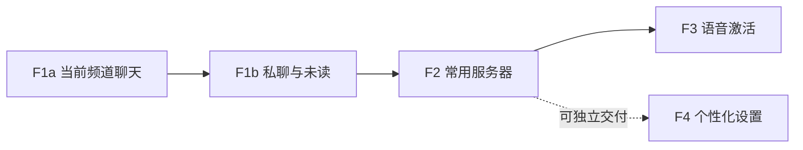

# TS3 Mobile 下一阶段功能设计与实施计划

日期：2026-10-23（Asia/Shanghai）

代码基线：`main` / `c83aa45051bdc32cf8a090c082363bca16e356fa`

方案编写时状态：用户已同意功能迭代路线并要求详细执行方案，当时暂不提供真机条件。
后续已按用户要求实现 F0/F1a，并在连接手机后验证 Debug 频道互通；追加的 F1b 私聊已接入。
当前交付与未验证边界见[私聊记录](../testing/F1B_PRIVATE_CHAT_2026-10-23.md)及[真机记录](../testing/F1A_DEVICE_2026-10-23.md)，F2/F3/F4 仍待后续实施。

具体任务、接口、验收矩阵和交付拆分见[详细执行方案](FEATURE_EXECUTION_PLAN_2026-10-23_ZH.md)。本文件保留为总体路线图，实施细节以详细方案为准。

## 1. 本轮目标与约束

从已经具备双向语音、频道浏览和后台恢复的客户端，向完整的日常交流工具推进。下一阶段按用户可以感知的新能力分阶段交付。

- 后台连接、切网恢复、PTT、常开、RNNoise、路由选择、最近服务器历史和加密表单记忆均为已有能力，不重新列为待开发功能。
- 当前不要求用户提供手机、耳机、第二台设备、测试服务器或现场发声配合。
- 长时间双工、物理蓝牙、耗电和跨设备验收保留为后续发布事项，不作为功能设计与开发的前置条件；相关清单不会被虚假勾选。
- 维持一个活动服务器，继续使用暖米白主题、现有三模块结构和会话代次隔离。
- 用户已同意按此方向细化执行；具体交付以各阶段记录为准，不代表整个线上兼容性矩阵已验收。

新的范围说明见 [ADR-0012](../decisions/0012-feature-roadmap-with-deferred-device-acceptance.md)。原 M11 文件继续负责发布就绪状态，本文件负责接下来开发什么。

## 2. 推荐功能路线

| 阶段 | 新增功能 | 用户得到什么 | 当前条件下可推进的范围 |
| --- | --- | --- | --- |
| F1：文字交流 | 当前频道聊天，随后补私聊与未读提示 | 不方便开麦时也能参与交流 | 协议适配、消息状态、界面及离线回归；实际服务器互通待后续验证 |
| F2：常用服务器 | 命名收藏、编辑、从历史保存、快捷连接 | 不必在一串历史地址中寻找常用服务器 | 存储、迁移、加密、列表和连接交接逻辑均可先实现 |
| F3：语音激活 | 检测说话后发送，停顿后结束 | 在 PTT 和持续发送之外增加免按键方式 | RNNoise 概率接入、门控状态机、设置和模拟输入测试；听感调校待后续验证 |
| F4：个性化设置 | 跟随系统/浅色/深色、应用语言入口、本地数据管理 | 更适合不同环境与个人习惯 | 主题、设置持久化、双语界面与离线 UI 测试；可拆小任务穿插 F2 |

首个迭代建议只做 **F1a 当前频道文字聊天**。私聊、收藏、语音激活分别交付，避免同时扩展协议、持久化与采集生命周期。



## 3. 为什么先做文字聊天

当前 `NavigationTabs` 只有频道和用户；`Ts3SessionListener` 只暴露状态、快照与语音，`Ts3jEventAdapter` 尚未接入文字事件。这是明确的应用功能缺口。

已经核对固定的 ts3j 源提交 `db57d60c989e399626aa16d921390f5033e6cdeb`，其中具有：

- [LocalTeamspeakClientSocket](https://github.com/Manevolent/ts3j/blob/db57d60c989e399626aa16d921390f5033e6cdeb/src/main/java/com/github/manevolent/ts3j/protocol/socket/client/LocalTeamspeakClientSocket.java)：`sendChannelMessage`、`sendPrivateMessage` 和 `sendServerMessage`。
- [TextMessageEvent](https://github.com/Manevolent/ts3j/blob/db57d60c989e399626aa16d921390f5033e6cdeb/src/main/java/com/github/manevolent/ts3j/event/TextMessageEvent.java) 与 `TS3Listener.onTextMessage`：接收文字消息。
- `TextMessageTargetMode`：客户端、频道和服务器三类目标。

因此首轮可围绕现有依赖补应用层能力，无需先更换协议库或等待音频硬件。接口存在只证明接入可行，具体字段、服务器限制和回显行为仍须通过 fixture 与后续互通验证。

## 4. F1 文字聊天设计

### F1a：当前频道聊天

在频道/用户旁新增“聊天”标签，沿用卡片与陶土橙强调色。顶部显示当前频道上下文，中间为消息列表，底部为多行输入与发送按钮。通话控制保持独立；键盘展开时输入区可见，不因发消息而切换麦克风模式。

首版包含：

- 收发当前频道纯文本，显示发送者、时间和消息内容。
- 发送状态区分“发送中”“服务器已接受”“失败”“结果未知”。服务器接受不显示成对方已读。
- 收到消息而未打开聊天页时显示未读数；用户实际看到消息后清除相应未读。
- 长按复制消息；新消息到来时，仅在接近列表底部时自动滚动，否则显示“新消息”入口。
- 网络恢复期间可查看已有消息、编辑草稿，禁止发送；恢复成功后由用户主动发送，不自动重发。
- 频道切换加入分隔提示。第一版采用当前会话的频道消息流，不构建多频道历史浏览器；无法可靠判定频道归属的事件保留为会话消息，避免错误归档。

消息存于服务拥有的有界内存 Store，不写入诊断或磁盘。初始建议总上限 500 条，并设单条输入/事件大小保护；具体协议字节限制在适配时确认。普通重连到同一手动会话可保留已有消息，接收事件仍按新连接代次校验。主动断开、切换服务器或进程结束时清空消息、未读与草稿。

首版不加入图片、文件、历史数据库、推送、已读回执、服务器广播发送和自动离线补发。TeamSpeak 格式标签先按纯文本显示，不执行 HTML 或远端内容。

### F1b：私聊与未读管理

在用户行菜单增加“发送私信”，打开该用户的会话。聊天页提供频道/私聊列表和未读数。私聊可独立回复，列表中明确区分频道消息与个人消息。

客户端 ID 仅在当前服务器连接中有效。私聊目标同时关联当前代次及稳定身份信息；重连后必须重新确认映射。若目标离线或映射不可靠，保留只读消息并提示，不能把旧 ID 的草稿发给新占用者。

应用内未读提示先交付；通知栏私信通知作为独立后续任务，不与首轮收发绑定。没有稳定身份信息时，会话限定于当前连接，不通过昵称猜测身份。

### 技术边界与拆分

| 层 | 新增/扩展职责 | 保持的约束 |
| --- | --- | --- |
| `ts3-protocol` | 文字目标、事件、发送结果模型；socket 发送端口；文字事件适配 | 不依赖 Android；统一使用协议库参数编码；不记录消息原文 |
| `app/service` | 独立的消息 Store/控制器、当前会话归属、发送任务和未读 | 复用连接代次；断开后取消待发送任务；消息有界 |
| `app/ui` | 聊天页、输入区、消息气泡/行、用户菜单入口 | 状态驱动、双语、大字体、键盘与 PTT 可用 |

`ConnectionCoordinator` 当前约 979 行，`Ts3jSessionClient` 约 528 行；新增文字状态不继续堆入这两个类型。新增独立文字适配/控制器，只在原入口增加必要的转发与代次校验。旧监听器新增回调可提供默认空实现，避免无关 fake 被迫改写；发送接口不提供假成功默认值。

发送任务绑定发起时的会话、频道和目标。先验证并捕获目标，再执行有时限的 IO；超时标为结果未知，禁止自动重发。断开和替换会话使旧任务失效。发送者回显先核对 pinned ts3j 行为，再决定如何合并本地待发送项，不按“相同文字”全局去重。

### 无需用户现场配合的验收

- fixture 覆盖频道/私聊事件、中文和特殊字符、缺字段/未知目标、切换频道时的事件归属。
- fake socket 验证目标和原文参数、权限拒绝、超时未知、取消、断开后的晚到回调，以及不会自动重发。
- 消息 Store 验证上限、顺序、未读、重连保留与主动断开清空，不跨服务器串消息。
- Compose fixture 验证收发状态、输入、滚动、键盘/大字体、中英文和用户私聊入口；模拟器可用时运行仪器测试。
- 日志/诊断检查不含消息内容、收发人昵称或服务器地址。

以上验证支持“代码与离线行为完成”的交付说明；真实 TeamSpeak 服务器互通单独列为待验证，不要求用户现在提供条件。

### 首轮实施拆分

1. 协议文字模型与 fake socket 回归，确认上游事件字段、编码和发送返回语义。
2. 文字事件/发送适配与独立 Store；覆盖并发、目标绑定和断开清理。
3. 当前频道聊天界面、未读及离线 UI fixture，交付 F1a。
4. 在前述基础上加入私聊目标映射、用户入口与会话列表，交付 F1b。

工程量初步估计：F1a 约 3–5 个开发日，F1b 再约 2–3 日；不包含本机工具链首次配置、服务器互通和后续问题返工，不据此承诺日期。

## 5. F2 常用服务器设计

现有十条记录是“连接成功后自动加入的地址历史”，现有加密存储是一份最近表单。新增收藏应提供真正不同的能力：

- 用户手动保存并命名，支持新增、编辑、删除、排序和从历史保存。
- 每项保存地址、端口、可选昵称；可选“记住此服务器密码”，默认关闭。
- 未连接时可从收藏发起一次连接。已连接另一服务器时先展示切换意图，正常退出旧会话后再连接，不创建多服务器并发。
- 收藏与自动历史分别展示；删除收藏不删除身份或自动历史，清理入口明确说明范围。

新增版本化的加密收藏 Store 与独立键，排除备份；不改写既有身份、最近表单和历史格式。旧安装升级后收藏为空，保留全部既有数据；用户手动从历史转存，不批量把最近密码复制给其他地址。

每项使用独立 ID，允许同一端点的不同昵称配置。迟到加载和保存必须绑定收藏 ID/版本，选中另一项后不能恢复前一项密码。测试使用虚构数据，验证增删改、排序、重启恢复、加密错误可见、跨项隔离和旧数据保留。

初步估计 3–5 个开发日。第一版不增加多个身份选择、云同步、文件导入和默认密码频道。

## 6. F3 语音激活设计

当前 `MicrophoneMode` 仅有关闭、PTT、常开。`OpusMicrophoneCapture` 已每 10 毫秒调用 RNNoise，并获得 `vadProbability`，但该值目前只计入统计，没有控制发送。

新增“语音激活”模式，基于现有概率做发送门控：

- 界面提供低/中/高灵敏度和清楚的“监听中/正在发送”状态；保留现有三种模式。
- 将采集运行、检测到语音、讲话发送和队列就绪分开建模。无语音时仍需采集/检测，不能宣称因此无需麦克风或保证省电。
- 使用不同开启/关闭阈值、短时连续检测和结束延迟，避免抖动；预留约 100–200 毫秒的有界内存帧，减少吞掉起声。初始参数用于离线验证，实际听感调校另记。
- 保持 ADR-0011 的“队列暂空不结束讲话”规则。结束延迟到达后按明确状态收尾；关闭/断开立即清空缓存并停止发送，不把旧帧补发到新会话。
- 保持现有 Android 麦克风资格：只要仍在监听采集，就维持相应前台类型；后台采集停止后不偷偷重新启动。

把门控逻辑放入纯 Kotlin 的独立类型，以模拟概率序列和虚拟时间测试阈值、起声、停顿、噪声脉冲、切模式、断开与缓冲边界，再接入采集链。确定性测试可证明状态和队列规则；噪声误触发率、手机/蓝牙听感仍标为未实测。

初步估计 4–6 个开发日，不含真实环境调校。本阶段安排在文字聊天和收藏之后，避免当前没有音频实测条件时优先修改核心采集路径。

## 7. F4 个性化与数据管理

- **主题**：提供跟随系统/浅色/深色。现有 `Colors.kt` 已有深色配色，`Ts3MobileTheme` 默认浅色且 Activity 未传入用户选择；这里补设置与入口，复用现有视觉。
- **语言**：提供跟随系统/中文/英文。实现前确认 Android 版本兼容方式，界面、弹窗和通知共用选择，避免仅修改 Compose locale。
- **本地数据**：分别清理最近表单、成功历史和收藏；身份不包含在普通清理中，处理好延迟保存回写竞态。

这三个小功能各自提交和验证，可独立交付。身份导入导出另做格式、加密和迁移设计；不与普通设置混在一次实现中。

## 8. 开发验证与后续发布

功能开发可先完成纯 JVM 回归、fake 协议适配和界面 fixture，再在可用模拟器中补 Compose/原生回归。当前 Mac 已探测到 JDK 11，未发现默认 Android SDK 或 `pwsh`；实施时需要另行配置 JDK 17 和仓库指定 Android 工具链。本次没有安装环境或运行 Android 构建。

后续代码改动运行适用门禁：

```sh
./gradlew quality :ts3-protocol:test :audio-opus:testDebugUnitTest \
  :audio-opus:lintDebug :app:testDebugUnitTest :app:lintDebug \
  :app:lintRelease :app:assembleDebug :app:assembleRelease \
  --max-workers=2 --stacktrace
pwsh -NoProfile -File tools/check-repository-privacy.ps1
git diff --check
```

真机长时双工、物理蓝牙、耗电、第二代 Android、生产签名与身份升级继续保留在 [M11 发布清单](../release/M11_RELEASE_CHECKLIST.md)、[M10 矩阵](../testing/M10_STABILITY_MATRIX.md)和后续发布记录中。它们决定发布质量声明，当前不阻塞新功能设计和开发。代码可完成与候选可对外发布应分别报告，未测内容保持未测状态。

## 9. 基线与本次交付记录

已完整克隆 `monet4070/ts3-mobile` 到本地，当前 `main` 包含三个其他分支的全部提交；相对三个分支分别多 4、11、14 个提交，其他分支均无独有提交。`v0.11.1-m10` 至当前 main 的差异仅为 README 和 CI，应用实现一致。

后台与切网并非空白工作：已合并的 [PR #2](https://github.com/monet4070/ts3-mobile/pull/2)记录了静默断开恢复、离线资源释放、十分钟蜂窝后台和特定设置下三十分钟充电锁屏；[ADR-0011](../decisions/0011-manual-refusal-and-form-memory.md)记录了后续连接限制手动处理与表单记忆。已有实现和历史通过记录继续保留。

本次交付为此功能路线图、范围决策说明，以及双语 README/旧发布计划的入口同步。生产代码、测试代码、依赖和构建配置均未修改，未提交或推送。只做文档链接、空白和 diff 检查，不宣称新功能或设备验收已经完成。

## 2026-10-23 用户范围更新

本文件为历史候选路线。用户最新选择只做服务器收藏、暂离/静音状态同步、频道信息与搜索；
其他新候选不在当前范围，不继续推进。此前已完成的聊天、私聊、戳一下和麦克风功能保留。
实现和验证见 [1/3/4 交付记录](../testing/FEATURES_134_2026-10-23.md) 与
[ADR-0017](../decisions/0017-bookmarks-presence-channel-discovery.md)。
